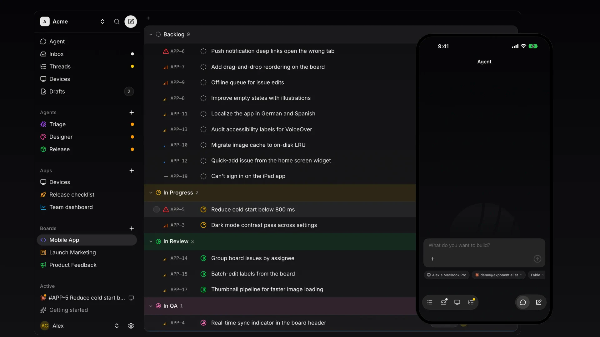

# Exponential

[](./LICENSE)
[](https://apps.apple.com/app/exponential-vibecode-together/id6788189402)
[](https://play.google.com/store/apps/details?id=at.exponential)
[](https://exponential.at/download/?ref=github)

**The next generation dev platform for teams.** Issues, customer feedback, and coding agents in one realtime tracker. Agents run on your own machines, on your own subscription. Web, macOS, Linux, Windows, iOS, Android.

<p align="center">
  
</p>

- **Cloud**: [app.exponential.at](https://app.exponential.at/?ref=github), free for up to three people
- **Self-host**: one `docker compose`, no seat caps, no licence gate
- **Desktop app**: [exponential.at/download](https://exponential.at/download/?ref=github)
- **Mobile apps**: [App Store](https://apps.apple.com/app/exponential-vibecode-together/id6788189402) · [Google Play](https://play.google.com/store/apps/details?id=at.exponential)

## What you get

- **Issues** with statuses, priorities, labels, estimates, due dates, sub-issues and relations, markdown, @mentions and #issue references, full-text search, drafts that follow you across devices. Realtime sync on every client via [ElectricSQL](https://electric-sql.com). Moving from Linear? Settings → Import brings your issues over.
- **Boards backed by a GitHub repo**: a session's branch and PR are tracked on every issue it works; several issues started together share one branch and one PR. The PR opening moves the issue to In Review, the merge to Done.
- **Start**: hand an issue to Claude Code or Codex from any client, on any of your machines. It codes in a worktree and opens the PR.
- **Chats**: one chat per piece of work, with its conversation, its issues, every session it runs and the stories it showed you next to its PR. Watch the transcript, answer the agent's questions and approve its plans, read the diff and the screenshots it publishes, from your phone or the desktop.
- **Your machines, your logins**: every desktop and server lists its agent accounts with plan, usage and reset times; switch a session to another account when one hits its limit.
- **Prompts and agents**: saved team prompts run from the composer's `/` menu; team agents wake on a schedule or an issue event and run on your own machines.
- **Apps**: New app opens the editor; describe a dashboard or a checklist and an agent session builds it as a team app, with a live preview and versions. Apps keep their own records, read the team's boards, issues and chats, act as you through the tools an owner grants, and travel as one file.
- **Headless CLI**: `exponential` turns any Linux or macOS box into an always-on agent machine your team starts sessions on.
- **Feedback widget**: a script tag for your site; reports with annotated screenshots land as issues, and the reporter keeps a conversation with your team through an emailed link.
- **Sealed sessions**: session content is sealed on your devices and the server stores only ciphertext; watching and steering a session goes over eNet, straight to the machine it runs on.
- **MCP server** at `/api/mcp` (16 tools) for Claude Code, Codex, ChatGPT, Cursor, or any MCP client, and your team's app tools at `/api/mcp/apps`.

## Libraries

Exponential is built from open libraries it shares with other apps ([docs/libraries.md](./docs/libraries.md)):

| | what | code | docs |
|---|---|---|---|
| **eUI** | Generative UI: agents send A2UI, native renderers paint it on web, iOS, Android and desktop | `packages/exponential-ui*`, `apps/desktop/crates/eui-core*` | [exponential.at/ui](https://exponential.at/ui/) |
| **eTalk** | Speech in and out for agents: push to talk, wake word, spoken replies, calls | `apps/desktop/crates/etalk*`, `packages/etalk` | [exponential.at/talk](https://exponential.at/talk/) |
| **ePilot** | Computer use: the agent sees the real screen and drives the real pointer and keyboard | `apps/desktop/crates/epilot*` | [exponential.at/pilot](https://exponential.at/pilot/) |
| **eNet** | Peer to peer, end-to-end encrypted networking on iroh: sealed sessions, steering, calls, sealed push | `apps/desktop/crates/enet-core*` | [exponential.at/net](https://exponential.at/net/) |
| **eMCP** | MCP on rmcp: a loopback server, a client with OAuth and a vault, the app tool contract | `apps/desktop/crates/emcp`, `packages/emcp` | [exponential.at/mcp](https://exponential.at/mcp/) |
| **eApps** | The app package format: templates, bindings, records and tools as data | `packages/exponential-ui/src/host` | [exponential.at/apps](https://exponential.at/apps/) |
| **eAgent** | The server-free agent core: run the user's own Claude Code or Codex, plus the orchestration spec (tree, bus, wake-ups) | `apps/desktop/crates/eagent`, `packages/eagent` | [exponential.at/agent](https://exponential.at/agent/) |
| **eCore** | The plain types the modules share, one contract for Rust, TS, Swift and Kotlin (unreleased) | `apps/desktop/crates/ecore`, `packages/ecore` | [exponential.at/core](https://exponential.at/core/) |

In progress: **eDE**, the desktop of ExponentialOS (`apps/ede`, not released; [the vision](https://exponential.at/blog/exponentialos/)).

## Self-host

```sh
mkdir exponential && cd exponential
curl -fsSLO https://raw.githubusercontent.com/Niach/exponential/master/selfhost/docker-compose.yaml
curl -fsSL https://raw.githubusercontent.com/Niach/exponential/master/selfhost/.env.example -o .env
# fill in .env: two secrets + S3 credentials
docker compose up -d
```

App at `http://localhost`. Migrations run on boot. A GitHub App is only needed for the coding features. Full runbook: [`INSTALL.md`](./INSTALL.md), env reference: [`.env.example`](./.env.example). Upgrade with `docker compose pull && docker compose up -d`.

The only cloud-only feature is mobile push (store apps are built against the first-party Firebase project).

## Connect an MCP client

```sh
claude mcp add --transport http exponential https://app.exponential.at/api/mcp
```

## Development

Needs [bun](https://bun.sh), Node ≥ 22.12, and Docker Compose.

```sh
bun install
cp .env.example .env
cp Caddyfile.example Caddyfile
bun run backend        # docker compose up -d + web dev server (localhost:3000)
bun run storage:init   # one-time S3 bootstrap, prints keys for .env
```

```
apps/web        TanStack Start app: tracker, API, Electric shape proxies
apps/desktop    Rust IDE (gpui)
apps/ios        SwiftUI
apps/android    Kotlin / Compose
apps/marketing  exponential.at
packages/       db schema, widget, icons, contracts
```

Other scripts: `bun run ios`, `bun run android`, `bun run dev:desktop`, `bun run typecheck`, `bun run test`. Don't run `bun run lint` (its `--fix` breaks `typeof import()` sites). Architecture notes live in [`CLAUDE.md`](./CLAUDE.md).

## License

[Apache-2.0](./LICENSE). [Enterprise Support](https://exponential.at/contact/?ref=github) is available for self-hosters who want an SLA or deployment help.
