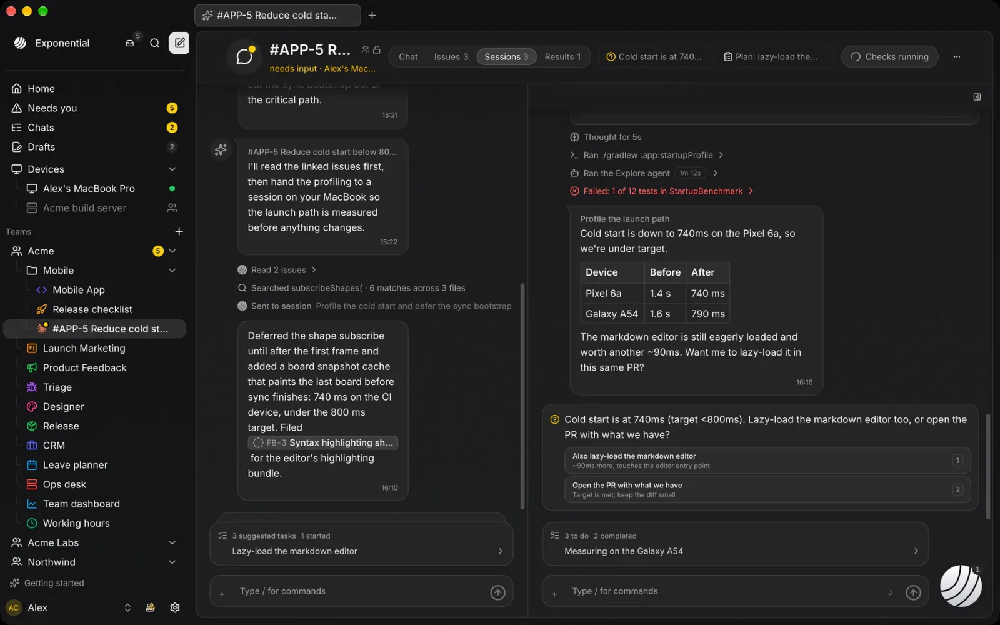
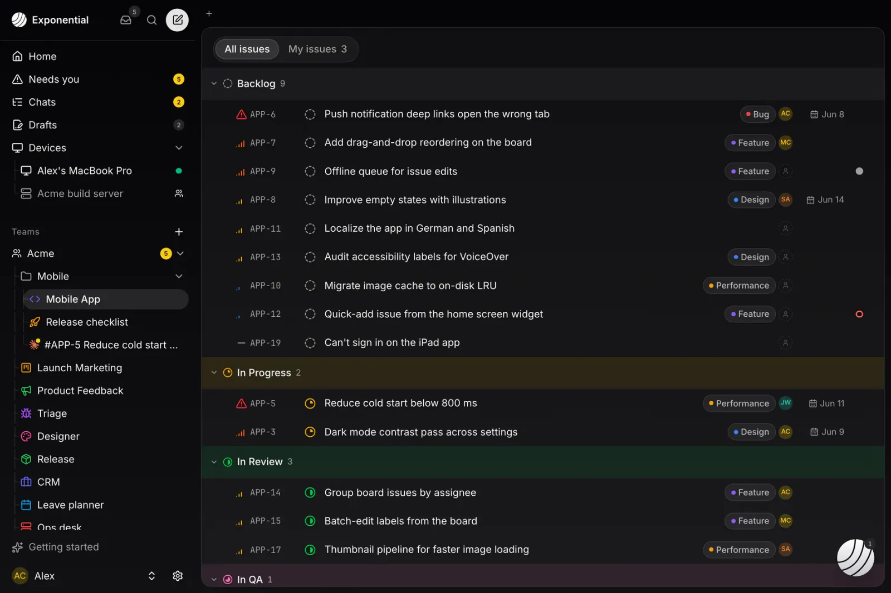
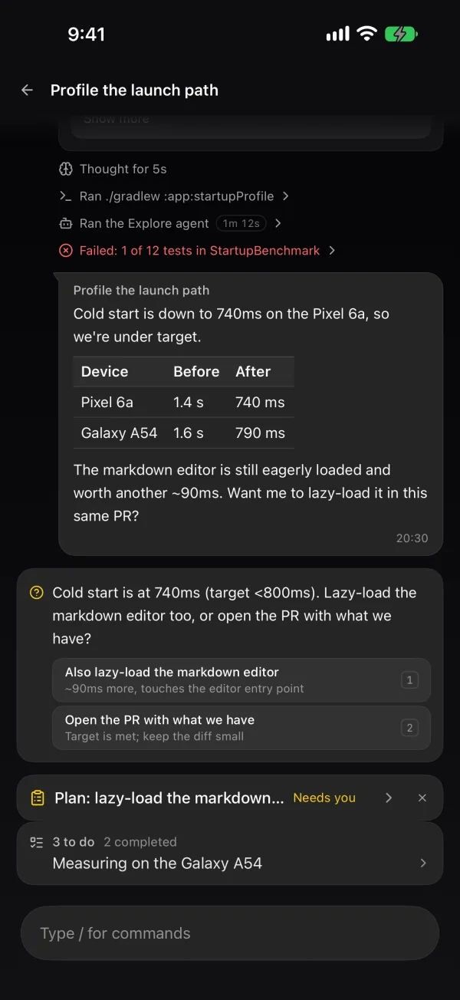
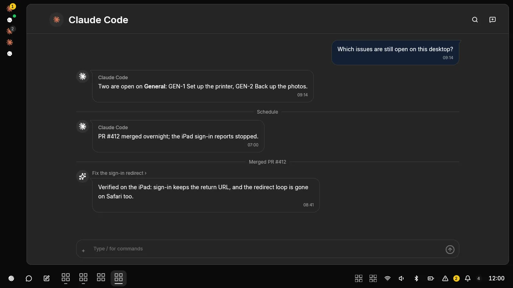

# Exponential

[](./LICENSE)
[](https://apps.apple.com/app/exponential-vibecode-together/id6788189402)
[](https://play.google.com/store/apps/details?id=at.exponential)
[](https://exponential.at/download/?ref=github)

Exponential is a development platform where agents do the work and your team steers it. You talk to your Assistant or a team agent; it starts coding sessions on your own machines, in a worktree per session, on your own Claude Code or Codex login, opens the pull request and lands it through a merge train. Issues, boards, chats, CI and git hosting live in the same realtime app on web, desktop, iOS and Android. The monorepo also holds the pieces this is built on: **genUI**, an A2UI 1.0 UI framework with native renderers on five platforms, and **Exponential Desktop**, a Wayland desktop environment for Linux where agents get a screen of their own. Everything is open source under Apache-2.0 and self-hostable.

<p align="center">
  
</p>

<table>
  <tr>
    <td width="72%"></td>
    <td width="28%"></td>
  </tr>
  <tr>
    <td colspan="2"></td>
  </tr>
</table>

<sub>Top: the desktop app (gpui), a chat on an issue next to the session doing the work. Middle: a board on the web; a session on iPhone. Bottom: Exponential Desktop, captured on a headless compositor. All pictures use the seeded demo team.</sub>

## What's in the box

### Exponential: the agent dev platform

- **Agents.** Your **Assistant** works across all your teams; **team agents** are definitions that wake on a schedule or an event and post to their own channel; **group chats** put several people and agents in one conversation. Every agent runs as a session on one of your devices, never on a hosted model account. ([Sessions](https://exponential.at/docs/using/sessions/), [Agents SDK](https://exponential.at/docs/sdk/agents/))
- **Coding sessions.** One tree of sessions per chat: a root that plans and delegates, children that each get a git worktree and a branch on a chosen device. They ask questions and propose plans as cards, publish screenshots as results, and open the PR. **Needs you** collects every question, plan and blocked session across teams in one list.
- **PRs, CI and git.** PR open and merge move the linked issues. A merge train batches green PRs onto the base and resolves generated files (changelog, migrations) itself. **eCode** adds repositories hosted on the Exponential server (`git-remote-exp`) and its own CI from `.exponential/ci.json`, with runners on your devices; GitHub stays a supported forge. ([Code SDK](https://exponential.at/docs/sdk/code/))
- **Boards and issues.** Statuses, priorities, labels, estimates, due dates, sub-issues and relations, markdown, semantic search, a Linear import and a feedback widget. Realtime on every client via [ElectricSQL](https://electric-sql.com).
- **Voice and computer use.** Call your Assistant or hold push-to-talk; speech runs on your own desktop (beta, English and German). Agents can see and drive a screen, on Exponential Desktop in a separate agent space. ([Voice](https://exponential.at/docs/using/voice/), [Computer Use](https://exponential.at/docs/sdk/computer-use/))
- **End-to-end encryption.** Chats and session content are encrypted on your devices by default; the server stores ciphertext. Watching and steering a session, and calls, go peer to peer over [iroh](https://iroh.computer). ([P2P](https://exponential.at/docs/sdk/p2p/))
- **MCP server** at `/api/mcp`: 22 tools for Claude Code, Codex, ChatGPT, Cursor or any MCP client, team skills, MCP Apps views (`ui://`) for hosts that render them, and team **Apps**, small tools an agent builds for you, at `/api/mcp/apps`. ([Apps](https://exponential.at/docs/sdk/apps/))
- **Clients.** Web (TanStack Start), a native desktop app in Rust on [gpui](https://gpui.rs) for macOS, Linux and Windows, the headless `exponential` CLI daemon for servers, and native iOS (SwiftUI) and Android (Jetpack Compose) apps. Coding sessions run on the desktop app and the daemon; phones and the web start, watch and answer them.

### Exponential Desktop (eDE)

A Linux desktop environment: a [Smithay](https://github.com/Smithay/smithay) Wayland compositor with Xwayland, and a shell (panel, menu, Alt+Tab switcher, notifications, OSD, settings) drawn in genUI from documents on disk that you or an agent can edit, with every edit a git commit. The layout and behaviour are modelled on Cinnamon. **Agent spaces** give an agent its own off-screen desktop for computer use while you keep your keyboard and pointer. Packages for Ubuntu, Linux Mint, Debian, Fedora and Arch. ([Features](https://exponential.at/docs/desktop/features/), [Agent spaces](https://exponential.at/docs/desktop/agent-spaces/), [Install](https://exponential.at/docs/desktop/install/), [`apps/ede`](./apps/ede))

### genUI (eUI): the UI framework

Agents send [A2UI](https://a2ui.org) 1.0 (components from a catalog, a data model, actions) and native renderers paint it: **React** and **Solid** on the web, **SwiftUI**, **Jetpack Compose** and **gpui**, one shared Rust core (`eui-core`, layout on taffy), held to the same look by conformance tests across all five. The catalog, themes, Motion (vector animation) and a playground are at [exponential.at/sdk/genui](https://exponential.at/sdk/genui/). The Exponential apps and the eDE shell draw their agent views with it.

- [`a2ui-express`](https://github.com/Niach/a2ui-express-compiler-rust): a compact text format for models that compiles to A2UI messages; on [crates.io](https://crates.io/crates/a2ui-express) and npm as [`@mrniach/a2ui-express`](https://www.npmjs.com/package/@mrniach/a2ui-express). ([Express docs](https://exponential.at/docs/sdk/genui/express/))
- [`a2ui-gen-eui`](https://github.com/Niach/a2ui-gen-eui): generates genUI screens locally with a small model on llama.cpp, grammar-guided by the catalog, with an MCP server.
- Packages: `@exponential_app/eui*` on npm, `eui-core` on crates.io, Swift and Compose packages. ([Install](https://exponential.at/docs/sdk/genui/guides/))

### The Exponential SDK

The modules under the product, each usable on its own: genUI, Motion, Voice, P2P, Computer Use, MCP Proxy, Agents, Code, Core and Apps. Overview and status per module: [exponential.at/docs/sdk](https://exponential.at/docs/sdk/) and [docs/libraries.md](./docs/libraries.md).

## Repository layout

```
apps/
  web            TanStack Start app: UI, tRPC API, MCP server, Electric shape proxies, merge train, CI
  desktop        Cargo workspace: the gpui desktop app and the SDK crates
    crates/cli         the `exponential` CLI daemon
    crates/eagent      the server-free agent core (Claude Code / Codex over ACP)
    crates/coding      launches coding sessions in worktrees
    crates/eui-*       genUI core, gpui painter, Motion
    crates/etalk*      voice     crates/epilot*  computer use    crates/enet-core  P2P
    crates/ecode*      git + CI  crates/emcp     MCP proxy       crates/ede-shell  eDE shell
  ede            Exponential Desktop: compositor, session, portal, services, packaging
  ios            SwiftUI (Tuist + GRDB)
  android        Jetpack Compose
  site           exponential.at: landing, docs, blog, the genUI catalogue (Astro + Starlight)
  push-relay     mobile push relay
  steer-relay    presence, device control and call signalling
  runner         prebuilt shells an exported App runs in (web, iOS, Android)
packages/
  db-schema      Drizzle schema (source of truth)
  domain-contract  enums + behaviour fixtures replayed on web, desktop, iOS and Android
  exponential-ui*  genUI: shared core, React, Solid, Swift, Compose, element renderers
  eagent, ecode, ecore, eengine, emcp, etalk   SDK contracts and fixtures
  ui, design-tokens, icons, view-catalog, shots, widget, ...
selfhost/        docker compose + .env for self-hosting
shots/           committed screenshots of every view on every platform
```

[`CLAUDE.md`](./CLAUDE.md) has the architecture notes and conventions.

## Quick start

### Use it

- **Cloud:** [app.exponential.at](https://app.exponential.at/?ref=github), free for up to three people.
- **Desktop app:** [exponential.at/download](https://exponential.at/download/?ref=github) (macOS, Windows, Linux AppImage).
- **A server as an agent machine:** `curl -fsSL https://exponential.at/install.sh | sh` installs the CLI daemon (Linux x86_64/arm64, macOS Apple Silicon).
- **Phones:** [App Store](https://apps.apple.com/app/exponential-vibecode-together/id6788189402) · [Google Play](https://play.google.com/store/apps/details?id=at.exponential).
- **MCP:** `claude mcp add --transport http exponential https://app.exponential.at/api/mcp`

[Getting started](https://exponential.at/docs/get-started/) walks through team, device and first session.

### Develop it

Needs [bun](https://bun.sh), Node ≥ 22.12 and Docker Compose; Rust for the desktop app and eDE, Xcode + Tuist for iOS, Android Studio for Android.

```sh
bun install
cp .env.example .env
cp Caddyfile.example Caddyfile
bun run backend        # Postgres, Electric, Garage (S3), Caddy + the web dev server on localhost:3000
bun run storage:init   # one time: bootstraps S3, prints the keys for .env
```

Then `bun run dev:desktop`, `bun run ios`, `bun run android`, `bun run dev:site`; checks with `bun run typecheck` and `bun run test`. Don't run `bun run lint` (its `--fix` breaks `typeof import()` sites). eDE runs nested in an existing session for development; see [`apps/ede/README.md`](./apps/ede/README.md).

## Self-hosting

One container image (`ghcr.io/niach/exponential-web`) next to PostgreSQL 18, Electric and S3-compatible storage, all in one compose file:

```sh
mkdir exponential && cd exponential
curl -fsSLO https://raw.githubusercontent.com/Niach/exponential/master/selfhost/docker-compose.yaml
curl -fsSL https://raw.githubusercontent.com/Niach/exponential/master/selfhost/.env.example -o .env
# fill in .env: two secrets + S3 credentials
docker compose up -d
```

The app is on `http://localhost`; migrations run on boot. No seat caps or licence gate. A GitHub App is only needed for GitHub repositories. Domains, optional subsystems, upgrades and backups: [`INSTALL.md`](./INSTALL.md). Mobile push is the one cloud-only feature (the store apps use the first-party Firebase project). Devices connect with the same desktop app or `install.sh` plus `EXP_INSTANCE=https://your.host`.

## Status

| | State |
|---|---|
| Issues, boards, chats, sessions, PRs, MCP server, web/desktop/iOS/Android apps, self-hosting | In production on app.exponential.at, released continuously |
| Agents (Assistant, team agents, group chats), end-to-end encrypted chats, the merge train | In production, still changing quickly |
| Voice (English, German), computer use, Apps | Beta |
| eCode: hosted git and own CI | New; GitHub remains the default forge |
| genUI / eUI | Released as the `eui-v*` packages; the catalog still grows; `eui-gpui` stays a git dependency until gpui is on crates.io |
| Exponential Desktop | In progress: installable from signed package repositories, expect rough edges |
| Core, the Code device crate | Unreleased |

Work is tracked in Exponential itself; releases and changelogs are on [GitHub Releases](https://github.com/Niach/exponential/releases) and in the app.

## Licence and links

[Apache-2.0](./LICENSE). Third-party licences: [`docs/third-party-licences.md`](./docs/third-party-licences.md). [Enterprise support](https://exponential.at/contact/?ref=github) for self-hosters who want an SLA or deployment help.

[Website](https://exponential.at) · [Docs](https://exponential.at/docs/) · [genUI catalogue](https://exponential.at/sdk/genui/) · [Exponential Desktop](https://exponential.at/desktop/) · [Download](https://exponential.at/download/?ref=github)
