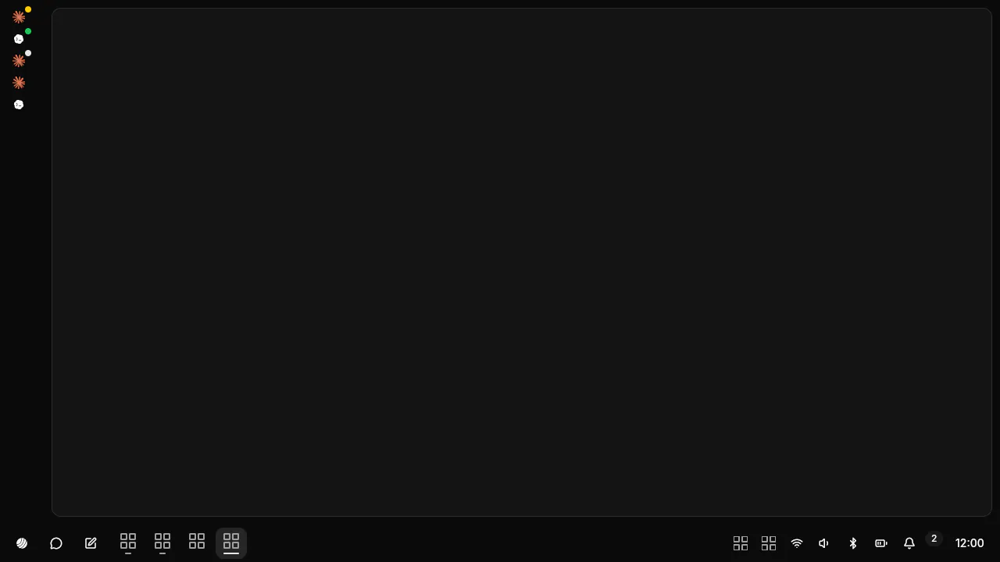
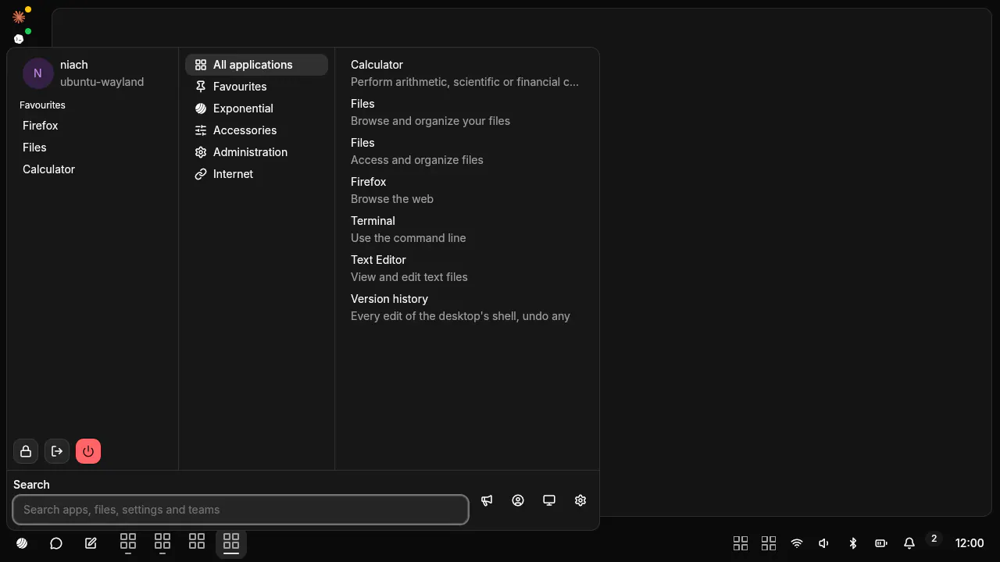
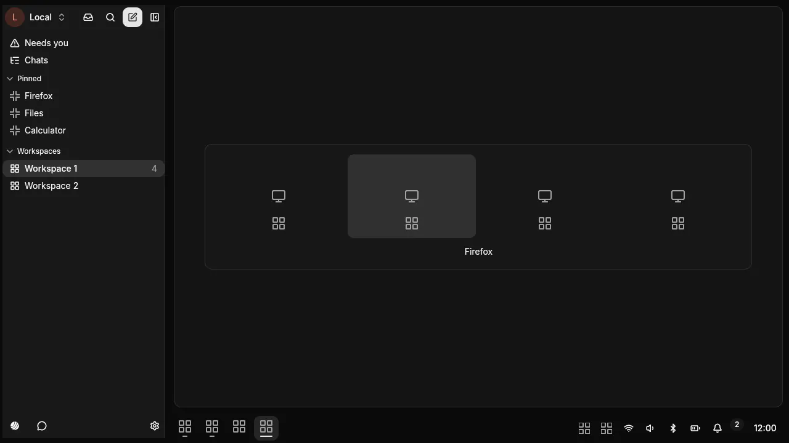
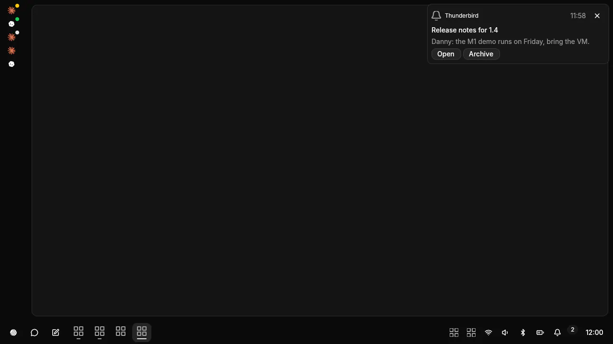
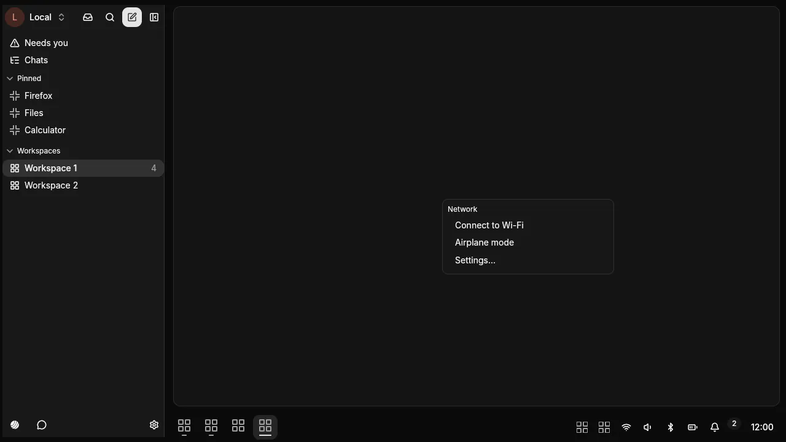
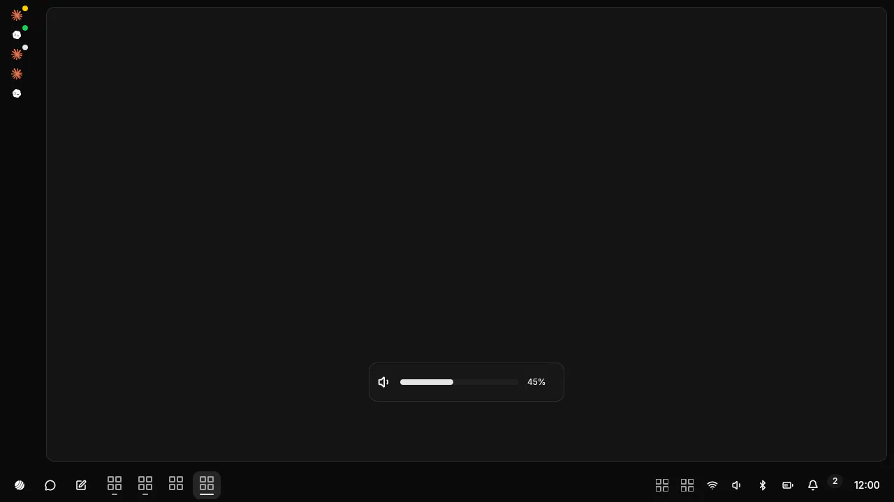
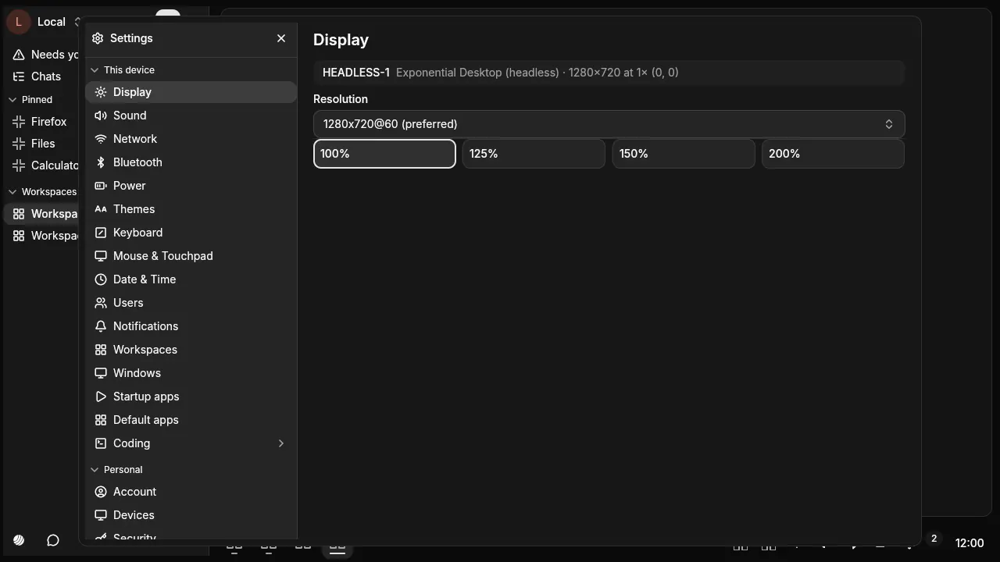

import { CardGrid, LinkCard } from "@astrojs/starlight/components"

Exponential Desktop is a Linux desktop: a Wayland compositor with Xwayland, and a shell drawn in [genUI](/docs/sdk/genui/). Everything the shell shows is a document on disk, so you and your agents change it the same way. The login screen lists it as **Exponential**.

<CardGrid>
  <LinkCard title="Install" href="/docs/desktop/install/" />
  <LinkCard title="Reference" href="/docs/desktop/reference/" />
</CardGrid>

## The shell

| | |
|---|---|
|  | **Panel**: the menu button, the taskbar, the tray, the bell, the clock. |
|  | **Menu**: **Super** opens it. Search apps, launch, lock, log out, power. |
|  | **Switcher**: **Alt+Tab**, live thumbnails with app icons, most recent first; **Alt+`** for one app's windows. |
|  | **Notifications**: toasts top right, the history under the bell. |
|  | **Tray**: StatusNotifier items and their menus. |
|  | **OSD**: volume, microphone and brightness keys. |
|  | **Settings**: Displays, Network, Sound, Bluetooth, Power, Input, Theme, Apps & updates, Users, Printers, About (with the system check). |

Each one is a genUI document in `~/.config/exponential-desktop/ui/` (`panel.json`, `menu.json`, `switcher.json`, `notifications.json`, `notification-center.json`, `tray-menu.json`, `osd.json`, `settings.json`) plus `theme.json` for the look. The factory copies live in `/usr/share/exponential-desktop/ui/`.

## Change it on the fly

Edit a document and save. The shell checks it and redraws within a moment.

1. The file changes on disk.
2. It is validated: the surface header, the [Tier C rules](#security-tiers), then every component, prop, style and token.
3. Valid: it is committed and the shell redraws it.
4. Invalid: it is refused with the reasons, and the last good version stays on screen.

```sh
exponential-ui check          # what applies, what is refused and why
exponential-ui watch          # one JSON line per change: ui.applied, ui.rejected, theme.applied…
```

## History and rollback

The ui directory is a git repository. Every edit that applies is a commit; a refused file is never committed. Undo reverts the newest commit as a new commit, so an undo can be undone too.

```sh
exponential-ui log [N]                 # the history, newest first
exponential-ui undo                    # revert the newest edit
exponential-ui set panel panel.json    # validate, write, commit
exponential-ui discard panel           # drop a broken hand edit
exponential-ui reset                   # every factory document back; your edits stay in the history
```

The shell runs under `exponential-ui supervise`. An edit that draws no frame within 2 s is rolled back. Three shell crashes after an edit revert it; three more put the factory copy back. **Super+Shift+R** resets every document and restarts the shell at any time.

## Agents

An agent works the desktop through three doors.

- **Documents**: the same files, the same checks, the same history. An agent's edit is a commit you can undo.
- **System services**: `exponential-services` serves network, sound, Bluetooth, power, disks, updates, firmware, printers and about as MCP tools, one bearer per agent session, each action gated by a capability, every call written to an audit log. See [Services MCP](/docs/desktop/reference/#services-mcp).
- **The compositor**: `exponential-ctl` lists windows and outputs, captures the screen as PNG and sends keys and pointer input. Captures and input are what [Computer Use](/docs/sdk/computer-use/) works with: look, act, look again.

## Security tiers

| Tier | What | Who can change it |
|---|---|---|
| **A** | Window frames, the recovery screen, the restore hotkey. Drawn by the compositor from colour tokens. | Nobody at run time. |
| **B** | Lock screen, polkit prompt, consent dialog, screen-share chooser. Compiled into `exponential-sealed`. | Nobody at run time. Its surfaces are black in captures and refuse agent input. |
| **C** | Every shell document. | You and your agents. A document grants no privileges: no password inputs, only the host functions its header lists, each id once. |

Password managers, polkit and keyring prompts, pinentry and ssh askpass are protected too: never captured, never driven by an agent.
