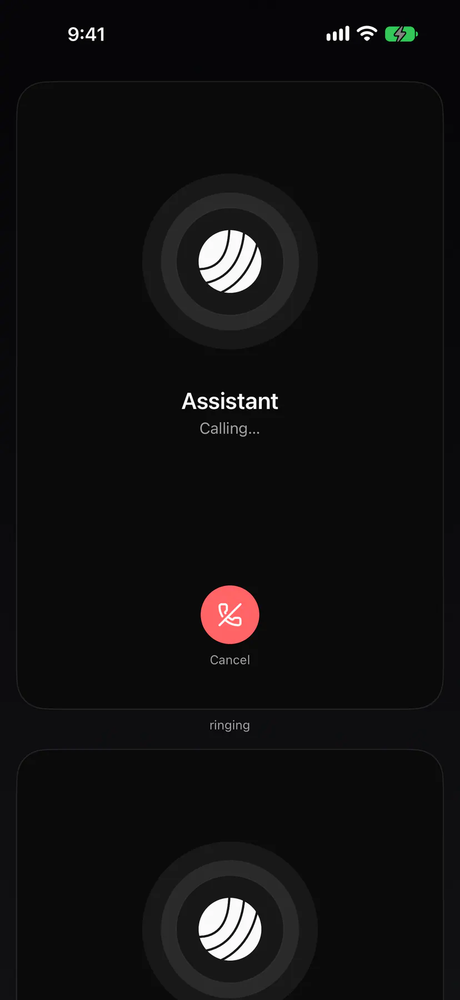

eTalk is speech in and out for agents: push to talk, spoken replies, phone calls, a wake word and meeting mode, on your own machine. One core for Exponential and any Rust, Swift or Kotlin app. Apache-2.0.

## Status

Every part is beta since the 2026-10-27 release. The latest tag is `etalk-v0.2.4`.

| Part | What |
|---|---|
| Push to talk | Hold a shortcut on your desktop. Silero VAD and Parakeet through CrispASR |
| Spoken replies | English and German. Qwen3-TTS, cloned from a clip of your voice |
| Call your agent | From your phone, the web or the desktop app |
| Wake word | “Hey Triage”, instead of holding the shortcut |

## The voice device

One of your desktops listens and speaks for you. Pick it in Settings → Assistant → Voice, with the agent it talks to. Phones and servers can't be the voice device.

The desktop app runs a speech worker beside itself. Models download on first use, pinned and checked. Audio stays on the machine.

## Speech in

The microphone runs at 16 kHz. Silero VAD finds speech, Parakeet turns it into text. On a GPU you see the words while you speak (with 1.6 GB of VRAM free); on the CPU you get the text when you let go.

| | GPU (CUDA) | CPU, 8 threads |
|---|---|---|
| Text after you let go | 10–41 ms | 102–450 ms |
| Words while you speak | every 300 ms | no |
| VRAM | 1,246 MiB | none |

## Speech out

Qwen3-TTS reads the agent's replies in English or German, in your voice: give it an 8–15 s clip and what it says, or leave it empty for a built-in voice. Cloning needs no training and no upload. It needs a GPU with at least 4 GB; without one, replies are shown and stay silent. See [Your voice](/docs/libraries/etalk/guides/your-voice/).

## Push to talk

On the desktop app only. Hold the shortcut and speak. The overlay shows what it heard, then sends it to the agent as a plain message. What you say by voice is answered by voice; typed messages are answered in text. The tray mutes the microphone. See [Push-to-talk shortcuts](/docs/libraries/etalk/guides/push-to-talk/).

## Calls

Call your voice device's agent from iPhone, Android, the web or the desktop app. It rings while the voice device loads speech and the voice, then answers with “Hello?”. The call screen shows the agent, the timer and what is being said, with mute, speaker and end buttons. The audio rides [eNet](/docs/libraries/enet/)'s call channel.

## Wake word

Say the wake phrase on your voice device instead of holding push to talk; a red dot shows while the microphone listens. A phrase with a model of its own is heard by an openWakeWord detector, any other phrase by the speech recogniser.

## Packages

| Package | Registry | What |
|---|---|---|
| `etalk`, `etalk-engine`, `etalk-crispasr`, `etalk-codec`, `etalk-wakeword`, `etalk-gpui` | git dependency on `etalk-v*` ([install](/docs/libraries/install/)) | The host side, the worker, the runtime, the codec, the wake word, the gpui UI |
| `ExponentialTalk` | SwiftPM (`Niach/exponential-talk-swift`) | iOS and macOS: the call machine and the codec, through UniFFI |
| `at.exponential:etalk` | Maven Central | Android: the same, through UniFFI |
| `@exponential_app/etalk` | npm | The contract: fixtures and TypeScript references |

Details per crate: [Reference](/docs/libraries/etalk/reference/).
