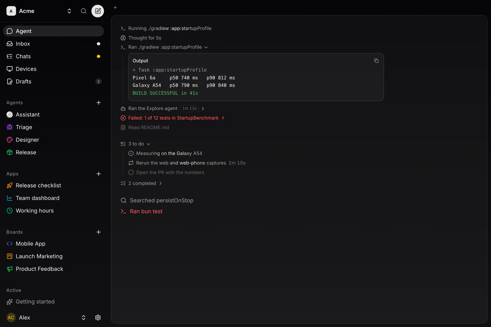

ACP is the single-account agent core: it spawns the user's own, unmodified `claude` or `codex` binary over the Agent Client Protocol, streams what the agent does, lists the CLIs' own session history, runs the agent's login in a PTY and wires MCP servers. One local account; no server needed. Apache-2.0.

## Status

The core runs every coding session of the Exponential desktop app and the CLI daemon, and is being moved out of the app crate step by step. The crate is `eagent`; the old name, `exponential-agent-runtime` (released as `agent-runtime-v0.1.0`), stays one more release as a re-export shim. See [Migrating](/docs/sdk/acp/reference/migrating/).

| Part | What | State |
|---|---|---|
| **The runtime** | Spawn, the Agent Client Protocol, events, login, history, MCP wiring | in the app |
| **The module** | `eagent`, a git dependency on `eagent-v*` | 0.1.0 |
| **Orchestration spec** | Session trees, the bus, wake-ups, reports, caps and the watchdog as fixtures (`@exp/eagent`) and a Rust reducer (`eagent-hub-core`) | built |
| **Local orchestration** | Session trees for one person, without a server | planned |

## Your agent, your login

ACP runs the vendor's own binary on your machine with your own subscription. It never reads, copies, moves or refreshes a token: the CLI logs in itself, in a terminal ACP drives. It depends on no Exponential app crate and no UI toolkit.

## Seams

Everything host-specific is a trait the host implements; a local host uses the defaults.

| Trait | Answers |
|---|---|
| `LaunchSpec` | What to spawn and how: program, env, working directory, agent, picks, resume, MCP servers |
| `EventSink` | Where the mapped events of a run go |
| `RunBackend` | The side-car a run brings up, its record and its end sequence |
| `PromptLocalizer` | A host prompt's attachment embeds, as the agent reads them |
| `AccountEnv` | The config directory and env of the spawn |
| `McpProvider` | The MCP servers a run gets |
| `HostTools` | The host's own tools: how they are shown and previewed |

Next: [Guides](/docs/sdk/acp/guides/) · [Reference](/docs/sdk/acp/reference/)
