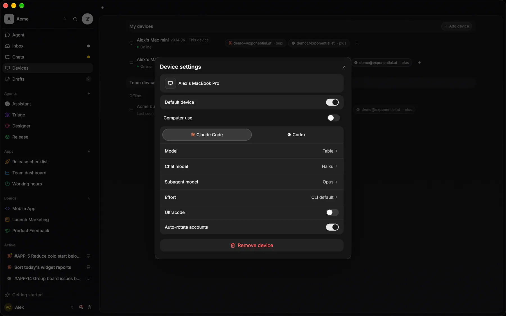

Computer Use is computer use for agents: the agent looks at the real screen, acts on it with the real pointer and keyboard through the OS input APIs, and looks again. Pixels only, so it drives any app the person can. Apache-2.0.

## Status

| Part | Where | State |
|---|---|---|
| **Computer use** | Coding sessions on the desktop app and the CLI daemon | in the app |
| **Screen memory** | The voice device, for your Assistant | in the app |
| **The module** | `epilot` and `epilot-screen`, a git dependency on `epilot-v0.1.0` | 0.1.0 |

On master the tools are served through [MCP Proxy](/docs/sdk/mcp-proxy/); the next tag carries that.

## Plan, act, observe

The agent's model plans; Computer Use is its eyes and hands. Each step is a screenshot, one action, and another screenshot.

1. **Observe**: `screenshot` fits the display to the model's frame (at most 1280 × 800). Every coordinate after that is in that image's pixels, and Computer Use maps it back to the screen.
2. **Plan**: the model reads the image and picks the next action.
3. **Act**: a click, a drag, typed text or a key combo, through the OS's own input APIs.
4. **Observe again**: `wait` lets the screen settle and returns the next screenshot.

The host serves it as one loopback MCP server, `computer`. A session gets its URL and a token only while the device's Computer use switch is on.

## The tools

| Tool | What |
|---|---|
| `screenshot` | The current display as a PNG fitted to at most 1280 × 800. Every other tool's coordinates are in this image's pixels. |
| `list_windows` | Every top-level window on the work screen, top first, plus the displays. |
| `activate_window` | Bring a window to the front and give it the keyboard. |
| `cursor_position` | Where the pointer is, in screenshot pixels. |
| `mouse_move` | Move the pointer (a hover). |
| `left_click` | Also `right_click`, `middle_click` and `double_click`: move there and click. |
| `drag` | Press at one point, move to another, release. |
| `scroll` | Move there and turn the wheel. |
| `type` | Type up to 4,000 characters into the focused control. |
| `paste_text` | Paste up to 100,000 characters in one step: the clipboard is saved, set, pasted once into the focused control and put back. `sensitive: true` keeps a secret out of clipboard managers and the OS history (X11: served only to the focused app + `x-kde-passwordManagerHint`; macOS `org.nspasteboard.ConcealedType`; Windows `ExcludeClipboardContentFromMonitorProcessing`, `CanIncludeInClipboardHistory` = 0); `file` reads the text from a local file. |
| `copy_selection` | Copy the focused window's selection and answer its text; the clipboard is put back. |
| `read_clipboard` | The clipboard's text, only right after the agent's own click or key copied something; never the person's clipboard. |
| `key` | One key or combo: Return, ctrl+s, alt+Tab, cmd+space. |
| `wait` | Let the screen settle (up to 10 s), then take a screenshot. |

## Foreground only

The agent drives the person's real pointer, so the person's own mouse and keyboard are held while it works. Esc takes them back and stops the agent. The desktop app shows a banner the whole time.

The work screen decides what the agent sees and drives: every display without a fullscreen app, or one display you pick.

## Screen memory

`epilot-screen` keeps the last 10 minutes of the screen as deduplicated frames, on the device only. Its one tool, `get_screenshots`, returns up to 4 frames from a moment, each cut to the window the person was in, so a voice agent can see what you are talking about. Off by default; turning it off deletes the buffer.

## Platforms

| Platform | Input | Needs |
|---|---|---|
| macOS | CGEvent | Screen Recording and Accessibility |
| Windows | SendInput | nothing |
| Linux (X11) | XTest | an X11 session; Wayland is not supported |

Desktop only: there are no Swift, Kotlin or npm packages.

Next: [Guides](/docs/sdk/computer-use/guides/) · [Reference](/docs/sdk/computer-use/reference/)
