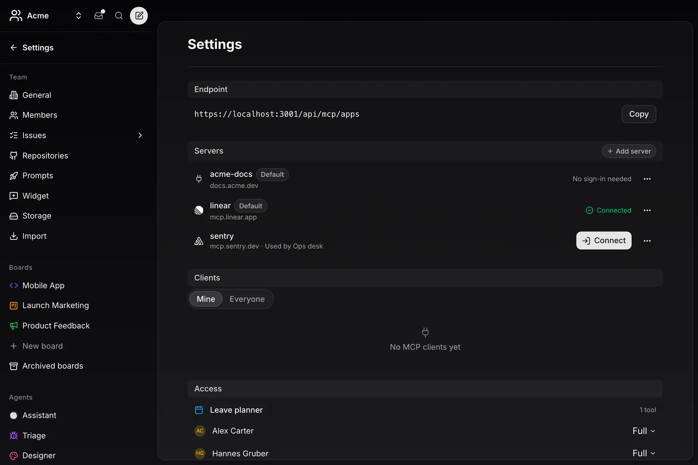

MCP Proxy is MCP for devices, on [rmcp](https://github.com/modelcontextprotocol/rust-sdk), the official Rust MCP SDK: a loopback Streamable HTTP server for your own tools, a blocking client for any server, OAuth with a vault for its credentials, the local hub that puts several servers behind one endpoint, and code mode. Apache-2.0.

## Status

The latest release is `emcp-v0.2.0`.

| Part | Where | State |
|---|---|---|
| **Server and client** | Code mode, Computer Use and the MCP calls of the desktop app and the CLI daemon | in the app |
| **App tool broker** | An app's `exposes` as MCP tools at `/api/mcp/apps`, with consent, access and audit | in the app |
| **The contract** | The fixtures in `packages/emcp`, replayed in Rust and TypeScript | built |
| **The module** | `emcp`, a git dependency | 0.2.0 |

On the server, the same contract runs the broker for [app MCP tools](/docs/build/mcp/).

## Serve tools

Implement `ToolProvider` and serve it. The server listens on `127.0.0.1`, answers plain JSON, and admits each run with its own bearer token: an unknown or revoked token is refused before any tool runs. A refusal the agent should read is content in the result.

## Call a server

`Client::connect` does the handshake against any Streamable HTTP server with the headers you resolved. Header values are never logged and never appear in an error.

## OAuth and the vault

For a server behind OAuth, `emcp::oauth` discovers the authorization server, registers the client, runs PKCE and refreshes expired tokens. The credentials live in a `Vault` you implement: the OS keychain on a device, a server-backed store for a member's connection. `SealedVault` encrypts every value with the vault format before it reaches your store; `MemoryVault` is for tests.

## The local hub

One loopback endpoint over several MCP servers. Mount upstreams and in-process providers under a name, admit each run with a grant (`read` or `write` per server) and one token. The run lists `<server>__<tool>` for the tools its grant covers, and every call becomes one audit row.

## Code mode

With the `codemode` feature, `exec` and `describe` on one endpoint: a script the agent writes calls the run's other MCP servers as `await tools.<server>.<tool>(args)`, in parallel, and only its output reaches the model.

## The contract

`emcp::contract` holds the rules an app tool broker follows, the same on the server and on a device. Each module mirrors one fixture in `packages/emcp` and replays every case of it.

| Module | What |
|---|---|
| `exposes` | An app's MCP tools as declarative bindings: validation, input resolution, naming and collisions, provenance. |
| `access` | Who sees and calls which app tool: the member × app policy (none, read or write) and what revoking it ends. |
| `audit` | The audit row of every call: canonical JSON, the arguments hash, the status rule, 90 days of retention. |
| `vault` | Encryption at rest for every secret: the `ev1` format, AES-256-GCM, bound to its row and key. |
| `upstream` | One member's connection to one upstream server: its states, transitions and what is callable. |
| `hub` | The local hub: server names, a run's tool list under its grant, routing, the audit row. |
| `actions` | Which `exponential.<noun>.<op>` actions exist, which are destructive or owner-only. |

Next: [Guides](/docs/sdk/mcp-proxy/guides/) · [Reference](/docs/sdk/mcp-proxy/reference/)
