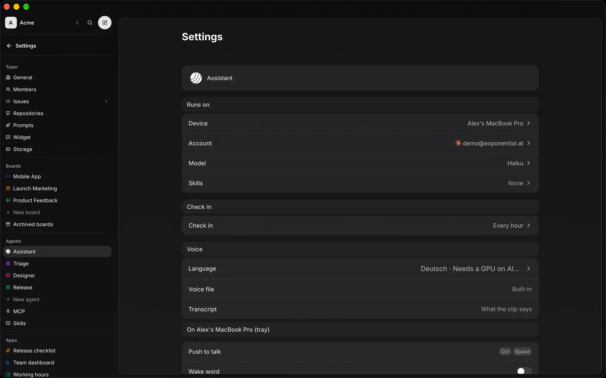

## Settings → Assistant → Voice

Voice is part of the Exponential desktop app; there is nothing else to install. Open Settings → Assistant → Voice on the web, the desktop app or your phone. The settings are yours, per member.

| Row | What it does |
|---|---|
| **Voice device** | The desktop that listens and speaks. Only your own desktops are listed. |
| **Agent** | The agent you talk to. Your words go into your chat with it. |
| **Language** | English or Deutsch. Replies are spoken, and speech is heard, in this language. |
| **Voice file, Transcript** | Shown once a voice device is picked. A clip of your voice and what it says. Empty = a built-in voice. See [Your voice](/docs/sdk/voice/guides/your-voice/). |

Every switch stays off until both a voice device and an agent are picked.

## The download

Replies to your voice are always spoken: once a voice device is picked it downloads the voice. The row shows the progress. Every file is pinned and checked against its sha256 before it is loaded. A failed download shows “Couldn't download the voice” and is tried again on the next request, after a wait that starts at a minute and doubles up to an hour.

| | Linux | macOS | Windows |
|---|---|---|---|
| Speech out (first use) | ~2.97 GB | ~2.19 GB | ~2.28 GB |
| Speech in (first push to talk) | + 675 MB | + 675 MB | + 675 MB |

On macOS the runtime ships inside the app, so only the models download. The first push to talk answers “Downloading speech recognition…” while its models arrive.

## GPU

| | Needs |
|---|---|
| Linux | x86_64. NVIDIA GPU with its driver (CUDA). |
| macOS | Apple silicon (Metal). |
| Windows | x86_64. A Vulkan driver. |

Speech out needs a GPU with at least 4 GB that passes a speed test on one sentence. Without one, replies are shown and stay silent. A GPU that fails the test is tried again after 30 days or a driver change.

Speech in also runs on the CPU, slower and without words while you speak. On Windows the CPU path needs the Visual C++ runtime.

## Microphone

The microphone opens only while you hold the shortcut. Linux reads it through PipeWire or PulseAudio. Windows uses the default input device.

:::note[macOS]
The first push to talk asks for the microphone. If you said no, allow Exponential in System Settings → Privacy & Security → Microphone. Until then the overlay reads “Microphone not allowed”.
:::

## Push to talk

Desktop only. With a voice device picked, a second group appears: On `{device}` (tray). Click Push to talk in the desktop app of the voice device and press any key or combination, like a game keybind (Esc cancels, Backspace clears it). No key bound = push to talk off. Other clients show the binding, read-only.

Hold the shortcut, speak, let go. Not every desktop lets an app grab every key: [Push-to-talk shortcuts](/docs/sdk/voice/guides/push-to-talk/) lists what works where.

## The tray

On the voice device the desktop app adds a tray icon. Its menu, top to bottom:

| Item | Does |
|---|---|
| **Open Exponential** | Brings a window up, a new one when none is open. |
| **Push to talk · Ctrl + Space** | Shown while a key is bound; opens Settings → Assistant → Voice. Reads `{shortcut}` unavailable when the desktop won't let the app grab it. |
| **Wake word · Hey Triage** | The switch, with the wake phrase. |
| **Mute microphone** | Shown while push to talk listens on this desktop. Keeps the microphone closed. |
| **Voice settings…** | Opens Settings → Assistant → Voice. |
| **Quit** | Quits the app. |

Wake word is off and disabled until both a voice device and an agent are picked. While the tray is there, closing the last window keeps the app running, so the voice stays loaded; macOS always keeps it running.

On GNOME the tray needs the AppIndicator extension. Without it there is no tray, and closing the last window quits.
