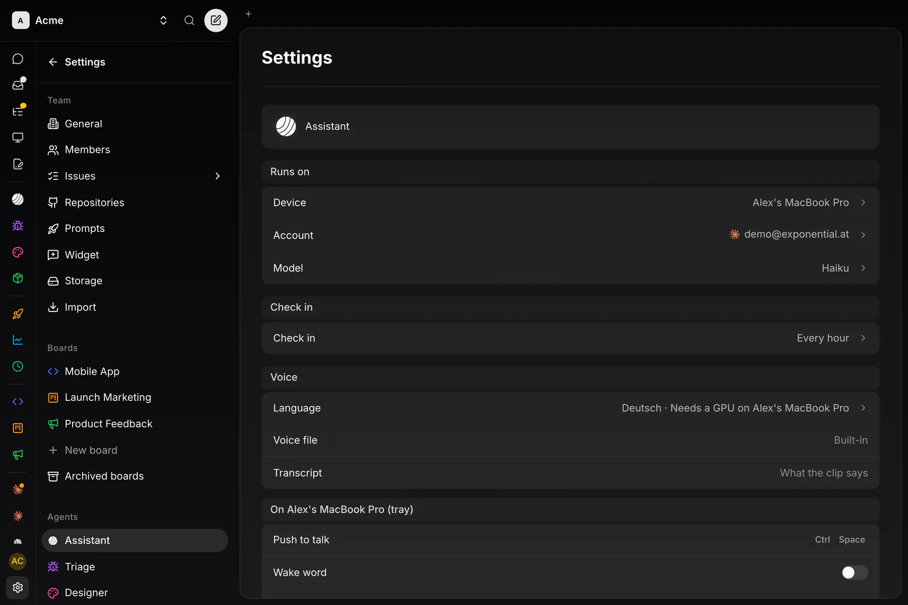

## How it works

Voice speaks in a voice cloned from one short clip, in English and in German. Cloning needs no training and no upload. The clip stays on your voice device; Settings → Assistant → Voice stores only its path and its transcript.

Leave the Voice file empty and each language uses its built-in clip. Cloning, like all speech out, runs only on a GPU.

For an agent: [the same guide as a skill file](/talk/skills/voice-reference-clip/SKILL.md).

## Consent first

Use your own voice, or a voice whose owner agreed. Do not clone anyone without consent.

## Pick the take

- 8 to 15 seconds of one speaker, speaking calmly in the language you picked.
- Clean speech: no music, no background noise.

## Cut it to a WAV

With ffmpeg (start and length in seconds):

```sh
mkdir -p ~/voice
ffmpeg -ss 12.5 -t 10 -i recording.m4a -ac 1 -ar 24000 -c:a pcm_s16le ~/voice/ref.wav
```

- Mono, 24 kHz, 16-bit PCM, like the built-in clips.
- Listen to it once, all the way through.

## Write the transcript

Type exactly what the clip says, word for word, with normal punctuation.

## Enter it

In Settings → Assistant → Voice, with your desktop as the voice device:



| Row | Value |
|---|---|
| **Language** | English or Deutsch |
| **Voice file** | the WAV's full path on that desktop, e.g. `/home/you/voice/ref.wav` |
| **Transcript** | the text from the step before |

:::note[What the voice device accepts]
An absolute path to a local `.wav` of at most 10 MB, with a transcript. URLs, `..` and (on Windows) network shares are refused. Anything else is ignored and the built-in voice speaks.
:::
