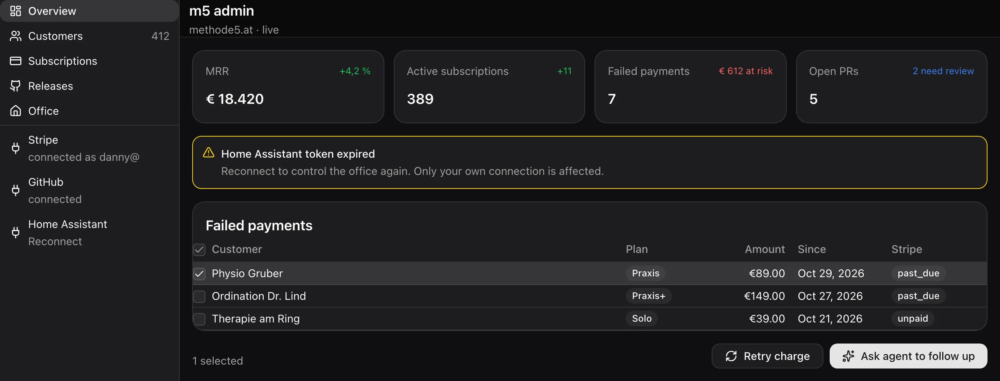

# Exponential apps (eApps): spec

> Status: **approved 2026-11-01** (Danny; decisions in §18). Sources: the code at `e59ef9f4909`, epic #VAPP-110 (slice 1, done), #VAPP-175 (editor-first + eMCP), `packages/emcp`, eUI 0.3.0, the time-tracker check (thread 2db0b7d0), ExponentialOS plan v5 (thread 196b5162), Spezl #YO-32.
> Legend: ✅ exists · 🟡 partial · ❌ missing · 🆕 proposed here (no issue yet). The mocks are drawn with eUI (React harness, exponential theme, dark).

## 0. In one paragraph

An Exponential app is **data, never code**: a declarative package (manifest, eUI templates, bindings, record kinds, a function allowlist, `exposes`, `upstreams`) stored per team, versioned in the DB, and painted by the same eUI renderers on web, desktop, iOS and Android, as well as Spezl and eDE. Three executors run an app, and none of them runs app code:

1. the **client host**, while someone is looking at the app;
2. the **server broker**, for MCP calls (and, proposed here, the clock, events and webhooks);
3. an **agent**, when the work is fuzzy.

Real code lives behind an **upstream MCP server** the team already runs. Hosted apps (#VAPP-101) stay cancelled.

The rest of this spec turns that rule into the missing pieces:

- records that know who owns them;
- a real query language;
- several screens per app;
- triggers;
- an offline outbox;
- the `exponential-apps` crate for Spezl and eDE.


---

## 1. Use cases → capabilities

Each group lists concrete apps, then the capabilities they need. The capability IDs (C1…C30) are used in the roadmap (§17).

### 1.1 Team tools

| App | What it does | Needs |
|---|---|---|
| **Stunden** (time tracker, replaces `stunden.xlsx`) | Log hours per day with a note and issue refs. Monthly target per person. **Übertrag** = the carry-over from earlier months. Danny and Chris side by side. | C1 ownership, C2 on-behalf backfill (≈170 rows), C5 group-by member, C6 running sums, C7 mul/div + date maths, C13 spreadsheet import |
| **CRM** | Contacts, companies, deals in stages, last touch, follow-up dates. Log a call from Claude Code. | C3 relations, C8 multi-screen nav, C9 record forms, C16 exposes, C18 schedules ("follow up due") |
| **Inventory** | Items, locations, stock moves, a low-stock alert. Scan a QR code on the phone. | C3, C6 sums of moves, C18 event trigger, C24 offline writes (warehouse without wifi), `QrScanner` ✅ |
| **On-call** | Weekly rotation, overrides, "who is on call now", hand-off note. | C7 date maths (week of year), C18 schedule (Monday rotation), C19 agent hand-off ("summarise the incidents of the week") |
| **Approvals** | Request → approver → approved/rejected, with a reason. Applies to expenses, leave, purchases. | C1 (only the approver decides), C4 per-kind policy, C10 state machine on a field, C18 event trigger (notify the approver), audit |
| **Forms / surveys** | A question set, anonymous or member answers, results as charts. | C21 public link (guest submit), C5 group-by answer, Chart ✅ |
| **OKRs** | Objectives → key results → check-ins, progress from linked issues. | C3, C11 computed fields (progress %), `exp:issues` ✅ |
| **Standups** | A daily three-question check-in per member and a team digest. | C18 schedule (09:00 reminder), C19 agent digest into a comment |
| **Retros** | Went well / to improve / actions; actions become issues. | `exponential.issues.create` ✅ (granted), C9 forms |
| **Hiring pipeline** | Candidates by stage, interview scorecards, files (CV). | C3, C4 (scorecards visible to the panel only), C20 files on records |
| **Expenses** | Receipt photo, amount, category, monthly total. | C20 files, C5, approvals |
| **Leave / vacation** | Requests, approval, remaining days per person, a team calendar. | C1, C5, C6 (days left = allowance − used + carry-over), C7 (workdays between dates), a calendar view (C29) |

### 1.2 Personal tools

| App | Needs |
|---|---|
| **Habits** (daily ticks, streaks) | C4 private kind (`read: author`), C6 streak = consecutive days, C24 offline |
| **Notes** | C4 private, Markdown ✅, search on records (C5) |
| **Budget** | C5 group-by category and month, C7, C13 bank CSV import |

Personal means private records inside a team app. In Spezl there is no team, so the same app is personal by construction (§16).

### 1.3 Ops and admin consoles over outside APIs

**m5 admin** (methode5.at) is one screen over several outside APIs:

- **m5's own MCP server:** customers, practices and licences. The person signs in with their m5 account through OAuth.
- **Stripe:** MRR, failed payments, retry a charge.
- **GitHub:** open PRs and releases.
- **Home Assistant:** the office lights and heating.
- **Exponential:** file an issue "via m5 admin", ask an agent to follow up.

Each upstream is a team MCP server row, and **every member connects their own account** (✅ #VAPP-181/#VAPP-183).

Needs:

- C16 `exposes`;
- C17 upstream reads inside templates (`upstream:` binding source, ❌);
- C17b upstreams reachable only on the LAN (Home Assistant), which needs a device-routed upstream (❌, stdio is refused on the server today);
- C22 a webhook (Stripe `invoice.payment_failed` → a record + a ping);
- C19 agent hand-off.



### 1.4 Dashboards over Exponential data

- Team pulse: issues opened and closed per week, cycle time, PRs merged.
- Sessions per device, agent cost.
- A device wall.

Needs:

- C5 aggregates over `exp:issues` and `exp:sessions`: group by status, assignee or week. Today those sources only list and filter.
- `exp:devices` ✅ and `exp:pullRequests` ❌.

### 1.5 Agent-facing apps (MCP tools for OpenClaw and Claude Code)

- "Log 2 h on VAPP-175" from Claude Code.
- "Which customers failed to pay?" from OpenClaw on the homelab.

This is `exposes` over `/api/mcp/apps`, with one OAuth flow (✅ #VAPP-180–185).

Needs:

- the same query power as the UI (C15: the broker's `records list` only does containment + limit today);
- on-behalf rules (C2);
- descriptions frozen per version ✅.


### 1.6 Apps that trigger agents, scheduled and automated apps

Examples:

- The standup digest at 17:00.
- "A new hiring candidate" → an agent drafts the interview plan.
- A Stripe failure → an agent writes to the customer.
- The on-call rotation flips every Monday.

Needs:

- C18 schedules and record events;
- C22 inbound webhooks;
- C19 `run.agent`, a prompt hand-off through `sessions.send`;
- C23 a run-as identity.

Nothing here may become a workflow engine: "standalone automations" and "workflows" are on the dead list (§7).

### 1.7 Apps elsewhere: Spezl offline, eDE widgets, phones

- **Spezl:** the same package and the same records query, a local sqlite store, a loopback-only MCP (#YO-32), no server.
- **eDE:** an app as a desktop widget (a "today's hours" tile, the on-call badge) and as a window. The desktop itself is eUI on disk (NEW-107).
- **Phones:** every app at 390 px, with a form factor that changes navigation (bottom bar instead of sidebar). Logging hours from the phone while offline in the train.


Needs: C24 offline outbox, C25 the `exponential-apps` crate, C26 widget templates + slots (#VAPP-64), C27 form-factor conditions.

### 1.8 Sharing, templates, marketplace

- A public leave-request form.
- A read-only dashboard link for a customer.
- "Start from a template" in the gallery.
- A signed catalog shared with Spezl (#YO-18).

Needs: C21 public links, C28 templates gallery, C30 signed catalog. Signing is already ✅ (#VAPP-161).

### 1.9 Import from spreadsheets

Typical sources: `stunden.xlsx` (7 month sheets, two people side by side), a CRM export, a bank CSV.

Two paths:

- the **agent path**: the agent reads the file in a session, maps the columns, and writes on behalf of the right members;
- a **mapping dialog**.

Needs: C2, C13.

### 1.10 Capability index

| ID | Capability | Status | Issue |
|---|---|---|---|
| C1 | Record ownership: only the author or an owner edits or deletes | ❌ | 🆕 R1 (approved 30.10, unfiled) |
| C2 | Writes on behalf of a member (owners), with audit | ❌ | 🆕 R2 (approved 30.10, unfiled) |
| C3 | Relations between kinds and refs to issues and members | ❌ | 🆕 R5 |
| C4 | Per-kind read/write policy (private, panel-only) | ❌ | 🆕 R3 |
| C5 | Group-by on any field, avg/min/max/count, text search | 🟡 sum + month view only | 🆕 Q1 (approved 30.10 as "grouping and maths") |
| C6 | Running sums and carry-over (sum before a date) | ❌ | 🆕 Q1 |
| C7 | mul/div/round, date maths (add, diff, startOf, workdays) | ❌ | 🆕 Q2 |
| C8 | Several screens per app with navigation and deep links | ❌ (the preview paints only the first template) | 🆕 U1 |
| C9 | Forms and tables generated from a kind's schema | 🟡 the Data tab does it in Exponential's own UI (#VAPP-178); nothing in eUI | 🆕 U2 |
| C10 | Field state machine (allowed transitions) | ❌ | 🆕 R6 |
| C11 | Computed fields on a kind | ❌ | 🆕 Q3 |
| C12 | CSV/xlsx export of a kind or the current query | ❌ **out of scope** (decided 2026-11-01): records leave through `.app.json` and MCP | — |
| C13 | Spreadsheet import (agent path + mapping dialog) | 🟡 `.app.json` import only (#VAPP-121) | 🆕 X2 |
| C14 | Package export/import, signed | ✅ | #VAPP-121, #VAPP-161 |
| C15 | Broker `records` with the full query | 🟡 containment + limit | 🆕 Q4 |
| C16 | `exposes` (records / action / upstream) | ✅ | #VAPP-180, #VAPP-181 |
| C17 | `upstream:` read bindings in templates | 🟡 only `harness.mcp`, which always asks | 🆕 M1 |
| C17b | Device-routed upstreams (stdio, LAN-only) | ❌ | 🆕 M2 |
| C18 | Schedules and record/event triggers | ❌ (agents only: `agentTrigger`) | 🆕 A1 |
| C19 | Agent hand-off (`run.agent`) | ❌ | 🆕 A2 |
| C20 | Files on records | ❌ (attachments live on issues only) | 🆕 R7 |
| C21 | Public / guest links (submit-only form, read-only view) | ❌ (#VAPP-24 cancelled, #YO-27 parked) | 🆕 P1 |
| C22 | Inbound webhooks | ❌ | 🆕 A3 |
| C23 | Run-as identity for unattended runs | ❌ | 🆕 A1 |
| C24 | Offline outbox for record writes | 🟡 natives read offline, writes need the network | 🆕 O1 |
| C25 | `exponential-apps` crate (host, query, store, broker executor) | ❌ (#EXP-1420 open item) | 🆕 S1, S2 |
| C26 | Widget templates + slots (eDE, home screen) | ❌ | #VAPP-64, NEW-107 |
| C27 | Form-factor / responsive templates | 🟡 `@media` conditions, `Sidebar.collapseBelow` | 🆕 U1 |
| C28 | Template gallery | 🟡 four editor starters | 🆕 P2 |
| C29 | Calendar / timeline view | ❌ (no component) | 🆕 U3 (styleguide first) |
| C30 | Marketplace (signed static catalog) | ❌ | #YO-18 |

---

## 2. Package model and versioning

### 2.1 The package (✅, eUI 0.3.0 `packages/exponential-ui/src/host/package.ts`)

```jsonc
{
  "id": "acme.stunden", "name": "Stunden", "version": "2.0.0",
  "formatVersion": 2,                      // host reads ≤ 2; 3 = this spec
  "catalogId": "https://ui.exponential.at/catalogs/core/v1",
  "icon": { "glyph": "clock", "color": "blue" }, "description": "…",
  "sources":   ["exp:records", "exp:members", "exp:issues"],   // allowlist
  "functions": ["harness.records.*", "bind", "exponential.comments.create"],
  "records":   { "entry": { "title": "…", "schema": { … } } },  // ≤ 16 kinds
  "templates": { "month": { "components": [ … ], "data": { … }, "bindings": [ … ] } },
  "exposes":   [ { "name": "log_hours", "access": "write", "input": { … }, "run": { "records": { … } } } ],
  "upstreams": ["stripe", "github"],
  "extensions": { "at.exponential": "^1" }                      // IssueRow, StatusGlyph, …
}
```

Caps (✅ `contract.json` `apps`): package ≤ 128 KB, ≤ 500 components per template, ≤ 16 kinds, record ≤ 16 KB, ≤ 32 exposed tools.

### 2.2 What formatVersion 3 adds (🆕)

| Key | Purpose | §  |
|---|---|---|
| `screens` | The navigation manifest: `[{template, title, icon, params?}]`, painted as a sidebar on desktop and a bottom bar on phones | 5.1 |
| `records.<kind>.policy` | Read/write per kind: `member` · `author` · `owners` · `role:<field>` | 3.4 |
| `records.<kind>.refs` | Relations: `{field: {kind}}`, `{field: "issue"}`, `{field: "member"}` | 3.3 |
| `records.<kind>.computed` | Expressions evaluated on read | 4.4 |
| `records.<kind>.transitions` | A state machine on one enum field | 3.3 |
| `queries` | Named structured queries, reusable by bindings and `exposes` | 4.1 |
| `automations` | Schedule, record event, Exponential event and webhook → one run | 7 |
| `migrations` | Declarative record migrations between versions | 3.6 |
| `share` | Public link definitions | 9.4 |

A host refuses a newer `formatVersion` (✅ today), so old clients show "Update Exponential to open this app" instead of a broken screen.

### 2.3 Versions and channels

Today:

- ✅ Every `upsert` writes `app_versions.number` and becomes the head at once. Users see edits live, mid-edit.
- ✅ Restore makes a new head.
- ✅ The editor session id is recorded on the version.

Proposed:

- 🆕 **Draft vs published** (decided 2026-11-01): `apps.published_version`.
  - Members see the published version. The editor and its preview see the head.
  - A "Publish" button, or `exponential_apps {op: "publish"}`, moves the pointer.
  - Exposed tools and automations always run the **published** version, so an agent mid-edit can't change what OpenClaw calls.
- **`version` (SemVer)** is the author's label. **`number`** is the truth. A major bump with no `migrations` for a changed kind is refused (§3.6).

---

## 3. Data: records

### 3.1 What exists

`app_records`, keyed on `(app_id, kind)`:

- columns `data jsonb`, `created_by`, `deleted_at`, `app_deleted_at`;
- one shape, member-only (web on demand per app, natives get the full shape);
- tRPC `apps.records.{list, upsert, delete}`;
- shallow patch inside `FOR UPDATE`;
- quota under an advisory lock: free 1,000 / team 25,000 / unlimited (`lib/plan-limits.ts`);
- a purge after retention (#VAPP-159).

Schemas are flat JSON Schema:

- types string, number, integer, boolean, array;
- formats date, date-time, time;
- enum, min/max, maxLength, required.

### 3.2 Identity of a record (🆕 R1/R2)

| Column | Meaning |
|---|---|
| `created_by` (✅) | Who pressed the button. Never changes. |
| `author_id` 🆕 | Whose record it is. It defaults to `created_by`. Only an owner may set it to someone else (an on-behalf write). |
| `updated_by` 🆕 | The last writer. |
| `via_app_id` / `via_client_id` 🆕 | How the write arrived: UI, MCP client, automation, import. |

Stunden's "Danny / Chris side by side" groups by `author`, not `created_by`. That way a backfill done by Danny for Chris still counts as Chris's hours.

### 3.3 Richer schemas (🆕 R5/R6/R7)

- **refs:**
  - `{"customer": {"ref": "company"}}` points to a record of the same app.
  - `{"ref": "issue"}` stores an identifier like `EXP-12`.
  - `{"ref": "member"}` stores a user id.
  - Refs are validated on write (the target exists in the same app or team) and resolved by queries (`expand`). Cross-app refs are not allowed.
- **transitions:** `{"field": "status", "from": {"requested": ["approved", "rejected"]}, "who": {"approved": "role:approver"}}`, enforced on the server.
- **files:** `{"format": "attachment"}` stores attachment ids. Uploads reuse the attachments pipeline, owned by the app and team, and purged with the record.
- **Nesting stays out.** Nested objects make every client's derivation harder. Use a second kind plus a ref.

### 3.4 Permissions

Layers, all intersected:

1. **Team membership** ✅. Only members, unless a public link applies (§9.4).
2. **Per-app member policy** `app_access` none/read/write. ✅ for MCP only; 🆕 applied everywhere: UI host, tRPC, shape filter, broker.
3. **Per-kind policy** 🆕:

```jsonc
"policy": {
  "read":   "member",          // member | author | owners | role:<field>
  "create": "member",
  "update": "author",          // the author or a team owner
  "delete": "author"
}
```

The defaults are `member/member/author/author`. This is the time-tracker rule, and it is a breaking change for existing apps, so it ships as the `formatVersion 3` default while v2 packages keep `member`.

The server enforces the policy. The shape enforces `read: author` with a row filter on `author_id`: a private kind never syncs to other members' devices.

4. **Field-level privacy is out.** Use a separate kind with `read: owners` (for example, salary next to a hiring candidate).

### 3.5 History, undo, retention, quotas

- 🆕 **History** (R4): an `app_record_events` row per write: `{record_id, op, actor, author, via, patch, before}`. It is kept 90 days, like `mcp_calls`.
- **Undo:** the UI offers it for 10 s through the toast (`feedback-states.json`). A record's History drawer can restore any earlier state as a new write.
- **Deletes are soft** ✅ (`deleted_at`). The trash is purged after 30 days (✅ purge, #VAPP-159). Owners can restore from the Data tab.
- 🆕 **Retention per kind:** `"retention": "365d"` purges old rows. Retention is not a quota tool.
- **Quotas** ✅ per team and plan. The editor and Data tab show the count against the plan. 🆕 A soft warning at 80 %. A write over the quota fails with a toast, never silently.

### 3.6 Migrations (🆕 R8)

Records carry `schema_version` (the package `number` that wrote them). A new version that changes a kind declares its migrations:

```jsonc
"migrations": [{ "kind": "entry", "ops": [
  { "rename": { "from": "issues", "to": "refs" } },
  { "set":    { "field": "project", "default": "Exponential" } },
  { "drop":   "legacy" },
  { "cast":   { "field": "hours", "to": "number" } }
]}]
```

- The server applies them **lazily** on read and on write, and **eagerly** in a background sweep, using compare-and-swap like the vault sweep.
- An additive change (a new optional field) needs none.
- A change that loses data is refused unless an op covers it.
- Every client reads through the same migration function (TS + eui-core) until the sweep finishes.

---

## 4. Query and expression language

### 4.1 The structured query (🆕 Q1)

Today a binding is a URL (`exp:records?kind=entry&mine=1&by=date&sum=hours`). URLs stay as sugar. The canonical form is JSON, named in `queries` and referenced by bindings, `exposes` and automations:

```jsonc
"queries": {
  "month": {
    "from": "entry",
    "where": [["date", "between", "${month.start}", "${month.end}"]],
    "group": ["author", { "bucket": "date", "by": "day" }],
    "aggregate": { "hours": ["sum", "hours"], "n": ["count"] },
    "sort": [["date", "desc"]],
    "limit": 500
  },
  "carry": {                                 // Übertrag: everything before this month
    "from": "entry",
    "where": [["date", "<", "${month.start}"]],
    "group": ["author"],
    "aggregate": { "worked": ["sum", "hours"], "months": ["countDistinct", { "bucket": "date", "by": "month" }] },
    "compute": { "balance": "worked - months * target.hours_per_month" }
  }
}
```

| Feature | Today | Spec |
|---|---|---|
| Filters | ✅ equality, `.gt/.gte/.lt/.lte`, `mine`, `user`, `app=` | + `in`, `between`, `contains`, `startsWith`, `isNull`, `or: […]`, text `search` |
| Sort / limit | ✅ (limit ≤ 500) | + several sort keys, a cursor |
| Group-by | 🟡 only `by=<date>&month=` (per day of one month) | Any field, `author`, time buckets `day/week/month/quarter/year` in the team timezone |
| Aggregates | 🟡 `sum` | `sum avg min max count countDistinct first last` |
| Running values | ❌ | `running: {field: "sum"}` and `before: <date>` (carry-over), streaks |
| Joins | ❌ | `expand: ["customer"]` follows refs (one level). There are no free joins. |
| Sources | `exp:records`, `exp:issues`, `exp:boards`, `exp:members`, `exp:sessions`, `exp:comments`, `exp:attachments`, `exp:devices` | The same query shape over every `exp:` source (group issues by status or week), + `exp:pullRequests`, `upstream:<server>/<tool>` (§6.3) |

**One evaluator:**

- A pure TS reference (`@exponential_app/eui/host/query`) and its Rust twin in `eui-core`, fixture-locked (`fixtures/records-query.json`, ×6 renderers).
- Web and the server broker use TS. Desktop, iOS, Android, Spezl and eDE use eui-core (iOS and Android already link it through UniFFI for painting).
- This removes the four hand-written derivations (`AppRecords.swift`, `AppRecords.kt`, `app_records.rs`, the TS host) that exist today.
- Queries run **locally** over the synced store. A query over more rows than the device holds (web on-demand) asks the server, which uses the same evaluator over SQL.

### 4.2 Expressions (🆕 Q2)

The bind-time functions exist ✅: add, sub, percent, eq, lt, clamp, cond, fallback, concat, coalesce, text, map, len, fill, filter, and/or/not, plus the format functions.

To add, both as functions (`{"call": "mul", …}`) and as the compact string form used in `compute`/`computed`:

| Group | Functions |
|---|---|
| Arithmetic | `mul div mod round floor ceil min max abs` |
| Arrays | `sumOf avgOf minOf maxOf countOf groupOf sortBy` over a bound list |
| Dates (team timezone) | `today now dateAdd(d, n, unit) dateDiff(a, b, unit) startOf(d, unit) endOf weekday isoWeek workdays(from, to, holidays?)` |
| Durations | `hours(minutes)`, `formatDuration(h, "h:mm")` |
| Text | `lower upper trim split join matches` |

The string form is a tiny pure grammar (numbers, paths, operators `+ - * / % < <= == && || !`, calls). It is parsed once at package validation, has no loops and no user functions, and must terminate. The function form stays the A2UI wire form, and the string form compiles to it.

### 4.3 Time

- Everything date-like is evaluated in the **team timezone**. `date` is a calendar day, not an instant.
- Weeks are ISO and months are calendar months.
- `workdays` counts Monday–Friday. Where public holidays come from is still open (§18).

### 4.4 Computed fields (🆕 Q3)

```jsonc
"computed": { "overtime": "max(0, hours - 8)", "week": "isoWeek(date)" }
```

Computed fields are evaluated on read by the same evaluator. They are never stored, so they never go stale. Queries can filter, sort and group on them.

---

## 5. UI

### 5.1 Screens and navigation (🆕 U1)

- `screens` lists the templates a person can open. The host draws the shell from it: an eUI `Sidebar` (✅ component) on desktop and web ≥ md, and a bottom `Segmented variant="bar"` (✅) on phones.
- **The app draws no chrome of its own** for this, so every app navigates the same way.
- A new host action `navigate {template, params}` and the route `/t/$team/apps/$slug/$template?…` give deep links that work ×4.
- `params` become `/params/*` in the template data, and bindings interpolate them (`${params.month}`).
- The editor preview gets a screen picker (#VAPP-179 in review: template picker + Desktop/Phone width).

### 5.2 Templates and components

- An app may use only catalog components (91 ✅, `core.catalog.json`) plus Exponential's extension (IssueRow, SessionRow, StatusGlyph…, ✅).
- **No new component enters an app** unless it is first in the styleguide and, if it is low-level, in eUI. That is the team rule; app authors (agents) can't invent widgets.

| Need | Status |
|---|---|
| Tables (sort, select, sticky header, density) | ✅ `Table` |
| Inline cell edit in tables | ❌. Proposal: none; edit opens the record form in a Drawer. |
| Charts (bar, stacked, line, area, pie, donut, sparkline) | ✅ `Chart`, `StatTile`, `Meter`, `Ring`, `Sparkline` |
| Forms and validation | ✅ `Form`, `FieldGroup`, `FormActions`, `checks` (required, email, length, regex, numeric), `validateOn` |
| Form from a kind's schema | 🆕 U2: `RecordForm {kind, id?}` as an eUI **macro** expanding to Form + inputs (date → DatePicker, enum → Select, ref member → Select over `exp:members`, string[] of issues → ChipInput). The server re-validates the kind's schema. |
| Table from a query | 🆕 U2: `RecordTable {query, columns?}` macro. Columns come from the schema, the row press opens `RecordForm` in a Drawer. |
| Calendar / timeline (leave, on-call) | ❌ 🆕 U3: styleguide first, then eUI (`Calendar` month grid + `Timeline`). It is low-level, so it belongs in eUI. |
| Empty, loading and error states | ✅ `EmptyState`, `Skeleton`, toasts per `feedback-states.json` |

### 5.3 Responsive

- ✅ Style `@media` conditions with breakpoint tokens, responsive props (`columns: {base: 2, md: 4}`), `Sidebar.collapseBelow`.
- 🆕 U1 adds a `formFactor: phone | tablet | desktop | widget` style condition and an optional `screens[].phone` template override. Use it only when a layout truly differs (the time tracker's phone screen is a list of days, not a table).

The two Stunden mocks above are the same package. The phone picks the `month.phone` override: StatTiles, a Meter split by project, Rows per day, one wide primary button.

---

## 6. Actions and functions

### 6.1 The three families (✅)

| Family | What | Consent |
|---|---|---|
| `harness.*` | toast, openIssue, openDevice, records.upsert/delete, mcp (always asks) | None for records; `harness.mcp` asks every time |
| `exponential.<noun>.<op>` | 84 typed actions, each an MCP call **as the viewer** | Only an owner grants (`apps.granted_tools`). Destructive and owner-only ops are never grantable. A non-owner version clears all grants. |
| `bind`, `set`, `openUrl` | Re-bind a source, set data, open a link (URL policy: private hosts denied) | None |

### 6.2 Side effects

The complete list: records writes, MCP operations, toasts, navigation and links. There is no `fetch`, no background code and no package `tools` (refused by Exponential's validator ✅).

🆕 Add `navigate` (§5.1) and `handoff` (§7.3).

### 6.3 Upstreams in the UI (🆕 M1)

- Today a template can reach an upstream only through `harness.mcp`, which asks every time. That is fine for a rare action and useless for a dashboard.
- Proposal: a read binding source `upstream:<server>/<tool>?args`:
  - allowed only when the tool reports `readOnlyHint: true` and the server is in the package's `upstreams`;
  - run by the **server broker** with the viewer's own credential (✅ `resolveForLaunch`);
  - cached for 60 s per (member, tool, args).
- Writes stay `exposes`-style named actions (`{"call": "upstream.stripe.retry_charge"}`). They are listed in `functions`, granted by an owner, and confirmed by the viewer the first time.

---

## 7. Automation

> Rule: **one trigger runs one binding.** No chains, no branches, no loops. Anything with judgement is handed to an agent. This keeps clear of the dead "standalone automations / workflows" (decided 2026-11-01).

### 7.1 Triggers (🆕 A1)

```jsonc
"automations": [
  { "name": "monday_rotation", "on": { "schedule": "0 8 * * MON" },
    "run": { "records": { "op": "upsert", "kind": "rotation", "data": { "week": "${isoWeek(today)}" } } } },
  { "name": "notify_approver", "on": { "record": { "kind": "request", "op": "create" } },
    "run": { "action": "exponential.notifications.create", "args": { "userId": "${record.approver}", "text": "${record.title}" } } },
  { "name": "standup_digest", "on": { "schedule": "0 17 * * MON-FRI" },
    "run": { "agent": { "agentId": "standup-bot", "prompt": "Summarise today's standup records", "data": { "query": "today" } } } }
]
```

- **`on`:**
  - `schedule` (cron, team timezone, ≥ 15 min apart);
  - `record` (create/update/delete of a kind, optional `where`);
  - `event` (the team stream: `issue.created`, `pr.merged`, `session.ended`… the same events agents' triggers use ✅ `agentTrigger`);
  - `webhook` (§7.2).
- **`run`:** the `exposes` run kinds (`records`, `action`, `upstream`) plus `agent` (§7.3). The same validator applies: no destructive runs.
- **Executor:** the **server broker** (the EXP-1491 scheduler already runs the audit and vault sweeps), on the **published** version. Every run is a `mcp_calls` row with `client = automation:<name>`.
- **Run-as** (C23): an automation acts as its **sponsor**. That is the member who published the version that enabled it, and must still be a member with write access. Upstream runs use the sponsor's credential. Writes read "via <app>" (§9.3). If the sponsor leaves or loses access, the automation pauses and the app's owners get a notification. There is no bot identity (decided 2026-11-01).

### 7.2 Webhooks (🆕 A3)

- **URL:** `POST /api/apps/hooks/<appId>/<name>`.
- **Verification:** a per-hook secret sealed in the vault (`ev1`). Stripe-style HMAC is checked against a declared scheme (`"verify": "stripe" | "github" | "hmac-sha256"`).
- **Payload:** the body is mapped into one run (`"${body.data.object.customer}"`).
- **Size and rate:** body ≤ 256 KB; 60 calls per minute per hook.
- **The payload is untrusted data**: it never reaches an agent prompt outside a fenced data block (§12.1).

### 7.3 Agent hand-off (🆕 A2)

`run.agent` = `sessions.send` to a team agent (✅ agents run as one conversation session per member). It carries:

- `prompt`: the app's text, frozen per version;
- `data`: query results or the triggering record, passed as an attachment-like JSON block marked as data;
- `as`: the sponsor.

The agent's output lands in its own conversation. It can call back into the app only through the app's `exposes`, if the agent's MCP grant includes the app.

The UI form is the `handoff` action: "Ask agent to follow up" in m5 admin.

---

## 8. MCP

| Piece | Status | Where |
|---|---|---|
| Contract (exposes, access, audit, vault, upstream) | ✅ | `packages/emcp` (#EXP-1490) |
| Server half: one gate (token → member → grant → access → audit) | ✅ | `apps/web/src/lib/emcp` (#EXP-1491) |
| Rust crate (loopback server, client, OAuth, vault trait, contract replay) | ✅ (rules only, no executor) | `apps/desktop/crates/emcp` (#EXP-1492) |
| `exposes` in the SDK | ✅ | eUI 0.3.0 (#VAPP-180) |
| `/api/mcp/apps` broker, `<app>__<tool>`, `_meta` provenance, `list_changed` | ✅ | `apps-broker.ts` (#VAPP-181) |
| Consent (team, apps, Read only / Full, inline Connect) | ✅ | #VAPP-182 |
| `app_access` + per-tool switch | ✅ | #VAPP-183 |
| Revocation cascades | ✅ | #VAPP-184 |
| Settings › MCP merged ×4 | ✅ | #VAPP-185 |
| "via <app>" | 🟡 comments only | #VAPP-186 |
| Broker `records` = full query | 🟡 | 🆕 Q4 |
| http upstreams | ✅ | |
| stdio / LAN upstreams | ❌ 🆕 M2: route the call to a member's online device over eNet; the device runs it through the `emcp` client and answers. If the device is offline: `upstreamFailed` "runs on <device>, offline". |
| eMCP local hub + codemode | in review | #EXP-1507 |
| Spezl loopback broker | ❌ | #YO-32 |

**The eMCP hub** (ExponentialOS v5): on a device, one loopback hub combines its servers (ePilot, eDE tools, Spezl apps) behind grants and audit. eApps plug into it as one more `ToolProvider`, using the same `<app>__<tool>` names and the same `exposes` rules, replayed from `packages/emcp` fixtures in Rust.

**Spezl loopback** (#YO-32, decided):

- 127.0.0.1 only, with a local token and no OAuth server.
- OpenClaw on the homelab can't reach it, by design.
- Upstream tokens live in the OS keychain (a `Vault` implementation in Spezl, not in `emcp`).

---

## 9. Identity and access

### 9.1 Roles

| Who | Can |
|---|---|
| Team owner | Everything. Grants `exponential.*` actions, sets `app_access`, publishes, restores, deletes, does on-behalf writes and imports. |
| App editor 🆕 | Edit the package (today any member can, and a non-owner edit clears grants ✅). Proposal: `apps.editors` (default: creator + owners). Everyone else can only use the app. |
| Member | Use the app within `app_access` and the kind policy. |
| Guest 🆕 | Through a public link only (§9.4). |
| MCP client | The calling member ∩ grant ∩ policy ∩ tool level (✅ `effectiveAccess`). |
| Automation | Its sponsor (§7.1). |

### 9.2 Per-app policy

- `app_access` none/read/write per member (✅).
- 🆕 It is enforced in the UI host (hidden from the Apps list at none, inputs disabled at read), in tRPC and in the shape (none = no records sync).

### 9.3 Audit and attribution

- ✅ `mcp_calls` (90 days, args hashed, never stored).
- 🆕 `app_record_events` (§3.5).
- 🆕 Extend `via_app_id` from comments to issues, sessions and records, so every write an app causes reads "via <app>" ×4.

### 9.4 Public links (🆕 P1, decided: Phase 7)

`share: [{name, template, mode: "submit" | "view", kind?, query?, expires?}]`:

- **submit:** a guest fills one `RecordForm` of one kind and creates exactly one record.
  - The guest sees nothing else.
  - Rate-limited per IP, with optional email verification.
  - The record's author is "Guest".
- **view:** a frozen query rendered read-only. It is a snapshot computed by the server at view time, with no shape and no live sync to the guest.
- URL: `/s/<token>`. An owner creates and revokes it, and it appears in Settings › Apps.
- Billing: counts as one link, not a seat.

---

## 10. Import and export

| Format | Today | Spec |
|---|---|---|
| `.app.json` (package ± records, signed) | ✅ #VAPP-121, #VAPP-161 (4 MB, ≤ 2,000 records) | Records carry `author` 🆕, so importing into another team asks for an author mapping. |
| CSV / xlsx export | ❌ | **Out of scope** (decided 2026-11-01). Records leave through `.app.json` and MCP: an agent reads `records_list` or an exposed tool and writes whatever file it needs. |
| CSV / xlsx import | ❌ | 🆕 X2. **Agent path** (now possible): the agent reads the file in a session and calls `records_upsert` with `author` (R2). **Dialog** (later): the file → pick a kind → map columns (auto-matched by name and type) → preview the issues → import in one transaction; idempotent by an optional `externalId`. |
| JSON (records only) | 🟡 via `records_list` | Covered by `.app.json` |

The `stunden.xlsx` migration is the acceptance test:

- 7 month sheets, 2 people, ≈ 170 rows.
- The sum bug on 31 October and the unlinked Übertrag cells disappear because the app computes both.
- Accounting gets the month from an agent over MCP (`stunden__month_summary`), not from a file export.

---

## 11. Authoring

- **Editor-first** (✅ #VAPP-176):
  - "New app" opens the editor on an Untitled draft.
  - The agent names it.
  - Leaving an empty draft deletes it.
- **Layout** (#VAPP-177–179, in review):
  - Docked chat with tabs Preview | Data | Versions | Settings.
  - Phones: Chat | Preview | Data plus a `…` menu.
- **The agent path** (✅):
  - The chat is the member's editor session. It reads the catalog through `exponential_apps {op: "catalog"}` (prompt budget ≈ 8k tokens, components served one at a time).
  - It writes with `upsert` (one version per write, with a note) and seeds and inspects data with `records_*`.
  - Any coding agent (Claude Code, OpenClaw) can do the same through MCP.
- **Testing** 🆕 T1:
  - The package validator ✅ runs on every upsert.
  - 🆕 `checks` in the package: `[{query, expect}]` assertions the editor runs against **draft sample records** (a `sample: true` flag, never synced to members, never counted in the quota).
  - Preview at phone and desktop widths, with a screen picker.
  - 🆕 A "Run as <member>" preview for the policy.
- **Publishing:** draft → published (§2.3). Publish runs the migration check (§3.6) and shows the diff of `exposes` and automations. Changes to tools need an owner, as grants do today.

---

## 12. Security

### 12.1 Prompt injection between apps

The rules decided in #VAPP-175, now ✅:

- an app sees only its own upstreams and records;
- the broker runs exactly one binding per call and never chains across apps;
- results carry `_meta` provenance (`at.exponential/app`, `tool`, `via`, `upstream`);
- descriptions are frozen per version;
- read-only and destructive hints are set, and destructive runs are refused at save and at call.

Added here:

- **Data is never instructions.** `run.agent` and webhooks pass records and payloads as a fenced, typed data block. The agent prompt is the package's frozen text, never interpolated record text.
- **Cross-app reads:** `exp:records?app=<slug>` lets an app read another app's rows today. 🆕 The target app must list the reader in `records.<kind>.readableBy`, and the kind's policy still applies (decided 2026-11-01).
- **Rendered text:** record strings render as text. `Markdown` renders links through the URL policy ✅, and images go through the media policy (#VAPP-157 ✅).

### 12.2 Data isolation

- Every query is scoped by `(team_id, app_id)`, and shapes are member-only ✅.
- 🆕 The `author` policy filters rows in the shape itself.
- Spezl keeps records in a per-app eNet records space.

### 12.3 Secrets

- **The vault:** `VAULT_KEY` with a kid, AES-256-GCM `ev1`, rotation by a daily re-seal ✅.
- **What is sealed:** upstream credentials (one per member and server), better-auth tokens, webhook secrets 🆕.
- **No secrets in packages:** 🆕 the validator refuses string literals that match key patterns (`sk_live_`, `ghp_`, `xoxb-`, PEM).
- **Natives:** upstream tokens never reach a client; the server broker or the device's keychain (Spezl, M2) uses them.

---

## 13. Runtime: where things run

| Executor | Runs | When | Status |
|---|---|---|---|
| Client host ×4 (web, desktop, iOS, Android) | Bindings, queries, actions, forms | While the app is open | ✅ |
| Server broker | `exposes`, upstream reads (M1), automations (A1), webhooks (A3), public links (P1) | Always (the web server process) | ✅ for exposes, 🆕 for the rest |
| Agent | Anything that needs judgement (`run.agent`) | On trigger | 🆕 A2 |
| Device | stdio/LAN upstreams (M2) | When the device is online | 🆕 |
| Spezl (no server) | Everything above, in-app; automations only while the app runs (eagent-hub scheduler) | Local | #YO-32, 🆕 S3 |

**Hosted apps (#VAPP-101) stay cancelled.** Code that must always run lives in an **upstream MCP server** the team deploys: m5's MCP, a small Bun service, a Home Assistant add-on. The app calls it by name. That keeps Exponential free of a sandbox, of a per-app process model and of billing for compute (decided 2026-11-01: for good).

Self-hosted gets everything: the broker is the same image (`ghcr.io/niach/exponential-web`).

## 14. Sync, offline, conflicts

| Platform | Read | Write | Status |
|---|---|---|---|
| Web | Records on demand per app (`subsets`) | Online (tRPC) | ✅ / offline ❌ (banner) |
| Desktop | Full shape | Online | 🟡 |
| iOS (GRDB), Android (Room) | Full shape | Online | 🟡 |
| Spezl | Local sqlite + eNet records space | Local first | #YO-32 |
| eDE | Through the `exponential-apps` crate (Exponential or Spezl store) | Same | 🆕 S4 |

**🆕 O1, the outbox.** On desktop and the natives, a record write is applied locally at once and queued:

- **Ids:** the client generates the uuid, so a retry is idempotent.
- **Patches:** shallow (field-level). The server merges them **last writer wins per field**, ordered by server receive time.
- **Delete wins** over a concurrent update.
- **Refusals:** a write the server refuses (policy, schema, quota, transition) rolls back locally and shows a toast naming the record.
- **What can't queue:** `exponential.*` actions and upstream calls. Their buttons are disabled offline, with the reason in the tooltip.

The web stays online-only. Issue and comment writes have their own NEW-13.

## 15. Performance limits

| Limit | Value | Today |
|---|---|---|
| Package | 128 KB, 500 components per template, 16 kinds | ✅ |
| Record | 16 KB | ✅ |
| Records per team | 1,000 / 25,000 / unlimited | ✅ |
| Rows per binding result | 500 (cursor for more) | ✅ (no cursor) |
| Local query | p95 ≤ 16 ms over 25k rows on a mid phone (eui-core), gated in the eUI bench | 🆕 |
| Server query (web on-demand, broker) | ≤ 200 ms p95, `statement_timeout` 2 s | 🆕 |
| Exposed tools per app | 32 | ✅ |
| Upstream read cache | 60 s per (member, tool, args) | 🆕 |
| Automations | ≤ 20 per app; schedules ≥ 15 min apart; ≤ 2,000 runs per team per day | 🆕 |
| Webhooks | 256 KB body, 60 calls per minute per hook | 🆕 |
| Import (`.app.json`) | 4 MB, 2,000 records | ✅ |

## 16. Spezl and eDE: what they need

**Spezl** (#YO-1, #YO-4 shared format ✅, #YO-32):

1. The records query and the persistent `RecordStore` trait **inside eUI**, not in Exponential's `domain-contract` (S1). Spezl's eUI 0.2.0 lacks `month/by/sum/user` and only has `MemoryRecordStore`.
2. The **`exponential-apps` crate** (S2, #EXP-1420): `AppHost` (package validation, bindings, policy), the query evaluator (eui-core), a `RecordStore` trait with sqlite and eNet implementations, the `exposes` executor on `emcp` (records/action/upstream), the migration runner.
3. A keychain `Vault` and loopback serving (#YO-32).
4. `exponential.*` actions become an **`exponential` upstream** (`ExponentialConnector`) when the person connects an Exponential account. Without one, the action is unavailable.
5. Multi-user app state (#YO-27, parked) maps to eNet spaces later. Without it, Spezl apps are personal: the kind policy collapses to "me".

**eDE** (NEW-10):

1. Apps run through the same crate in eDE's shell process. eUI on disk (NEW-107) loads `~/.config/ede/apps/*.app.json` with the same validator.
2. Widget templates (C26): `screens[].widget: {template, size: "s" | "m" | "l"}` are painted in the eDE panel and desktop. The same entry gives iOS/Android home-screen widgets later. It depends on the slots model (#VAPP-64).
3. The eMCP local hub (#EXP-1507) lists the apps' tools to on-device agents, using the same `exposes`.

---

## 17. Gap list and roadmap (proposed issues, not filed)

They are ordered by dependency. Every item lands ×4 (web, desktop, iOS, Android) with a fixture change first, per the repo rules. ★ = approved on 30.10 in thread 2db0b7d0 but never filed.

**Phase 1: Records you can trust** (unblocks Stunden)

- **R1 ★** Record ownership: `author_id`, the default policy `update/delete: author`, owners override. Server, shape, fixture `app-records.json`. (C1)
- **R2 ★** On-behalf writes: `author` on `records_upsert`, `.app.json` import and the Data tab, owners only. Audit `created_by ≠ author`. (C2)
- **R3** Per-kind policy (`read/create/update/delete`), with a shape row filter for `read: author`. `app_access` enforced in the UI, tRPC and shape. (C4)
- **R4** Record history (`app_record_events`), a 10 s undo, the History drawer. (§3.5)

**Phase 2: The query** (unblocks Übertrag and dashboards)

- **S1 ★** Move the records query out of `domain-contract` into eUI host records (TS + eui-core), with a pluggable `RecordStore`. The ×4 hand derivations become one. (C25)
- **Q1 ★** The structured query: group-by on any field + time buckets, all aggregates, `before`/running sums, `in/between/or/search`, a cursor. Fixture `records-query.json` ×6. (C5, C6)
- **Q2 ★** Expressions: mul/div/round/min/max, array aggregates, date maths in the team timezone, the string form. (C7)
- **Q3** Computed fields. (C11)
- **Q4** The broker's `records` run uses the Q1 evaluator: tools get the same query as the UI. (C15)

**Phase 3: Multi-screen apps** (unblocks CRM, hiring, approvals)

- **U1** `screens` + `navigate` + deep links + phone bar + the `formFactor` condition. (C8, C27)
- **U2** `RecordForm` and `RecordTable` macros: styleguide entry ×5 sites, eUI catalog, prompt budget trimmed to fit. (C9)
- **R5** Refs + `expand`. **R6** Transitions. **R7** Files on records. (C3, C10, C20)
- **V1** Draft vs published (`published_version`, Publish, tools and automations on published). (§2.3)
- **R8** Declarative migrations + the sweep. (§3.6)

**Phase 4: Data in, and testing**

- **X2** Spreadsheet import: the agent recipe first (documented in the editor brief), the mapping dialog second. (C13)
- **T1** Package `checks` + sample records + "Run as" preview. (§11)

**Phase 5: Automation and upstreams**

- **A1** Automations: schedule, record and event triggers, one run, a sponsor, audit. (C18, C23)
- **A2** `run.agent` + the `handoff` action. (C19)
- **A3** Inbound webhooks with vault-sealed secrets. (C22)
- **M1** `upstream:` read bindings through the broker, with a 60 s cache. (C17)
- **M2** Device-routed (stdio/LAN) upstreams over eNet. (C17b)
- **M3** `via_app_id` on issues, sessions and records ×4. (§9.3)

**Phase 6: Everywhere**

- **O1** Offline outbox for record writes (desktop, iOS, Android). (C24)
- **S2 ★** `exponential-apps` crate + release (`exponential-apps-v*`). (C25)
- **S3** Spezl runs eApps: #YO-32 on S2 (keychain vault, loopback, `exponential` upstream).
- **S4** eDE widgets + apps on the crate. Depends on #VAPP-64 and NEW-107. (C26)
- **U3** `Calendar` / `Timeline`: styleguide first, then eUI. (C29)

**Phase 7: Sharing**

- **P1** Public links (`submit` / `view`). (C21)
- **P2** Template gallery (Stunden, CRM, Leave, On-call, Standup as signed `.app.json` files in the repo). (C28)
- **P3** A signed catalog shared with Spezl (#YO-18). (C30)

```
R1 ─ R2 ─ R3 ─ R4
S1 ─ Q1 ─ Q2 ─ Q3 ─ Q4
            └─ U1 ─ U2 ─ R5/R6/R7 ─ V1 ─ R8
R2 ─ X2 · U2 ─ T1
V1 ─ A1 ─ A2 ─ A3 · Q4 ─ M1 ─ M2 · M3
R3 ─ O1 · S1 ─ S2 ─ S3 / S4 · U3
R3 + U2 ─ P1 · V1 ─ P2 ─ P3
```

**Stunden can replace `stunden.xlsx` after R1, R2, S1, Q1 and Q2.** That is the first milestone.

## 18. Decisions (Danny, 2026-11-01)

1. **No CSV/xlsx export.** Records leave through `.app.json` and MCP (C12 is out of scope; X1 dropped).
2. **Automations:** one trigger runs one binding in the server broker; anything with judgement goes to an agent (§7).
3. **Draft vs published:** yes, `published_version` + Publish (§2.3).
4. **Unattended runs act as the sponsor member** (§7.1).
5. **Public links:** in scope, Phase 7 (§9.4).
6. **Cross-app reads stay**, with an opt-in `readableBy` on the target kind (§12.1).
7. **Code lives behind an upstream MCP server;** #VAPP-101 stays cancelled for good (§13).

### Still open: where "workdays" come from (§4.3)

Some apps need to know which days count as working days:

- Stunden's monthly target ("Soll") is the working days of the month × 8 h.
- A leave request of 23.12.–2.1. costs 5 vacation days, not 11: weekends and public holidays (25./26.12., 1.1.) don't count.

The `workdays(from, to)` expression needs a list of public holidays (in Austria: 1.1., 6.1., Easter Monday…), and maybe the team's own closing days.

There are three ways to get it:

- **a) A team setting:** a country (→ its public holidays) plus extra closing days, in Settings › General. Every app reads it.
- **b) Every app keeps its own holiday records.**
- **c) No holidays:** `workdays` counts Monday–Friday only, and apps that care set a fixed target instead (the Stunden template's `hours_per_month`, as today).

Proposal: **c) now**, a) when the first leave app needs it.
