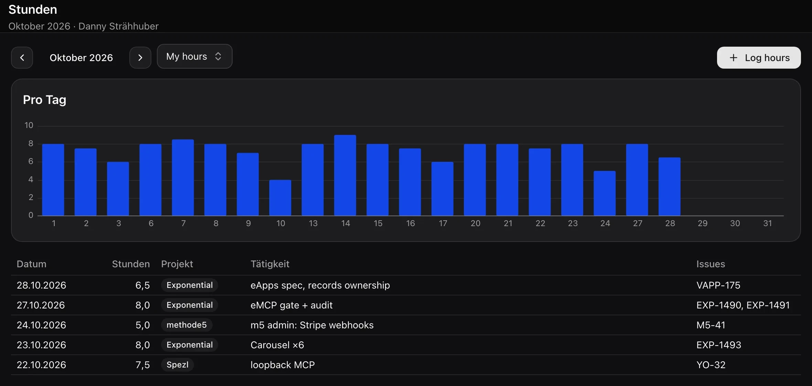
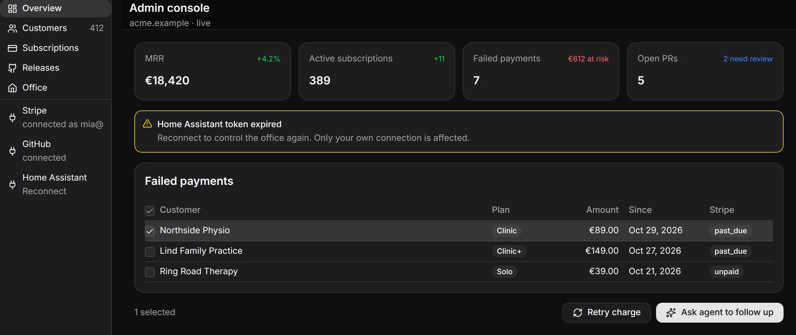
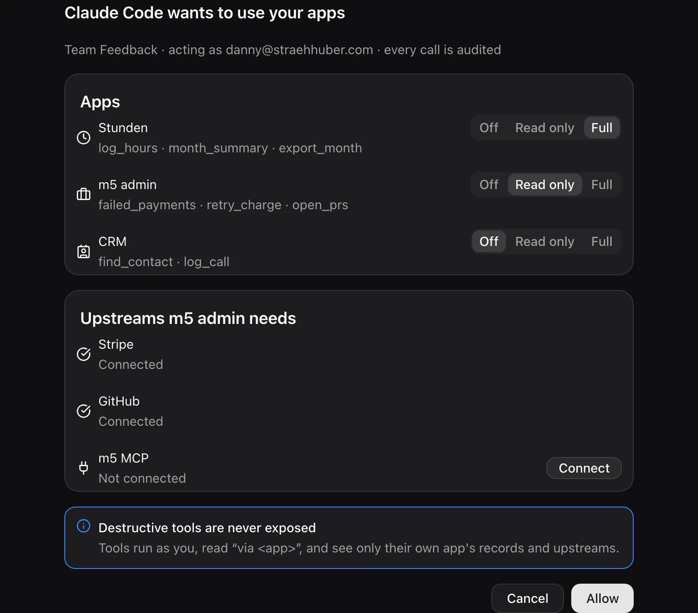
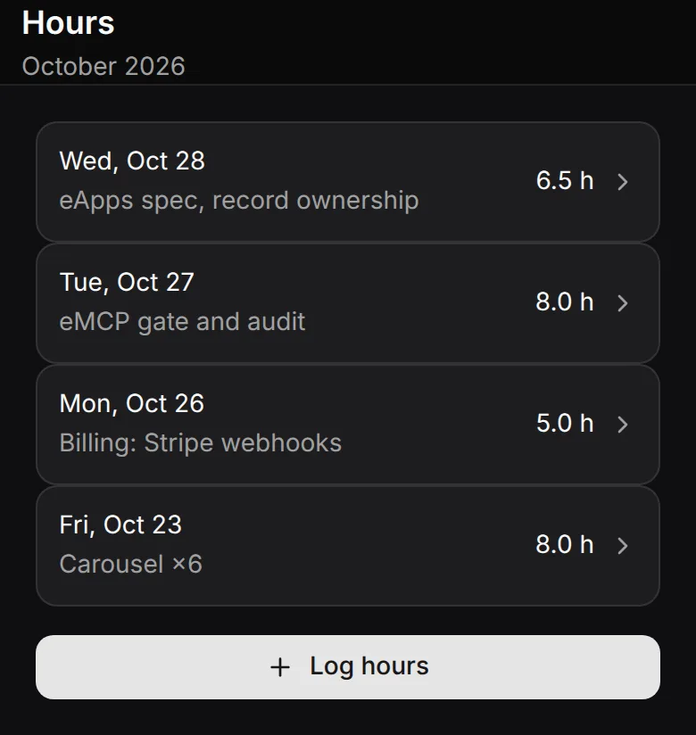

# Apps: spec

> Status: **approved 2026-11-01** (Danny; decisions in §18). **General availability: §20 (Milestone G, released 2026-11-03).** Batch-1 readiness: §20.1. Sources: the code at `e59ef9f4909`, epic #VAPP-110 (slice 1, done), #VAPP-175 (editor-first + MCP Proxy), `packages/emcp`, genUI 0.3.0, the time-tracker check (session 2db0b7d0), ExponentialOS plan v5 (session 196b5162), Spezl #YO-32.
> **The Engine** (Danny, 2026-11-05, #VAPP-259): §13.1 replaces S2 to S4; hosts in §16.
> Legend: ✅ exists · 🟡 partial · ❌ missing · 🆕 proposed here (no issue yet). The mocks are drawn with genUI (React harness, exponential theme, dark).

## 0. In one paragraph

An Exponential app is **data, never code**: a declarative package (manifest, genUI templates, bindings, record kinds, a function allowlist, `exposes`, `upstreams`) stored per team, versioned in the DB, and painted by the same genUI renderers on web, desktop, iOS and Android, as well as Spezl and eDE. Three executors run an app, and none of them runs app code:

1. the **client host**, while someone is looking at the app;
2. the **server broker**, for MCP calls (and, proposed here, the clock, events and webhooks);
3. an **agent**, when the work is fuzzy.

Real code lives behind an **upstream MCP server** the team already runs. Hosted apps (#VAPP-101) stay cancelled.

The rest of this spec turns that rule into the missing pieces:

- records that know who owns them;
- a real query language;
- several screens per app;
- triggers;
- an offline outbox;
- the **Engine** (`eengine`): one runtime for Apps in every host (§13.1).



---

## 1. Use cases → capabilities

Each group lists concrete apps, then the capabilities they need. The capability IDs (C1…C30) are used in the roadmap (§17).

### 1.1 Team tools

| App | What it does | Needs |
|---|---|---|
| **Hours** (time tracker, an example) | Log hours per day with a note and issue refs; totals per day, month and member. Any app-specific rule (a target, a balance) is the app's own records and expressions. | C1 ownership, C2 on-behalf backfill, C5 group-by member, C7 date maths, C13 spreadsheet import |
| **CRM** | Contacts, companies, deals in stages, last touch, follow-up dates. Log a call from Claude Code. | C3 relations, C8 multi-screen nav, C9 record forms, C16 exposes, C18 schedules ("follow up due") |
| **Inventory** | Items, locations, stock moves, a low-stock alert. Scan a QR code on the phone. | C3, C6 sums of moves, C18 event trigger, C24 offline writes (warehouse without wifi), `QrScanner` ✅ |
| **On-call** | Weekly rotation, overrides, "who is on call now", hand-off note. | C7 date maths (week of year), C18 schedule (Monday rotation), C19 agent hand-off ("summarise the incidents of the week") |
| **Approvals** | Request → approver → approved/rejected, with a reason. Applies to expenses, leave, purchases. | C1 (only the approver decides), C4 per-kind policy, C10 state machine on a field, C18 event trigger (notify the approver), audit |
| **Forms / surveys** | A question set, anonymous or member answers, results as charts. | C21 public link (guest submit), C5 group-by answer, Chart ✅ |
| **OKRs** | Objectives → key results → check-ins, progress from linked issues. | C3, C11 computed fields (progress %), `exp:issues` ✅ |
| **Standups** | A daily three-question check-in per member and a team digest. | C18 schedule (09:00 reminder), C19 agent digest into a comment |
| **Retros** | Went well / to improve / actions; actions become issues. | `exponential.issues.create` ✅ (granted), C9 forms |
| **Hiring pipeline** | Candidates by stage, interview scorecards, files (CV). | C3, C4 (scorecards visible to the panel only), C20 files on records |
| **Expenses** | Receipt photo, amount, category, monthly total. | C20 files, C5, approvals |
| **Leave / vacation** | Requests, approval, remaining days per person, a team calendar. | C1, C5, C6 (days left = allowance − used), C7 date maths over the app's own holiday records, a calendar view (C29) |

### 1.2 Personal tools

| App | Needs |
|---|---|
| **Habits** (daily ticks, streaks) | C4 private kind (`read: author`), C6 streak = consecutive days, C24 offline |
| **Notes** | C4 private, Markdown ✅, search on records (C5) |
| **Budget** | C5 group-by category and month, C7, C13 bank CSV import |

Personal means private records inside a team app. In Spezl there is no team, so the same app is personal by construction (§16).

### 1.3 Ops and admin consoles over outside APIs

**Admin console** (an example: a small software company's back office) is one screen over several outside APIs:

- **The company's own MCP server:** customers, plans and licences. The person signs in with their company account through OAuth.
- **Stripe:** MRR, failed payments, retry a charge.
- **GitHub:** open PRs and releases.
- **Home Assistant:** the office lights and heating.
- **Exponential:** file an issue "via Admin console", ask an agent to follow up.

Each upstream is a team MCP server row, and **every member connects their own account** (✅ #VAPP-181/#VAPP-183).

Needs:

- C16 `exposes`;
- C17 upstream reads inside templates (`upstream:` binding source, ✅ #VAPP-230);
- C17b upstreams reachable only on the LAN (Home Assistant), which needs a device-routed upstream (✅ M2, #VAPP-239: the server row names its owner's device, §8);
- C22 a webhook (Stripe `invoice.payment_failed` → a record + a ping);
- C19 agent hand-off.



### 1.4 Dashboards over Exponential data

- Team pulse: issues opened and closed per week, cycle time, PRs merged.
- Sessions per device, agent cost.
- A device wall.

Needs:

- C5 aggregates over `exp:issues` and `exp:sessions`: group by status, assignee or week. Today those sources only list and filter.
- `exp:devices` ✅ and `exp:pullRequests` ❌.

### 1.5 Agent-facing apps (MCP tools for OpenClaw and Claude Code)

- "Log 2 h on VAPP-175" from Claude Code.
- "Which customers failed to pay?" from OpenClaw on the homelab.

This is `exposes` over `/api/mcp/apps`, with one OAuth flow (✅ #VAPP-180–185).

Needs:

- the same query power as the UI ✅ (C15, #VAPP-216: a tool's `records` list and `records_list` run the Q1 query through the UI's evaluator);
- on-behalf rules (C2);
- descriptions frozen per version ✅.



### 1.6 Apps that trigger agents, scheduled and automated apps

Examples:

- The standup digest at 17:00.
- "A new hiring candidate" → an agent drafts the interview plan.
- A Stripe failure → an agent writes to the customer.
- The on-call rotation flips every Monday.

Needs:

- C18 schedules and record events;
- C22 inbound webhooks;
- C19 `run.agent`, a prompt hand-off through `sessions.send`;
- C23 a run-as identity.

Nothing here may become a workflow engine: "standalone automations" and "workflows" are on the dead list (§7).

### 1.7 Apps elsewhere: Spezl offline, eDE widgets, phones

- **Spezl:** the same package and the same records query, a local sqlite store, a loopback-only MCP (#YO-32), no server.
- **eDE:** an app as a desktop widget (a "today's hours" tile, the on-call badge) and as a window. The desktop itself is genUI on disk (NEW-107).
- **Phones:** every app at 390 px, with a form factor that changes navigation (bottom bar instead of sidebar). Logging hours from the phone while offline in the train.



Needs: C24 offline outbox, C25 the Engine, C26 widget templates + slots (#VAPP-64), C27 form-factor conditions.

### 1.8 Sharing, templates, marketplace

- A public leave-request form.
- A read-only dashboard link for a customer.
- "Start from a template" in the gallery (✅ #VAPP-234: time tracker, CRM and standup; leave and on-call later).
- A signed catalog shared with Spezl (#YO-18).

Needs: C21 public links, C28 templates gallery, C30 signed catalog. Signing is already ✅ (#VAPP-161).

### 1.9 Import from spreadsheets

Typical sources: a timesheet workbook (one sheet per month), a CRM export, a bank CSV.

Two paths:

- the **agent path**: the agent reads the file in a session, maps the columns, and writes on behalf of the right members;
- a **mapping dialog**.

Needs: C2, C13.

### 1.10 Capability index

| ID | Capability | Status | Issue |
|---|---|---|---|
| C1 | Record ownership: only the author or an owner edits or deletes | ✅ | #VAPP-187 |
| C2 | Writes on behalf of a member (owners), with audit | ✅ | #VAPP-188 |
| C3 | Relations between kinds and refs to issues and members | ✅ R5 (#VAPP-219) | R5 |
| C4 | Per-kind read/write policy (private, panel-only) | ❌ | 🆕 R3 |
| C5 | Group-by on any field, avg/min/max/count, text search | ✅ group-by + aggregates; 🟡 text `search` open | #VAPP-190 |
| C6 | Running sums and totals before a date | ✅ | #VAPP-190 |
| C7 | mul/div/round, date maths (add, diff, startOf, weekday) | ✅ CEL subset, type-checked | #VAPP-191 |
| C8 | Several screens per app with navigation and deep links | ✅ U1 (#VAPP-218) | U1 |
| C9 | Forms and tables generated from a kind's schema | 🟡 the Data tab does it in Exponential's own UI (#VAPP-178); nothing in genUI | 🆕 U2 |
| C10 | Field state machine (allowed transitions) | ✅ R6 (#VAPP-222) | R6 |
| C11 | Computed fields on a kind | ❌ | 🆕 Q3 |
| C12 | CSV/xlsx export of a kind or the current query | ❌ **out of scope** (decided 2026-11-01): records leave through `.app.json` and MCP | — |
| C13 | Spreadsheet import (agent path + mapping dialog) | ✅ the agent recipe (§10.2) and the mapping dialog ×4 (§10.3) | #VAPP-228 |
| C14 | Package export/import, signed | ✅ | #VAPP-121, #VAPP-161 |
| C15 | Broker `records` with the full query | ✅ Q4 (#VAPP-216) | |
| C16 | `exposes` (records / action / upstream) | ✅ | #VAPP-180, #VAPP-181 |
| C17 | `upstream:` read bindings in templates | ✅ #VAPP-230 (M1) | |
| C17b | Device-routed upstreams (stdio, LAN-only) | ✅ | M2 (#VAPP-239) |
| C18 | Schedules and record/event triggers | ❌ (agents only: `agentTrigger`) | 🆕 A1 |
| C19 | Agent hand-off (`run.agent`) | ✅ A2 (#VAPP-236) | ✅ A2 |
| C20 | Files on records | ✅ R7 (#VAPP-221) | `format: "attachment"` fields, `POST /api/apps/{id}/files` |
| C21 | Public / guest links (submit-only form, read-only view) | ❌ (#VAPP-24 cancelled, #YO-27 parked) | 🆕 P1 |
| C22 | Inbound webhooks | ✅ A3 server (#VAPP-237) + Settings ×4 (#VAPP-238) | ✅ |
| C23 | Run-as identity for unattended runs | ❌ | 🆕 A1 |
| C24 | Offline outbox for record writes | ✅ desktop, iOS, Android (#VAPP-235) | ✅ O1 |
| C25 | The Engine (`eengine`): app instances, lifecycle, sources, dispatch, outbox, consent, the capability broker, host providers (§13.1) | 🟡 the query + `RecordStore` live in genUI (S1 ✅ #VAPP-189); the contract `packages/eengine` ✅ (E0, #VAPP-260); the crate is open (E1, #VAPP-261) | #VAPP-259 |
| C26 | Widget templates + slots (eDE, home screen) | 🟡 the format (`screens[].widget`, #VAPP-273); the eDE desktop paints it; the home-screen slots wait for #VAPP-64 | #VAPP-64, NEW-107 |
| C27 | Form-factor / responsive templates | ✅ `@media (form-factor: …)` (U1), `@media` sizes, `Sidebar.collapseBelow` | U1 |
| C28 | Template gallery | ✅ #VAPP-234: `samples/apps/*.app.json`, signed by the pinned Exponential key; "Start from a template" in the import dialog and a draft's starters (`fixtures/app-templates.json`) | Leave, On-call |
| C29 | Calendar / timeline view | ✅ #VAPP-232 (U3) | |
| C30 | Marketplace (signed static catalog) | ❌ | #YO-18 |

---

## 2. Package model and versioning

### 2.1 The package (✅, genUI 0.3.0 `packages/exponential-ui/src/host/package.ts`)

```jsonc
{
  "id": "acme.hours", "name": "Hours", "version": "2.0.0",
  "formatVersion": 5,                      // a host reads exactly its own
  "catalogId": "https://ui.exponential.at/catalogs/core/v1",
  "icon": { "glyph": "clock", "color": "blue" }, "description": "…",
  "sources":   ["records:*", "exp:members", "exp:issues"],     // allowlist
  "functions": ["records.*", "bind", "exponential.comments.create"],
  "records":   { "entry": { "title": "…", "schema": { … } } },  // ≤ 16 kinds
  "templates": { "month": { "components": [ … ], "data": { … }, "bindings": [ … ] } },
  "exposes":   [ { "name": "log_hours", "access": "write", "input": { … }, "run": { "records": { … } } } ],
  "upstreams": ["stripe", "github"],
  "extensions": { "at.exponential": "^1" }                      // IssueRow, StatusGlyph, …
}
```

Caps (✅ `contract.json` `apps`): package ≤ 128 KB, ≤ 500 components per template, ≤ 16 kinds, record ≤ 16 KB, ≤ 32 exposed tools.

### 2.2 What formatVersion 3 adds (🆕)

| Key | Purpose | §  |
|---|---|---|
| `screens` | ✅ U1 (#VAPP-218): the navigation manifest `[{template, title, icon?, params?}]` (≤ 5), painted by the host as a sidebar on wide frames and the phone bottom bar on phones | 5.1 |
| `records.<kind>.policy` | ✅ R3 (#VAPP-199): read/create/update/delete per kind: `member` · `author` · `owners` (`role:<field>` waits for R6 transitions) | 3.4 |
| `records.<kind>.refs` | Relations: `{field: {kind}}`, `{field: "issue"}`, `{field: "member"}` | 3.3 |
| `records.<kind>.computed` | ✅ Q3 (#VAPP-214): expressions evaluated on read | 4.4 |
| `records.<kind>.transitions` | A state machine on one enum field | 3.3 |
| `queries` | Named structured queries, reusable by bindings and `exposes` (✅ Q1 for bindings, already in format 2) | 4.1 |
| `automations` | Schedule, record event, Exponential event and webhook → one run | 7 |
| `migrations` | Declarative record migrations between versions | 3.6 |
| `share` | Public link definitions (`package-format.md`) | 9.4 |

### 2.2.1 What formatVersion 4 adds (✅ #EXP-1674)

A screen's `nav: false` and `exposed` (§5.1). A version 3 package is a valid version 4 package, so migration `0251_eapps_format_v4` moved the stored ones (`apps.package`, `apps.draft_package`, `app_versions.package`) up, as `0237` did for version 3; a client that has not updated shows the update prompt below.

### 2.2.2 What formatVersion 5 adds (✅ #VAPP-260)

`capabilities: [{id, why, origins?}]`: the package's **capability manifest** (§13.2). `id` is a scope of the Engine's catalog (`packages/eengine/fixtures/capabilities.json`, never a host-only one), at most once; `why` is the author's one line the consent sheet shows (≤ 200 characters); `origins` is required for `http.fetch` and only there (exact `https://host[:port]` origins). The manifest is the ceiling of what the app's UI and its agents may reach, and the bundler maps it onto platform permissions. Absent = no capabilities. A version 4 package is a valid version 5 package, so migration `0258_eapps_format_v5` moved the stored ones up, as `0251` did for version 4. Every host runs the manifest through the same broker (§13.2).

A host refuses a newer `formatVersion` (✅ today), so old clients show "Update Exponential to open this app" instead of a broken screen.

### 2.3 Versions and channels

Today:

- ✅ Every `upsert` writes `app_versions.number` and becomes the head (the draft).
- ✅ Restore makes a new head.
- ✅ The editor session id is recorded on the version.
- ✅ **Draft vs published** (V1, #VAPP-210/#VAPP-211, decided 2026-11-01; fixture `apps.json` `publishCases` ×4):
  - `apps.package` is the PUBLISHED version's package (`published_version`, 0 = never published); `apps.draft_package` is the head's while it is ahead.
  - Every version write (`apps upsert`, Restore) makes a draft. Members, the exposed MCP tools (the broker), record policies and automations run the published package.
  - The editor's preview shows the head while the viewer's own editor session is live (or nothing is published), else the published version.
  - "Publish" (the editor header; phones: the … menu; any Versions row; the viewing banner) or `exponential_apps_write {op: "publish", version?}` moves the pointer. An older version = a rollback; past a version whose sweep ran, the Publish first warns that rollback doesn't reverse migrated data (#VAPP-256, apps.json `rollbackCases`, no data moves). An imported app, or one created with a package, publishes v1 at once.
  - Grants follow the published package: an owner's publish keeps the still-declared grants, anyone else's clears them.
  - Records validate against the published kinds plus a draft's new kinds (so an editor can seed them before publishing).

Proposed:

- **`version` (SemVer)** is the author's label. **`number`** is the truth. A major bump with no `migrations` for a changed kind is refused (§3.6). ✅ R8 (#VAPP-233): refused at upsert, naming the kind and the change (`migrationRefusal`, `record-migrations.json`).

---

## 3. Data: records

### 3.1 What exists

`app_records`, keyed on `(app_id, kind)`:

- columns `data jsonb`, `created_by`, `deleted_at`, `app_deleted_at`;
- one shape, member-only (web on demand per app, natives get the full shape);
- tRPC `apps.records.{list, upsert, delete}`;
- shallow patch inside `FOR UPDATE`;
- quota under an advisory lock: free 1,000 / team 25,000 / unlimited (`lib/plan-limits.ts`);
- a purge after retention (#VAPP-159).

Schemas are flat JSON Schema:

- types string, number, integer, boolean, array;
- formats date, date-time, time;
- enum, min/max, maxLength, required.

### 3.2 Identity of a record (✅ R1/R2)

| Column | Meaning |
|---|---|
| `created_by` (✅) | Who pressed the button. Never changes. |
| `author_id` (✅ #VAPP-187) | Whose record it is. It defaults to `created_by`. Only an owner may set it to someone else (an on-behalf write; ✅ #VAPP-188: `author` on `records_upsert`, `.app.json` import and the Data tab's Author picker; the row reads "<writer> for <author>" ×4). |
| `updated_by` (✅ #VAPP-187) | The last writer. |
| `via_app_id` / `via_client_id` 🆕 | How the write arrived: UI, MCP client, automation, import. |

A per-member view groups by `author`, not `created_by`. That way a backfill an owner does for another member still counts as that member's records.

### 3.3 Richer schemas (🆕 R5/R6, ✅ R7)

- **refs** (✅ R5, #VAPP-219): `records.<kind>.refs: {"customer": {"kind": "company"}, "task": "issue", "owner": "member"}` on string fields.
  - `{kind}` points to a record of that kind of the same app.
  - `"issue"` stores an identifier like `EXP-12`.
  - `"member"` stores a user id.
  - Refs are validated on write (the target exists in the same app or team; else BAD_REQUEST naming the field) and resolved by queries (`expand`). Cross-app refs are not allowed. Install checks the field is a declared string field and the kind exists. Deleting a target never cascades: the ref dangles and reads null when expanded.
- **transitions** (✅ R6, #VAPP-222): `{"field": "status", "initial"?: ["requested"], "from": {"requested": ["approved", "rejected"]}, "who": {"requested->approved": "role:approver", "paid": "owners"}}`, enforced on the server (the records service: an undeclared edge = BAD_REQUEST naming it, a mover the edge's `who` excludes = FORBIDDEN; creates start in an initial state; restores follow it unless an owner restores). `who` names an edge or a target; levels `member` (default), `author`, `owners`, `role:<field>` (the member a `member` ref names before the write, or an owner). The checker validates the field is an enum and every state exists. Rows of the kind carry `transitions` (the viewer's legal next states) so a template offers only those; `record-transitions.json`, TS + Rust, replayed ×4.
- **files** ✅ (R7, #VAPP-221): `{"type": "string", "format": "attachment"}` holds one file, a list of strings with `"items": {"type": "string", "format": "attachment"}` several. The value is `/api/attachments/<id>` (relative, lowercase uuid; genUI `validateRecord` ×2 twins, `host-router.json` `acme.files`).
  - **Upload:** a `FileUpload` whose `files` is bound; the app host posts each picked file to `POST /api/apps/{appId}/files` (write access to the app; the attachments pipeline: caps, the team's storage budget) and writes the returned `url` into the entry of the same name at the bound path. An action stores the urls in the record.
  - **The row** is the app's (`attachments.app_id`, no other owner, never synced). The bytes route serves it to team members whose access to the app is not `none`; the app hosts' media rule (`appMediaAllowed`) loads it in `Image`.
  - **On write** the records service checks that every referenced file is a row of the record's own app and team (`attachments must be files uploaded to this app`), before the `eapps` role.
  - **Purge:** the attachment sweep reclaims an app file that no record of its app references, past the week-long orphan grace. A trashed record still references its files, so they live until the trash purge (30 days) drops the record. An app's hard delete hands its files to the orphan sweep.
- **Nesting stays out.** Nested objects make every client's derivation harder. Use a second kind plus a ref.

### 3.4 Permissions

Layers, all intersected:

1. **Team membership** ✅. Only members, unless a public link applies (§9.4).
2. **Per-app member policy** `app_access` none/read/write. ✅ (#VAPP-199) applied everywhere: MCP, the records service (none = NOT_FOUND, read = writes FORBIDDEN), the apps router, the apps / app-versions / app-records shapes (none = the app and its rows never sync), the RLS scope (`eapps.write`), and the clients (`appAccess.mine`; the Data tab disables writes). An app's own writing controls paint disabled at read (#VAPP-200, the genUI `readOnly` host option ×7 renderers).
3. **Per-kind policy** ✅ (R3, #VAPP-199, `packages/exponential-ui/fixtures/record-policy.json`, TS `host/record-policy.ts` + Rust `host::record_policy`, iOS/Android hand ports replaying the fixture):

```jsonc
"policy": {
  "read":   "member",          // member | author | owners (owners = not even the author)
  "create": "member",
  "update": "author",          // the author or a team owner
  "delete": "author"
}
```

The defaults are `member/member/author/author`. This is the common case; it ships with `formatVersion 3`, and as Apps keeps no backwards compatibility (decided 2026-11-02) v2 packages are not read after that.

The server enforces the policy (the records service on every read and write, the broker's reads, the import's creates; a row the member may not read is NOT_FOUND). The app-records shape enforces `read: author` / `read: owners` with a row filter for non-owners (`lib/apps/records-shape.ts`): a private kind never syncs to other members' devices. `create` is never `author`. Package tests take `role` and run under the policies. ✅ R6 (#VAPP-222): `role:<field>` levels live on a kind's `transitions.who` (the member a `member` ref names), not on `policy`.

   ✅ #VAPP-206: a package reads the viewer through the `exp:me` source, `{id, name, email, avatar, role, access}` (`app-sources.json` ×4; in `sources` like any other), so an owners-only card hides itself: `"visible": {"call": "eq", "args": {"a": {"path": "/me/role"}, "b": "owner"}}`. An action reads it as `data.me.role`. This is presentation only: the policy above stays the authority.

4. **Field-level privacy is out.** Use a separate kind with `read: owners` (for example, salary next to a hiring candidate).
5. **The Postgres scope** ✅ (#VAPP-193), a backstop under layers 1 to 3, not a replacement. Every server read and write of a record runs through ONE service (`apps/web/src/lib/apps/records-service.ts`), which checks layers 1 to 3, ownership and quota, then runs the record statements as the `NOLOGIN` role `eapps` scoped to one team and its apps (§12.2). Ownership and policy stay in the service, never in RLS.

### 3.5 History, undo, retention, quotas

- ✅ **History** (R4, #VAPP-215, fixture `app-records.json` `history` ×4): an `app_record_events` row per records-service write, in the write's own transaction under role `eapps` (RLS team + app): `{record_id, op (create/update/delete/restore), actor, author, via (editor/app/mcp/action/import), patch, before}`. It is kept 90 days, like `mcp_calls` (the watchdog purge); a record's hard delete takes its events. Read on demand (no shape): tRPC `apps.records.history` (the record's read policy), MCP `apps records_history` / `records_restore`.
- ✅ **Undo:** a Data tab write and a package action's batch toast Undo for 10 s (the existing toast action); Undo = each event's `before` as a new write (`apps.records.undo`: a create undone = a delete, a delete undone = a restore). The record form's History section (existing list rows: label, who · when) restores any earlier state as a new write (`apps.records.restore`, needs update).
- **Deletes are soft** ✅ (`deleted_at`). The trash is purged after 30 days (✅ purge, #VAPP-159). Owners can restore from the Data tab.
- 🆕 **Retention per kind:** `"retention": "365d"` purges old rows. Retention is not a quota tool.
- **Quotas** ✅ per team and plan. ✅ #VAPP-227: a restore or undo that revives deleted rows counts against the quota like a create. The editor and Data tab show the count against the plan. 🆕 A soft warning at 80 %. A write over the quota fails with a toast, never silently.

### 3.6 Migrations (🆕 R8, #VAPP-233)

✅ (R8 1/3) The package side: `migrations: [{from: <range>, kind, ops: [rename {from, to} | default {field, value} | drop {field} | map {field, expr} | renameKind <kind>]}]`, `migrateRecord` / `validateMigrations` / `kindChanges` / `migrationRefusal` (TS `host/record-migrations.ts` + Rust `host::record_migrations`, `fixtures/record-migrations.json`), checked at install, and the major-bump refusal at upsert. ✅ (R8 2/3) The sweep on publish: records carry `schema_version` (every write stamps the published number); a publish of a version with migrations sweeps the app's records in batches (records service + RLS, all or nothing per batch, R4 events via `migration`, resumable through the watchdog, progress `migration_done`/`migration_total`/`migration_state` on the version row, a failing record stops it with its error). ✅ (R8 3/3) The clients: the Versions row shows the sweep (`Migrating records 120 of 500`, `Records not migrated: …`; apps.json `migrationCases` ×4, after the row's subtitle, no new component) off the synced `app_versions.migration_*` columns; the editor previews a draft that declares migrations on migrated copies of the app's records (from the published `version`; nothing written; FFI `migrate_record_json`, SDKs `RecordMigrations`). Lazy reads through the chain are not built: the sweep is eager and a record reads in its stamped shape until it moves. The ops below are the original sketch; `set`/`cast` became `default`/`map`.

Records carry `schema_version` (the package `number` that wrote them). A new version that changes a kind declares its migrations:

```jsonc
"migrations": [{ "kind": "entry", "ops": [
  { "rename": { "from": "issues", "to": "refs" } },
  { "set":    { "field": "project", "default": "Exponential" } },
  { "drop":   "legacy" },
  { "cast":   { "field": "hours", "to": "number" } }
]}]
```

- The server applies them **lazily** on read and on write, and **eagerly** in a background sweep, using compare-and-swap like the vault sweep.
- An additive change (a new optional field) needs none.
- A change that loses data is refused unless an op covers it.
- Every client reads through the same migration function (TS + eui-core) until the sweep finishes.

---

## 4. Query and expression language

### 4.1 The structured query (✅ Q1, #VAPP-190)

Today a binding is a URL (`records:entry?mine=1&by=date&sum=hours`). URLs stay as sugar. The canonical form is JSON, named in `queries` and referenced by bindings, `exposes` and automations:

```jsonc
"queries": {
  "month": {
    "from": "entry",
    "where": [["date", "between", "${month.start}", "${month.end}"]],
    "group": ["author", { "bucket": "date", "by": "day" }],
    "aggregate": { "hours": ["sum", "hours"], "n": ["count"] },
    "sort": [["date", "desc"]],
    "limit": 500
  },
  "before": {                                // totals before this month
    "from": "entry",
    "where": [["date", "<", "${month.start}"]],
    "group": ["author"],
    "aggregate": { "total": ["sum", "hours"] }
  }
}
```

| Feature | Today | Spec |
|---|---|---|
| Filters | ✅ equality, `.gt/.gte/.lt/.lte`, `mine`, `user`, `app=`; ✅ Q1 `in`, `between`, one `{or: [[…]…]}` (also `<`, `>=`… in JSON) | + `contains`, `startsWith`, `isNull`, text `search` |
| Sort / limit | ✅ (limit ≤ 500); ✅ Q1 several sort keys (JSON) | + a cursor |
| Group-by | ✅ Q1 any field, `author`, time buckets `day/week/month/quarter/year` (ISO weeks), plus `by=<date>&month=` | Buckets in the team timezone (today: the stored calendar day; a timestamp's UTC day) |
| Aggregates | ✅ Q1 `sum avg min max count countDistinct first last` (per group + `totals`) | |
| Running values | ✅ Q1 `running: {field: "sum"}` (sum count avg min max, over groups, rows or month days) and `before: <date>` (totals up to a date, seeding the running values) | streaks |
| Joins | ✅ R5 (#VAPP-219) `expand: ["customer"]` / `expand=customer` follows refs (one level): a record row, an issue summary `{id, identifier, title, status}`, a member `{id, name}`; dangling = null (TS + Rust, `records-query.json` ×4; the server's Q4 reads too) | There are no free joins. |
| Sources | `records:<kind>`, `exp:issues`, `exp:boards`, `exp:members`, ✅ `exp:me` (#VAPP-206), `exp:sessions`, `exp:comments`, `exp:attachments`, `exp:devices`, ✅ `upstream:<server>/<tool>` (§6.3, the tool's answer, no query) | The same query shape over every `exp:` source (group issues by status or week), + `exp:pullRequests` |

**Host-provided params (✅ #VAPP-206, `host-router.json` ×4):** a binding source and a named query read `${today}`, `${now}` and `${month}` (the team zone, read when the screen opens and at each `bind`), so a query bound to today has rows before any event fires. A binding's own param of the same name wins in a named query (a month picker's `bind`). A JSON query's `mine` may be `${mine}` (filled `true` or `1` = mine), and a sort key may place a missing value whatever the order: `["due", "asc", "last"]` (unset = it compares as empty text, first ascending; `records-query.json` ×4).

**One evaluator:**

- ✅ (Q1, #VAPP-190) The JSON form: `parseRecordsJson(json, kind?)` → `{query, issues}` (Rust `parse_records_json`, FFI `parse_records_json`, SDKs `RecordsQuery.parse(json:)` / `parseJson`), the `q=<json>` param, and the package's `queries` followed by `?query=<name>&<params>` (the router expands it, `${param}` templates filled from the binding's params). The value gains `groups`, `totals`, `before` and `running`. The date helpers (`dateBucket`, `parseDay`, `isoWeek`, `daysInMonth`, `weekdayOf`) live in `src/dates.ts` / `eui_core::dates` for Q2. `queries` is optional, like `exposes` (format version 3 since R3). The spec's `"${month.start}"` is spelled `"${start}"` (flat binding params).
- ✅ (S1, #VAPP-189) A pure TS reference (`@exponential_app/eui/host/query`) and its Rust twin in `eui-core` (`host::query`), fixture-locked (`fixtures/records-query.json`, replayed in TS, Rust, Swift and Kotlin). The URL params parse INTO a structured `RecordsQuery` (`from, app, mine, user, where, sort[], limit, sum, month`); the JSON form (Q1) adds keys next to these.
- Web and the server broker use TS. Desktop, iOS, Android, Spezl and eDE use eui-core (iOS and Android already link it through UniFFI for painting).
- ✅ The four hand-written derivations (`AppRecords.swift`, `AppRecords.kt`, `app_records.rs`, `app-records.ts`) are gone; their Data tab, ownership and on-behalf helpers stay.
- Queries run **locally** over the synced store. A query over more rows than the device holds (web on-demand) asks the server, which uses the same evaluator over SQL.

### 4.2 Expressions (✅ Q2, #VAPP-191)

The bind-time functions exist ✅: add, sub, percent, eq, lt, clamp, cond, fallback, concat, coalesce, text, map, len, fill, filter, and/or/not, plus the format functions.

To add, both as functions (`{"call": "mul", …}`) and as the compact string form used in `compute`/`computed`:

| Group | Functions |
|---|---|
| Arithmetic | `mul div mod round floor ceil min max abs` |
| Arrays | `sumOf avgOf minOf maxOf countOf groupOf sortBy` over a bound list |
| Dates (team timezone) | `today now dateAdd(d, n, unit) dateDiff(a, b, unit) startOf(d, unit) endOf weekday isoWeek` |
| Durations | `hours(minutes)`, `formatDuration(h, "h:mm")` |
| Text | `string lower upper trim split join` (`matches` is not built: §4.2) |

The string form is a tiny pure grammar (numbers, paths, operators `+ - * / % < <= == && || !`, calls). It is parsed once at package validation, has no loops and no user functions, and must terminate. The function form stays the A2UI wire form, and the string form compiles to it.

- ✅ (Q2, #VAPP-191) The string form is a **CEL subset**, hand-written as TS (`src/cel.ts`) + Rust (`eui_core::cel`) twins replaying ONE fixture (`fixtures/expressions.json`; FFI `evaluate_expression_json` / `check_expression_json`, SDKs `Expressions.evaluate/check` (Swift; `Expression` on Compose)). cel-js / the `cel` crates were not used: CEL splits int/uint/double (JSON has one number), their error texts and date handling would differ between the twins, and they would bloat the genUI bundle. One number type (`7 / 2` = 3.5); a missing field reads null. It is used as `{"call": "expr", "args": {"expr": "…", "vars": {…}}}` anywhere a value may be bound, and the arithmetic, date and duration rows above are also plain A2UI functions (`{"call": "mul", …}`) running the same table. Every `expr` is type-checked by `validatePackage` against its vars (a literal, a records binding's kind schema, the template data), issues at the JSON pointer. Caps: 1000 characters, nesting 32, no nested comprehensions, 10 000 steps. The team zone is the zone the host passes (`HostZone`): ✅ #VAPP-201 `teams.time_zone` (Settings › General, owners; fixture `team-zone.json` ×4), else the device's zone. Hardened by the CEL differential fuzz (`fixtures/cel-fuzz.json`, TS vs Rust, in CI): it found and fixed `dateAdd` overflowing on a huge `n` in both twins.
- ✅ #VAPP-206: the Arrays and Text rows and map literals (CEL only, never `{call: name}`, so the bind table and the catalog keep their names; `expressions.json` ×4). `rows.map(r, {'value': r.id, 'label': r.name})` turns record rows into Select options, `size(trim(x)) > 0` refuses a whitespace-only value. Arrays take a list and skip null entries (`sumOf(rows.map(r, r.hours))`), `sortBy` sorts a missing value last in either order. `matches` stays out: regex engines differ between the twins and an evaluated pattern can backtrack past the "always terminates" promise, while a form's `checks` keep their `regex`.

**Missing values are explicit (✅ E2, #VAPP-195):** a field that is not in its kind's `required`, and a var the checker cannot type, is typed `T?`. Arithmetic, comparisons and function arguments on a `T?` are install issues unless guarded: `has(r.f)`, `r.f == null ? … : …`, or `orElse(x, default)`. Every binding carries a fallback (`{"call": "expr", "args": {…, "default"}}`, shown when evaluation fails), so a renderer never paints undefined and never throws on a binding. Built (E2): `T?` is spelled `{"?": T}`; an unguarded use names its path (`entries.rows[0].hours may be missing: guard it with has(), a null check or orElse()`); `has()`, `!= null` / `== null` (through `&&`, `||`, `!`) and `orElse` narrow; `default` is required on every package `expr` binding and every bind-time call falls back to its `default` (TS `dynamic.ts`, Rust `data.rs`: all six renderers); fixture `expressions.json`, replayed ×4.

### 4.3 Time

- Everything date-like is evaluated in the **team timezone**. `date` is a calendar day, not an instant.
- Weeks are ISO and months are calendar months.
- The platform has no notion of working days, holidays or targets. An app that needs them keeps them as its own records (a `holiday` kind, a `target` kind) and combines them with `weekday`, `dateDiff` and the query.

### 4.4 Computed fields (✅ Q3, #VAPP-214)

```jsonc
"computed": { "minutes": "round(hours * 60)", "week": "isoWeek(date)" }
```

Computed fields are evaluated on read by the same evaluator. They are never stored, so they never go stale. Queries can filter, sort and group on them.

- ✅ (Q3, #VAPP-214) Built: `records.<kind>.computed` (≤ 16 per kind). Each expression reads the record's schema fields and the row keys (`id createdAt updatedAt createdBy authorId`) by name; a failing one reads null. The records query writes them into every row of the kind before it runs (`recordsValue(…, {computed})`, TS `withComputed` / Rust `computed_data`, FFI context `computed`, SDKs `RecordsQuery.value(…, computed:)` + `RecordsQuery.computed(records:kind:)`), so filters, sorts, groups, aggregates, running values, `sum=` and the month view read them, and a template's row type carries them (typed). The hosts ×4 pass the hosting package's; another app's rows (`app=`) carry none. The server's records service applies them to `apps.records.list` and every Q4 read (`readAppRecordRows`: the broker's `records` runs and MCP `records_list` with `query` filter, sort and group on them). Checked at install (`/records/<kind>/computed/<name>`): typed against the schema (E2 `T?`), no shadowing a schema field or a row key, no computed field reading another (no chains, no cycles), the cap. Evaluated in UTC with the query's clock, like the query's own buckets (the team zone lands with the buckets'). Fixtures: `records-query.json` (values, filter, sort, group, aggregate, the month view) and `expressions.json` `packages`, replayed ×4.

### 4.5 Effects: pure bindings, all-or-nothing actions (✅ E1, #VAPP-194)

One language at two levels, on the Q2 core:

- **Expressions are pure.** Bindings, `visible`, computed fields and query params cannot write. Every function in the signature table carries an effect (`pure | write | host`), and the checker refuses an effectful one in a pure place at install (path + reason).
- **Actions** (`actions: {<name>: {params, steps}}`, named by an `on.press`, an `exposes` run or an automation) are ordered steps: `require <expr>`, `records.upsert`, `records.delete`, `set <pointer> = <expr>` (the surface data model), and host functions from `functions` (behind the same policy and consent as today). ✅ #VAPP-205: a `call` step reaches the same dispatcher as a press, so `bind` re-binds and `openUrl` opens; one that refuses is the outcome's error (`actions.json` `hostCalls` ×4).
- **All or nothing.** The steps evaluate against one snapshot. A false `require` (its message is the toast), the action step limit (100,000), an error, or a write refused by policy or schema discards the whole action. Record writes land as one unit: one Postgres transaction in the records service, one `RecordStore` batch on a client host, one outbox entry offline (O1).
- ✅ #VAPP-206: create or patch in one action, and absent stays absent (`actions.json`, `record-macros.json` ×4; `package-format.md` "Actions"). Params may name `id`; `records.upsert`'s `id` may be `string?` (null or `""` creates, a string patches). An expression's null writes nothing, so a patch with a param left out keeps the row's value; `""` in an optional field and a literal `null` write nothing on a create and clear on a patch. A create never stores a null field (`withoutNulls`: `applyRecordBatch`, the `RecordStore`, the records service).
- ✅ #VAPP-271: a call's ANSWER. A `call` step may name it, `result: <name>`. That call runs when the plan reaches it, before the commit and behind the same policy and consent; a refusal or a failure discards the action. The steps after it read the answer as `results.<name>` in records, `set`s and later calls (`photos.pick`'s file ids into a page, `print.pdf`'s file into `/pdf` for Save and Share). `runAction` stays pure: it answers `{pending}` for the first unanswered call, and the host runs it and runs the action again over the same snapshot (`actions.json` `results` ×4; package tests give the answers as `results`). Every Engine capability name (`photos.`, `files.`, `print.`, `share.`, …) is a host function.
- An action runs where it was triggered: the client host for a press, the server broker for `exposes` and automations. The evaluator is the same ×4; fixture `actions.json`.
- The authority stays the server (§3.4, §14): `require` guards a single write path. Cross-peer invariants are not promised on P2P stores (Spezl, §16).
- ✅ (E1, #VAPP-194) Built as `src/host/actions.ts` + the effect table in `src/cel.ts` (Rust `eui_core::host::actions` / `cel`, FFI `run_package_action_json`, `apply_record_batch_json`, `function_effect`; SDKs `Actions`), fixture `fixtures/actions.json` replayed in TS, Rust, Swift and Kotlin. Step forms `require` (+ `message`), `records.upsert`, `records.delete`, `set`, `call`; CEL reads `params`, `data` and `me`; a press calls `actions.<name>`. Every host (`ExponentialHost` ×4) gates and asks for every host call first, then commits the writes through `records.batch` (Exponential: tRPC `apps.records.batch` = one transaction in the records service, every write re-checked), then applies the sets, then runs the calls; a failure = `ACTION_FAILED` + the failed-action toast. Open: the broker's `exposes` `run.action` form and automations (A1). ✅ The offline outbox entry (O1, #VAPP-235): a batch is one outbox entry on desktop, iOS and Android.

---

## 5. UI

### 5.1 Screens and navigation (✅ U1, #VAPP-218)

- `screens` lists the templates a person can open (at least 1 and at most 5 in the navigation, keyed by the template; `title`, a genUI `icon`, default `params`). The host draws the shell from it with Exponential's EXISTING navigation: the sidebar row pattern on wide frames (desktop, web ≥ md, the preview's Desktop frame) and the phone bottom tab bar on phones (and the preview's Phone frame). No new component.
- **The app draws no chrome of its own** for this, so every app navigates the same way.
- The host function `app.navigate {screen, params?}` (a press, or an action's `call` step after its writes; always allowed) and the route `/t/$team/apps/$slug/$screen?…` give deep links that work ×4 (natives: the same path as an app link).
- `params` become `/params/*` in the template data, and a binding source's `${params.month}` is filled (percent-encoded) when the screen opens.
- Install refuses an unknown template, a duplicate, a sixth screen, a bad icon, a non-string param and a literal navigate target that is no screen.
- ✅ #EXP-1674: `nav: false` = a detail screen outside the sidebar and tab bar (the limit of 5 counts only navigation screens, since it exists for the phone bar; a package with only `nav: false` screens is refused; a request with no screen opens the first in the navigation). `exposed: {description, params?: {<key>: {required?, description?}}}` = the public contract: a stable name and checked params.
- ✅ #EXP-1674: `~/x` in `Link.href`, `Row.href`, `Button.href` and `openUrl` expands against the host's `linkBase` (genUI `decideUrl`; Exponential's run views and chat cards: `/t/<team>`; a host without one paints it as text; `~//` and a `.` or `..` segment, percent-encoded too, are denied).
- ✅ #EXP-1674: a link from another app at `~/apps/<slug>/<screen>?k=v` passes `crossAppTarget` (`fixtures/host-router.json` `crossApp`, the host's check): the target screen must be `exposed` and its required params present and non-empty, only declared params arrive; otherwise the toast `app-link.json` `copy.noAccess`, the same for a missing or unpublished app. It PUSHES so back returns to the first app; `app.navigate` stays for the app's own screens and keeps replacing. A person's URL or an agent's chat link keeps opening any declared screen. `exponential_apps get` lists `linkableScreens` (navigation + exposed screens, params, a ready `~/` link).
- ✅ #VAPP-273 (C26): `widget: {template, size: "s" | "m" | "l"}` on a screen = the screen as a desktop widget: a declared template of the package painted compact at the size class, with the screen's own `params` as `/params/*`; a press in it that navigates opens the screen. `packageWidgets(pkg)` (TS; Rust `package_widgets`) lists them in screen order. eDE's desktop paints them (one layer surface each); the phones' home screens come with the slots model (#VAPP-64). Install refuses a widget that is no object, an unknown key, a template the package lacks and a size outside the three.
- ✅ Built as `src/host/screens.ts` (`validatePackageScreens`, `resolveScreen`, `navigateTarget`, `fillScreenParams`) + Rust `eui_core::host::screens` (FFI `resolve_screen_json`, `navigate_target_json`; SDKs `Screens`, `HostOptions.navigate` ×4), fixture `fixtures/host-router.json` (`screens`, `navigate`, `acme.badscreens`), the host contract `catalog/host.json` `package.screens`. The editor preview paints the screens in its frame (apps.json `screensCases`); with screens it replaces the template picker.

### 5.2 Templates and components

- An app may use only catalog components (91 ✅, `core.catalog.json`) plus Exponential's extension (IssueRow, SessionRow, StatusGlyph…, ✅).
- **No new component enters an app** unless it is first in the styleguide and, if it is low-level, in genUI. That is the team rule; app authors (agents) can't invent widgets.

| Need | Status |
|---|---|
| Tables (sort, select, sticky header, density) | ✅ `Table` |
| Inline cell edit in tables | ❌. Proposal: none; edit opens the record form in a Drawer. |
| Charts (bar, stacked, line, area, pie, donut, sparkline) | ✅ `Chart`, `StatTile`, `Meter`, `Ring`, `Sparkline` |
| Forms and validation | ✅ `Form`, `FieldGroup`, `FormActions`, `checks` (required, email, length, regex, numeric), `validateOn` |
| Form from a kind's schema | 🆕 U2: `RecordForm {kind, id?}` as a genUI **macro** expanding to Form + inputs (date → DatePicker, ✅ date-time → DatePicker + TimePicker in a FieldGroup, in the team zone, #VAPP-245; enum → Select, ref member → Select over `exp:members`, string[] of issues → ChipInput). The server re-validates the kind's schema. ✅ #VAPP-245: an owner's first field = Author (`formAuthor`, on-behalf writes skip the offline outbox); a BAD_REQUEST shows inline under the form, the editor stays open (its Drawer is not dismissible), anything else toasts. |
| Table from a query | 🆕 U2: `RecordTable {query, columns?}` macro. Columns come from the schema, the row press opens `RecordForm` in a Drawer. ✅ #VAPP-245: Edit and Delete are icon buttons in a cell, Delete confirms in a Dialog; a phone's row carries its own Delete. |
| Calendar / timeline (leave, on-call) | ✅ U3 (#VAPP-232): genUI `Calendar` (month/week; phones: dots + the day's agenda) and `Timeline`, catalog macros over the records calendar views (`until`, `view=week|timeline`); styleguide entries `calendar` + `timeline`. |
| Bound text and rows (✅ #VAPP-206) | `Dialog.description`, `Alert.message` and `Chip.detail` bind. A `Table.rowPress` action reads the pressed row through relative paths (`{"path": "id"}`). `on.press` stays one functionCall: several steps are an action (`actions.<name>`, §4.5). |
| Empty, loading and error states | ✅ `EmptyState`, `Skeleton`, toasts per `feedback-states.json` |

### 5.3 Responsive

- ✅ Style `@media` conditions with breakpoint tokens, responsive props (`columns: {base: 2, md: 4}`), `Sidebar.collapseBelow`.
- ✅ U1 adds the `@media (form-factor: phone | wide)` style condition: the host's form factor (the preview frame, a phone), unset = the surface width against `$breakpoint.md`. Use it only when a layout truly differs (the time tracker's phone screen is a list of days, not a table). `tablet` / `widget` and a `screens[].phone` template override wait for a need.

The two Hours mocks above are the same package. The phone picks the `month.phone` override: Rows per day and one wide primary button.

---

## 6. Actions and functions

### 6.1 The three families (✅)

| Family | What | Consent |
|---|---|---|
| `harness.*` | toast, records.upsert/delete, mcp (always asks); opening an issue or Devices is a link (`~/issues/<id>`, `~/devices`, #EXP-1674) | None for records; `harness.mcp` asks every time |
| `exponential.<noun>.<op>` | 84 typed actions, each an MCP call **as the viewer** | Only an owner grants (`apps.granted_tools`). Destructive and owner-only ops are never grantable. A non-owner version clears all grants. |
| `bind`, `set`, `openUrl` | Re-bind a source, set data, open a link (URL policy: private hosts denied) | None |

### 6.2 Side effects

The complete list: records writes, MCP operations, toasts, navigation and links. There is no `fetch`, no background code and no package `tools` (refused by Exponential's validator ✅).

🆕 Add `navigate` (§5.1). ✅ `handoff` (§7.3, A2): the `exponential.apps.handoff` action.

### 6.3 Upstreams in the UI (✅ M1, #VAPP-230)

- `harness.mcp` asks every time: fine for a rare action, useless for a dashboard. So a template has a read binding source `upstream:<server>/<tool>?<args>` (`@exp/emcp` `upstream.json` `binding`, its `$comment` the spec):
  - the name splits at its last `/`; each query param is one argument, read as JSON when it is a number, `true`/`false`/`null`, an object or an array, else the string (so a `bind` action's params drive it);
  - the server must be in the package's `upstreams` (an install issue otherwise; it runs on the team server that fills it: §8 "The per-app mapping") and the source in its `sources` (`upstream:<server>/<tool>`, `upstream:<server>/*` or `upstream:*`);
  - read-only only, checked at every call against the tool's live annotations: `readOnlyHint: true` reads; a tool with no hint reads only when `sources` lists it exactly (the author vouches); `readOnlyHint: false` and destructive tools never run;
  - run by the **server broker** as the viewer with their own credential (`resolveForLaunch`), exactly one tool per read, never another app's upstreams, `_meta` provenance on the answer (§12.1);
  - cached for 60 s per (member, server, tool, args); errors are never cached, and hosts re-read every 60 s while bound;
  - the value = the result's `structuredContent`, else its text as JSON, else the text.
- ✅ M2 (#VAPP-239): a server that names a device reads ON that device for its owner (§8 "Device-routed upstreams"), same rules, same cache; anyone else's read is refused `deviceNotOwned`, and an offline device answers `{ok: false, error: upstreamFailed, server, offline: <device>}`.
- Hosts ×4 subscribe through one tRPC query, `apps.upstreamRead {id, source}`. A refusal or offline keeps the path's template data (the binding's default); a viewer not connected to the server gets one host banner per server, "Connect <server>", opening Settings › MCP.
- Reads are not written to `mcp_calls` (a dashboard re-reads every minute); exposes calls still are.
- Writes stay `exposes`-style named actions (`{"call": "upstream.stripe.retry_charge"}`). They are listed in `functions`, granted by an owner, and confirmed by the viewer the first time.

---

## 7. Automation

> Rule: **one trigger runs one binding.** No chains, no branches, no loops. Anything with judgement is handed to an agent. This keeps clear of the dead "standalone automations / workflows" (decided 2026-11-01).

### 7.1 Triggers

✅ A1 (#VAPP-220): `automations`, one trigger → one binding, run by the server as a sponsor.

```jsonc
"automations": [
  { "name": "monday_rotation", "on": { "schedule": { "cron": "0 8 * * MON" } },
    "run": { "records": { "op": "upsert", "kind": "rotation", "data": { "startedAt": "${firedAt}" } } } },
  { "name": "notify_approver", "on": { "record": { "kind": "request", "op": "create" } },
    "run": { "action": "exponential.comments.create", "args": { "issueId": "${record.issue}", "body": "New request: ${record.title}" } } },
  { "name": "log_merges", "on": { "event": "pr.merged" }, "sponsor": "lead@acme.test",
    "run": { "records": { "op": "upsert", "kind": "merge", "data": { "title": "${event.title}" } } } }
]
```

The contract is `packages/emcp/fixtures/automations.json` (TS `@exp/emcp/automations`, Rust `emcp::contract::automations`); the server rules and the executor are `apps/web/src/lib/apps/{package,automations}.ts`.

- **`on`** (exactly one):
  - `schedule: {cron, tz?}`: a 5-field cron (the agents' trigger cron: names, ranges, steps), read in `tz` or the team time zone; the minutes of a day it fires on are ≥ 15 min apart. The watchdog tick runs the latest due minute since its last check, caught up once after downtime (24 h), never twice.
  - `record: {kind, op}`: a committed create/update/delete of a declared kind (members' writes, package actions, tools).
  - `event: "<name>"`: the team stream (`issue.created`, `pr.merged`, `session.ended`… or any `events_emit` name), the same events agents' triggers use ✅. It runs once the event is committed.
  - `webhook: {name}` (A3, §7.2): a signed `POST` to the app's hook URL; the body is `${event.body.<path>}`. `where` filters are not in A1.
- **`run`:** an `exposes` run (`records`, `action`, `upstream`, `agent`) with the same validator: no destructive runs, an action must be granted by an owner, an upstream must be declared. `agent` (A2) hands off to a team agent (§7.3). Templates: `${record.<field>}` (record triggers: its data + `id`; on delete, the data it had), `${event.<field>}` (event triggers: the payload + `name`), `${firedAt}`. No action through `exponential.apps.*`.
- **Executor:** the **server broker** (`runBrokerTool`, the same records service, grants and vault as a tool call), on the **published** version only (V1). Every run, and every refusal, is one `mcp_calls` row with `client_id = automation:<name>`, `tool` = `records.<op>:<kind>`, the action, or `<server>/<tool>` (Settings › MCP › Activity).
- **Run-as** (C23): an automation acts as its **sponsor**: the member who published the running version (`apps.published_by`), or a member it names by email (`sponsor`), honoured only when an owner published. The sponsor must still be a member with write access to the app. Upstream runs use the sponsor's credential; writes read "via <app>" (§9.3). Otherwise the automation pauses (`sponsorGone`, `sponsorReadOnly`, `sponsorNotAllowed`), the app's owners get one notification per pause, and a publish by a member with access resumes it. There is no bot identity (decided 2026-11-01).
- **Caps:** at most 16 automations per app; at most 30 runs a minute per app (over it: audited `rateLimited`, not run). **No chaining:** a run executes in an automation scope, so its records write and the events its action emits fire no automation, its own included.
- **Settings:** the app's settings page lists each automation with its trigger, its last run and its last failure (from its audit rows), the runs the cap dropped in the last 24 h (#VAPP-255: `N runs dropped in 24 h`; the drop stays, a run is never retried) and a pause, ×4.

### 7.2 Webhooks (✅ A3 server, #VAPP-237)

`on: {webhook: {name}}` runs an automation when an outside service posts to the hook. The contract is `packages/emcp/fixtures/automations.json` (`webhook`, TS `@exp/emcp/webhooks`); the server half is `apps/web/src/lib/apps/webhooks.ts`.

```jsonc
{ "name": "stripe_paid", "on": { "webhook": { "name": "stripe" } },
  "run": { "records": { "op": "upsert", "kind": "payment", "data": { "customer": "${event.body.data.customer}" } } } }
```

- **URL:** `POST /api/apps/hooks/<appId>/<name>`. The hook name is unique among the app's webhooks; the published package's automations on it run (A1's executor: the sponsor, the caps, the audit).
- **Secret:** one per hook, `whsec_` + 32 random bytes (base64url), minted by a team owner on the app's Settings (tRPC `appAccess.rotateHook`), answered ONCE, stored only vault-sealed (`ev1`, slot `app_hooks.secret_ciphertext`, re-sealed by the vault sweep), never synced. Minting again rotates it: the old secret stops at once. A hook without a secret answers 404.
- **Verification:** header `exponential-signature: t=<unix seconds>,v1=<hex HMAC-SHA256(secret, "<t>." + raw body)>` (Stripe's scheme; several `v1` may ride along). In order: body > 64 KB = 413, no header = 401, malformed = 401, `|now − t|` > 300 s = 401 (`stale`), no matching `v1` = 401, the signature already seen (the nonce cache: every accepted signature for 2 × the window, table `app_hook_nonces`, pruned by the watchdog) = 409 (`replayed`), not JSON = 400. The body is parsed only after the signature verifies. A verified delivery answers 202 with each run's status.
- **Payload:** the run's event = `{hook, body}`: `${event.body.<path>}` in the run (and in an agent hand-off's data block, never its instructions, §12.1).
- **Rate and audit:** at most 60 deliveries per hook per minute (429 beyond, not audited, so a flood never fills the audit table). Every delivery under the cap is one `mcp_calls` row: the run's (`automation:<name>`), or a refusal audited `denied` with its code (`badSignature`, `stale`, `replayed`, …) as the publisher.
- ✅ Settings ×4 (#VAPP-238, `apps.json` `webhookRowCases`): the Webhooks group under Automations, one row per hook with its URL (Copy URL), a Ready / No secret pill and the owner's Create secret / Rotate secret (the `rotate-webhook-secret` prompt first); the answer's secret is shown once under its hook (Copy secret), held in memory only. The trigger line "On webhook <name>" is ✅ ×4.

### 7.3 Agent hand-off (✅ A2, #VAPP-236)

`run.agent` hands judgement to a team agent. The contract is `packages/emcp/fixtures/exposes.json` (`agent`, `$comment` the spec) and `automations.json` (the agent loop guard); the server half is `apps/web/src/lib/apps/agent-handoff.ts`.

```jsonc
{ "name": "route_request", "on": { "record": { "kind": "request", "op": "create" } },
  "run": { "agent": "triage-bot", "prompt": "Route the request ${record.title} to its owner.", "device": "default" } }
```

- **The form:** `{agent, prompt, device?}`. `agent` = the agent's slug (its name lower-cased, everything outside `a-z0-9` one `-`: "Triage Bot" = `triage-bot`; the team's oldest agent with that slug, never a personal Assistant). `prompt` = at most 4000 characters, frozen per version. `device` absent or `"default"` (the agent's own device). It always writes.
- **Where it runs:** an automation (A1, as its **sponsor**), an `exposes` tool (as the **calling member**) and the `handoff` action `exponential.apps.handoff {slug, tool, input, record?}` (a press runs one of the package's published `agent` exposes as the viewer, behind the consent card unless an owner granted it; display row `apps_handoff`).
- **The session:** `sessions.send {agentId}`, the one entrypoint: the run-as member's own conversation with that agent (created on first use on the agent's device, then resumed), reading "via <app>" (M3 `via_app_id`). The agent's output lands in that conversation; it calls back into the app only through the app's `exposes`, if its MCP grant includes the app.
- **The brief (data is never instructions, §12.1):** the prompt with each `${…}` filled as inline data (backticks, quotes stripped of backticks and newlines, at most 200 characters each), then `From the app <name> (<automation|tool|handoff> <name>).`, for a record trigger `Record: <kind> <id> of the app <slug>.` (the ref back to the record), and the whole input as a fenced JSON block marked as data (at most 8000 characters).
- **Caps:** at most 10 hand-offs per app per rolling minute (over it: `rateLimited`, audited), beside the automations' 30 runs. **Loop guard:** a record write or an event caused from inside an agent's session tree (the MCP gate tags each call with the caller's own session) never fires an automation that hands off to that same agent; every other automation still runs.
- **Audit:** an automation's row reads `tool = agent:<slug>`; an exposed tool's row is the broker's as before.

---

## 8. MCP

| Piece | Status | Where |
|---|---|---|
| Contract (exposes, access, audit, vault, upstream) | ✅ | `packages/emcp` (#EXP-1490) |
| Server half: one gate (token → member → grant → access → audit) | ✅ | `apps/web/src/lib/emcp` (#EXP-1491) |
| Rust crate (loopback server, client, OAuth, vault trait, contract replay) | ✅ (rules only, no executor) | `apps/desktop/crates/emcp` (#EXP-1492) |
| `exposes` in the SDK | ✅ | genUI 0.3.0 (#VAPP-180) |
| `/api/mcp/apps` broker, `<app>__<tool>`, `_meta` provenance, `list_changed` | ✅ | `apps-broker.ts` (#VAPP-181) |
| Consent (team, apps, Read only / Full, inline Connect) | ✅ | #VAPP-182 |
| `app_access` + per-tool switch | ✅ | #VAPP-183 |
| Revocation cascades | ✅ | #VAPP-184 |
| Settings › MCP merged ×4 | ✅ | #VAPP-185 |
| "via <app>" | ✅ comments, issues, sessions, records, own-UI writes, issue list rows | #VAPP-186, #VAPP-229, #VAPP-231 |
| Broker `records` = full query | ✅ | Q4 #VAPP-216: `run.records` list + `records_list` `query` run the Q1 evaluator (`@exponential_app/eui/host/query`) over the caller's readable rows (read policy + RLS first, ≤ 25,000 rows read); `records-query.json` replays through the broker |
| http upstreams | ✅ | |
| Per-app upstream mapping | ✅ | #VAPP-254, below |
| stdio / LAN upstreams | ✅ M2 (#VAPP-239) | `@exp/emcp` upstream.json `device` (its `$comment` is the spec), `lib/emcp/upstream/device-call.ts`, the relay's `POST /devices/:userId/:deviceId/upstream`, `steer::upstream_call` + `emcp::device_call` on the device (below) |
| MCP Proxy local hub + codemode | in review | #EXP-1507 |
| Spezl loopback broker | ❌ | #YO-32 |

**Device-routed upstreams** (✅ M2, #VAPP-239): a team server row may name a device (`mcp_servers.device_id`: a desktop app or CLI daemon of a team OWNER, set with `mcpServers.setDevice`, only to a device of their own; a removed device clears it). It then runs THERE for app calls: a `stdio` command, or an `http` URL only that device's network reaches (plain `http://` is allowed on loopback and LAN hosts: private IPv4, `.local`, `.lan`, `.home.arpa`, `.internal`).

- **Who:** only the device owner's own calls (exposes runs, M1 read bindings) and automations they sponsor route to it; anyone else's are refused `deviceNotOwned` (audited `denied`), so nobody spends a teammate's machine. A stdio server naming no device stays `upstreamFailed`.
- **The path:** the broker writes one `mcp_device_calls` row (tool, args, the veto, a fresh X25519 reply key; 30 s, claimable once, no secret in it) and asks the steer relay to send `upstream_call {callId}` down the device's control socket (the same socket kill, interrupt and compact use). The device claims the call over its own authenticated API (`mcpServers.claimDeviceCall`: its own call on that device, else NOT_FOUND), which resolves the member's credential at claim time; it runs exactly that tool through the `emcp` client (http, or the command spawned over stdio), checking the tool's live annotations against the veto first, and answers `upstream_answer {callId, sealed}`, sealed to the reply key with P2P's sealed box (enet-core `push_seal`). The relay sees only the id and ciphertext and cannot forge an answer: the reply key never crosses it.
- **Offline:** the relay's `device_offline` = `upstreamFailed` "<server> runs on <device>, offline"; a read keeps the binding's default and the host shows that banner (no action) beside the "Connect <server>" ones; a device that never answers (25 s) = "<server>: <device> did not answer".
- **Grants, audit, cache:** exactly as for http upstreams; the answer's `_meta` adds `at.exponential/device` = the device's label.

**The per-app mapping** (✅ #VAPP-254, Danny 2026-11-04, replacing the exact-name-only rule of 2026-11-03; `@exp/emcp` upstream.json `mapping`, TS `resolveUpstreamServer`, Rust `emcp::contract::upstream`): a team owner picks which team server fills each upstream an app declares, at install (the import step) and on the app's Settings › Accounts (`apps.json` `upstreamPickerCases`, ×4). Exact name stays the automatic default, so a package whose names match keeps no row and nothing changes; a shared template works with any server name.

- **Data:** `app_upstream_bindings` (app + upstream → server, team-scoped, unique per app + upstream; cascades with the server, so a removed mapped server falls back to the exact name). Server-only, never a shape. Writes: `appAccess.setUpstreamMapping`, `apps.import {upstreamMappings}`, owners only; the upstream must be declared, the server the team's.
- **Resolve:** the mapping, else exactly the name, else `upstreamMissing`. Exposes runs, M1 reads, automations and M2 device routing all go through `loadRoutedServer` with the app's id. A mapped server that names a device routes exactly as above.
- **What keeps the declared name:** the package (`upstreams`, `sources`, `run.upstream`, `upstream:<declared>/<tool>`) and the provenance `tool`. **What shows the real server:** every banner and refusal, the answer's `server`, `_meta` `at.exponential/upstream`, the cache key, the consent page, an Accounts row's `Uses <server>` line, and an automation's audit `tool`.
- **Package writes:** a declared name is fine when it is a team server, mapped for the app, or already declared by the app's published or head package. Only a name new to the app must exist by name, so an imported template stays editable before an owner maps it.
- **Export/import:** the mapping belongs to the install. A file holds the declared names only; an import starts from the exact-name default plus the owner's picks in that dialog. A member's import keeps the default; the app shows "Not set up" until an owner maps it.
- **Audit:** each change is one `mcp_calls` row as the owner, `tool = upstream:<upstream>=<server>` (`auto` once cleared), Settings › MCP › Activity. Connections stay per server: a mapping changes no member's credential.

**The MCP Proxy hub** (ExponentialOS v5): on a device, one loopback hub combines its servers (Computer Use, eDE tools, Spezl apps) behind grants and audit. Apps plug into it as one more `ToolProvider`, using the same `<app>__<tool>` names and the same `exposes` rules, replayed from `packages/emcp` fixtures in Rust.

**Spezl loopback** (#YO-32, decided):

- 127.0.0.1 only, with a local token and no OAuth server.
- OpenClaw on the homelab can't reach it, by design.
- Upstream tokens live in the OS keychain (a `Vault` implementation in Spezl, not in `emcp`).

---

## 9. Identity and access

### 9.1 Roles

| Who | Can |
|---|---|
| Team owner | Everything. Grants `exponential.*` actions, sets `app_access`, publishes, restores, deletes, does on-behalf writes (✅ #VAPP-188) and imports. |
| App editor 🆕 | Edit the package (today any member can, and a non-owner edit clears grants ✅). Proposal: `apps.editors` (default: creator + owners). Everyone else can only use the app. |
| Member | Use the app within `app_access` and the kind policy. |
| Guest 🆕 | Through a public link only (§9.4). |
| MCP client | The calling member ∩ grant ∩ policy ∩ tool level (✅ `effectiveAccess`). |
| Automation | Its sponsor (§7.1). |

### 9.2 Per-app policy

- `app_access` none/read/write per member (✅).
- ✅ (#VAPP-199) It is enforced in tRPC, the shapes (none = the app, its versions and its records never sync, so it is hidden from the Apps list ×4) and the clients' Data tab.
- ✅ (#VAPP-200) At `read` an app's own writing controls paint disabled ×4: genUI's `readOnly` surface setting (a node calling `records.*` or `actions.*`, a writing Form and its fields, a field without an action of its own; a `bind`/`set` view control stays live; fixture `read-only.json`, conformance suite `read-only`). The editor preview passes it from `appAccess.mine`, or from the Run as member's level.

### 9.3 Audit and attribution

- ✅ `mcp_calls` (90 days, args hashed, never stored).
- ✅ `app_record_events` (§3.5, #VAPP-215).
- ✅ (#VAPP-229, fixture `via-app.json`) `via_app_id` on comments (#VAPP-186), issues, sessions and `app_records`, so every write an app causes reads "via <app>" ×4. Only the server sets it, from the apps broker's own context: an exposed tool's `run.records` create, and the issues and sessions its `run.action` creates (later: automations, A1). ✅ (#VAPP-231, fixture `claim`) An app's own UI writes as the viewer and claims its app: the host sends `viaApp: {appId, version}` (the synced `publishedVersion` at send time, on `apps.records.upsert` / `.batch`, and as the header `X-Exp-Via-App: {appId}@{version}` on an MCP call). The server stamps it only when the version is published, the caller is a member with app access, and the published package declares the function (`records.upsert` for record writes; the `exponential.<noun>.<op>` or `harness.mcp` for an MCP call). A forged claim adds at most a caption, never access, and a refused one costs the write nothing. Previews claim too: a function only a draft declares reads no caption. The Data tab and the CSV import are not the app's UI and send none. It shows on the issue detail's creation row (`created the issue · 2h · via Timesheet`), as one muted line in the session view's header, and in the Data tab's By cell (`Ana · via Timesheet`). A deleted app shows nothing. ✅ ×4: phones have no By cell (their Data rows carry no byline), so records show it on web and desktop only.

### 9.4 Public links (P1, decided: Phase 7, §18 item 5)

`share: [{name, mode: "submit" | "view", kind, fields?, query?, template?, expires?}]` (the format: `package-format.md` "Public links"; the rules ×4: fixture `app-share.json`):

- **submit:** a guest fills one `RecordForm` of one kind and creates exactly one record.
  - The guest sees nothing else.
  - Rate-limited per link and per hashed IP, with a honeypot field and no captcha; schema validation and the plan quota apply as to any write. Optional email verification is not built.
  - A record needs a member as its author, so the owner who enabled the link is its sponsor (`author_id` = `created_by`, `share_name` = the link's name, `via` = `share:<name>` in the history). Clients DISPLAY such a record's author as "Guest".
  - Every submission is audited in `app_share_submissions` (the IP only as a keyed hash).
- **view:** a frozen query rendered read-only, as the link's `template` (#VAPP-246), else as a `RecordTable`. It is a snapshot computed by the server at view time, with no shape and no live sync to the guest, carrying only the named fields, no member data and no `exp:` source.
  - A template reaches a guest as a one-template package with the narrowed kind, no queries, actions or functions, and every binding reading the snapshot. Install refuses a template that could not run that way (`package-format.md`), and the server re-checks per request, so a refused template is the dead link's page.
- URL: `/s/<token>`, a random token. An owner turns a link on and off in the app's Settings tab, and can rotate its token. Expiry starts from the package's `expires`; an owner can change a live link's expiry from its row's `…` menu (#VAPP-247: 7, 30 or 90 days from now, or never) until the next enable.
- Billing: counts as one link, not a seat.

---

## 10. Import and export

| Format | Today | Spec |
|---|---|---|
| `.app.json` (package ± records, signed) | ✅ #VAPP-121, #VAPP-161 (4 MB, ≤ 2,000 records) | Records carry `author`: the export writes it (✅ #VAPP-192, ×4), and the import keeps it when the author is a member of the importing team and the importer an owner; otherwise (a stranger, or a member importing a teammate's export) the row is the importer's (✅ #VAPP-188/192). 🆕 An explicit author mapping when importing into another team. ✅ The file never carries the app's upstream mapping; an owner picks servers in the import step (#VAPP-254, §8). |
| CSV / xlsx export | ❌ | **Out of scope** (decided 2026-11-01). Records leave through `.app.json` and MCP: an agent reads `records_list` or an exposed tool and writes whatever file it needs. |
| CSV / xlsx import | ✅ #VAPP-228: the agent recipe (§10.2, CSV + xlsx) and the Data tab's mapping dialog (§10.3, CSV) | **Agent path** (✅ §10.2): the agent reads the file in a session and calls `records_upsert` with `author` (R2 ✅ #VAPP-188). **Dialog** (✅ §10.3): paste or choose a CSV → map columns onto the Data tab's kind (auto-matched by name) → preview the issues → import the ready rows in one transaction (`apps.records.batch` `via: import`, ≤ 500 rows), Undo for 10 s. |
| JSON (records only) | 🟡 via `records_list` | Covered by `.app.json` |

Example: importing a timesheet workbook (one sheet per month, two members) into the time-tracker app exercises the agent path end to end: on-behalf writes, then the totals computed by the query instead of by spreadsheet formulas. Reports leave over MCP (an exposed tool such as `stunden__month_summary`), not as a file export.

### 10.1 Mapping a spreadsheet onto a kind

One set of rules, shared by the agent recipe and the mapping dialog (fixture `app-records.json` `csvImport`, replayed ×4):

- **Columns to fields.** Compare names with case, spaces and punctuation removed (`Hours worked` = `hoursworked`). A field takes the column with the same name. Failing that, it takes the one column whose name contains the field's name. A column maps to at most one field. Unmapped columns are skipped.
- **Cells to values.** A cell is trimmed first. An empty cell = no value: the field is left out, and a required field without a value is an issue.
  - text: the trimmed text;
  - a string enum: the matching value, ignoring case;
  - number and integer:
    - `6.5` and `6,5` both read 6.5 (a lone comma is a decimal comma);
    - with both `.` and `,`, the LAST one is the decimal separator and the other one groups thousands (`1,240.5`, `1.240,5`);
    - an integer must be whole;
  - boolean: `true/yes/y/1/x` and `false/no/n/0`, ignoring case;
  - `date`: `YYYY-MM-DD`, `DD.MM.YYYY` or `D.M.YYYY`. A slash date (`3/4/2026`) is ambiguous, so it is an issue;
  - `time`: `H:MM` or `HH:MM[:SS]`, padded to `HH:MM` (seconds kept);
  - `date-time`: ISO 8601 only;
  - a list: the cell split on `,` (or `;`), every item read by the item type.

  A cell that does not read as its field's type is an issue naming the column and the row (`row 4: hours: "three" is not a number`). Then the record goes through the kind's schema (`validateRecord`), the same check the server runs.
- **Authors.** A column mapped to the author (owners only, the on-behalf writes of §3.2) matches a member by email, else by name, ignoring case. Any other value is an issue.

### 10.2 The agent recipe (✅ X2 step 1)

When a person attaches a CSV, TSV or xlsx to an editor chat (or any session that may write the app), the agent:

1. **Reads the file.** `exponential_attachments {op: "get", id}`, then download its `downloadUrl` into the working directory and read it with real tooling: for xlsx, a spreadsheet library, one table per sheet. Header rows, merged title rows and total rows are not records.
2. **Picks or declares the kind.** Use an existing kind of the app when its fields fit. Otherwise propose a kind: one field per kept column, typed by the rules above (`date` format for dates, `number` for amounts and hours, an enum for a column with a handful of repeated values). Then save it with `exponential_apps_write {op: "upsert"}` before writing records.
3. **Dry run.** Map every row with §10.1. Do not write anything yet. Show the person the mapping in ONE `exponential_show` card:
   - the column → field pairs;
   - the first rows as a Table;
   - the count of rows ready;
   - every issue as `row N: field: message`;

   ask them to confirm or correct. A slash date, an unknown member or an ambiguous column is asked about, never guessed.
4. **Writes in batches.** `exponential_apps_write {op: "records_upsert", slug, kind, data}`, one call per row. Pass `author` (a member's user id from `exponential_people {op: "list"}`) for a row that belongs to someone else (owners only). Send up to 50 calls in parallel per batch, and check each batch's results before the next. Stop at the first refused batch and report it: a schema refusal names the field, and a plan-limit refusal is the team's records quota. The writes land as `via: mcp` in each record's history (§3.5), so a person can see and restore them.
5. **Checks the result.** `exponential_apps {op: "records_list", slug, kind, query}` with the app's own query (a sum per month, a count per member) compared with the spreadsheet's totals. The reply is one line: how many records, and any rows that were skipped.

A NEW app may instead ship its data inside an `.app.json` file with `records` (§10 table, ≤ 2,000 records), which the person imports from the Apps list.

### 10.3 The mapping dialog (✅ X2 step 2)

The Data tab's toolbar has an "Import…" button (×4) next to Add record. It opens the existing import dialog pattern: paste or choose a CSV, map, preview, import. xlsx is not parsed on a client: an xlsx goes through the agent recipe.

- **Reading the file.** CSV per RFC 4180:
  - the delimiter is the most frequent of `,`, `;` and tab in the header line, outside quotes;
  - a BOM is dropped, CRLF and LF both end a row, and quoted fields may hold delimiters, `""` and newlines;
  - blank lines are skipped;
  - the first row is the header. An empty header reads `Column N`, and a repeated one gets ` 2`, ` 3` appended;
  - a row shorter than the header is padded with empty cells. Extra cells beyond the header are an issue.
- **Mapping.** One labelled Select per field of the picked kind (the Data tab's kind, `dataColumns` order). Its options are the columns plus "Skip", and the first pick comes from §10.1. A team owner also gets an Author Select first, defaulting to "Me" (the importer).
- **Preview.** The first rows, each with its issues inline. Below them, a count: `{n} of {total} rows ready`.
- **Import.** Writes the ready rows only (rows with issues are skipped). It is ONE `apps.records.batch` with `via: import`: one transaction, at most `csvImport.maxRows` rows, judged against the team's quota as a whole (over = the plan-limit toast). A success toasts the record count with the existing Undo action for 10 s (§3.5 undo: every created record deleted again).

---

## 11. Authoring

- **Editor-first** (✅ #VAPP-176):
  - "New app" opens the editor on an Untitled draft.
  - The agent names it.
  - Leaving an empty draft deletes it.
- **Layout** (#VAPP-177–179, in review):
  - Docked chat with tabs Preview | Data | Versions | Settings.
  - Phones: Chat | Preview | Data plus a `…` menu.
- **The agent path** (✅):
  - The chat is the member's editor session. It reads the catalog through `exponential_apps {op: "catalog"}` (prompt budget ≈ 8k tokens, components served one at a time).
  - It writes with `upsert` (one version per write, with a note) and seeds and inspects data with `records_*`.
  - Any coding agent (Claude Code, OpenClaw) can do the same through MCP.
- **Testing** 🆕 T1:
  - The package validator ✅ runs on every upsert.
  - ✅ `tests` in the package (T1, #VAPP-196): `[{name, records?, now?, as?, expr | query | action, expect}]` (≤ 50), run against their own sample records in an in-memory store at every install (every upsert; the MCP upsert answers `tests: "<n> passed"`) and in CI; a failing test is an install issue (`/tests/<i>`, expected vs got), like a type error. `src/host/tests.ts` / `eui_core::host::tests` (FFI `run_package_tests_json`), fixture `fixtures/package-tests.json` replayed in TS, Rust, Swift and Kotlin; docs/package-format.md "Tests".
  - Preview at phone and desktop widths, with a screen picker.
  - ✅ (#VAPP-198) "Run as <member>" in the preview toolbar (web ≥ md + desktop; owners): `me` = them, the records their role and access may read, every write refused with a toast. A test's `as` + `role` run the same rule in CI.
- **Publishing:** draft → published (§2.3). Publish runs the migration check (§3.6) and shows the diff of `exposes` and automations. Changes to tools need an owner, as grants do today.

---

## 12. Security

### 12.1 Prompt injection between apps

The rules decided in #VAPP-175, now ✅:

- an app sees only its own upstreams and records;
- the broker runs exactly one binding per call and never chains across apps;
- results carry `_meta` provenance (`at.exponential/app`, `tool`, `via`, `upstream`);
- descriptions are frozen per version;
- read-only and destructive hints are set, and destructive runs are refused at save and at call.

Added here:

- **Data is never instructions.** `run.agent` and webhooks pass records and payloads as a fenced, typed data block. The agent prompt is the package's frozen text, never interpolated record text.
- **Cross-app reads:** `records:<kind>?app=<slug>` lets an app read another app's rows today. 🆕 The target app must list the reader in `records.<kind>.readableBy`, and the kind's policy still applies (decided 2026-11-01).
- ✅ **Cross-app links (#EXP-1674):** a link only navigates. An app reaches another app's screen only when it is `exposed` with its required params (§5.1), params are data (percent-encoded into bindings) and a screen never runs an action on open. `exposed` is not access control: the target's own policy decides what the viewer sees, and every refusal reads the same, so a link learns nothing about a missing app.
- **Rendered text:** record strings render as text. `Markdown` renders links through the URL policy ✅, and images go through the media policy (#VAPP-157 ✅).

### 12.2 Data isolation

- Every query is scoped by `(team_id, app_id)`, and shapes are member-only ✅.
- **RLS backstop** ✅ (#VAPP-193). The records service runs each operation in a transaction: the checks and every other table first (membership, `app_access`, the app row, plan and quota), then `SET LOCAL ROLE eapps`, `eapps.team` and `eapps.apps` (the hosting app plus any read targets), and `statement_timeout = 2s`. The role has `SELECT, INSERT, UPDATE` on `app_records` and nothing else (deletes are soft). A policy (`USING` + `WITH CHECK`) limits it to `team_id = eapps.team AND app_id = ANY(eapps.apps)`. A wrong query then sees no other team's or app's rows, cannot read any other table, cannot write outside its scope, and stops after 2 s. The structured query becomes a parameterised query over a fixed column list, so app text never becomes SQL. The insert trigger that reads `apps` is `SECURITY DEFINER` with a pinned `search_path`. The main role owns the table and bypasses RLS: the watchdog purge, the quota count, cascades and Electric (replication and snapshots) are unchanged, and the shape proxy stays their guard. The role and policy live in the idempotent custom SQL applied at boot, so self-host gets them too. The connection's role needs `CREATEROLE` (or superuser) once to create `eapps`.
- 🆕 The `author` policy filters rows in the shape itself.
- Spezl keeps records in a per-app P2P records space.

### 12.3 Secrets

- **The vault:** `VAULT_KEY` with a kid, AES-256-GCM `ev1`, rotation by a daily re-seal ✅.
- **What is sealed:** upstream credentials (one per member and server), better-auth tokens, webhook secrets ✅ (A3, `app_hooks`).
- **No secrets in packages:** 🆕 the validator refuses string literals that match key patterns (`sk_live_`, `ghp_`, `xoxb-`, PEM).
- **Natives:** upstream tokens never reach a client; the server broker uses them, or (M2) the member's OWN device-routed server receives the member's own credential at claim time, never stored with the call (Spezl: the device's keychain).

---

## 13. Runtime: where things run

| Executor | Runs | When | Engine | Status |
|---|---|---|---|---|
| Client host ×4 (web, desktop, iOS, Android) | Bindings, queries, actions, forms | While the app is open | web: its own host (it stays online-only, §14); desktop, iOS, Android: `SyncedRecordStore` on `eengine` (#VAPP-272), the rest is the host's (§13.1) | ✅ |
| Server broker | `exposes`, upstream reads (M1), automations (A1), webhooks (A3), public links (P1) | Always (the web server process) | none: the server is a provider (records service, Postgres + RLS), never inside the Engine | ✅ for exposes and upstream reads, 🆕 for the rest |
| Agent | Anything that needs judgement (`run.agent`) | On trigger | an `AgentProvider` (Agents) with a hub grant | ✅ A2 |
| Device | stdio/LAN upstreams (M2) | When the device is online | capabilities and upstreams on the in-process hub | ✅ (#VAPP-239) |
| Softcoded app, eDE, exported apps | Everything above, in-app; automations only while the app runs | Local | `eengine` with local identity and a SqliteRecordStore | 🆕 E1 to E8 (#VAPP-259) |
| Spezl (no server) | Everything above, in-app; automations only while the app runs (eagent-hub scheduler) | Local | `eengine` with the P2P store | #YO-32 on the Engine |

### 13.1 The Engine (✅ contract E0 #VAPP-260; ✅ crate E1 #VAPP-261; ✅ FFI + SDK products E3 #VAPP-263)

The **Engine** (crate `eengine`, contract `packages/eengine`, tag `eengine-v*`) replaces the old S2 to S4 (the `eapps` crate). It is the stateful, I/O-bearing runtime around genUI. Exponential's hosts run their record writes on it (#VAPP-272) and keep what is Exponential's own (below). The Apps format and its pure logic (validation, query, CEL, policy, transitions, migrations, exposes) stay in genUI's host (`eui-core/src/host` + TS) and ship with genUI. There is no `eapps` crate.

```
 hosts:  Exponential web · desktop · iOS · Android │ softcoded app │ eDE │ Spezl │ exported apps
            │ (web: TS twin)        └──────── eengine-ffi (UniFFI) / Rust ────────┘
 ┌──────────────────────────── Engine (eengine) ────────────────────────────┐
 │ AppInstance · lifecycle · screens/router · sources · action dispatch ·  │
 │ outbox · consent · capability broker · HostConfig                       │
 └──┬───────┬─────────┬────────────┬─────────────┬───────┬────────┬────────┘
  Apps    genUI    MCP Proxy     Agents         Voice    P2P   Computer Use
 (format, (eui-core, (emcp: hub,  (eagent: ACP  (etalk)  (enet) (epilot,
  query,  Motion,    OAuth, Vault, CLIs + AgentProvider)          desktop only)
  policy) eui-gen)   code mode)
    └───────┴─────────┴──── Core (ecore: ids, grants, failures, envelope) ──┘
 painters (per platform, unchanged): eui-gpui · Swift · Compose · React/Solid/element
```

- **Dependency rule:** modules never depend on the Engine. The Engine depends on the modules, each optional behind a cargo feature, so a photobook build carries no Voice, P2P or llama.cpp. Painters stay per platform: the Engine hands them a surface and never paints.
- **Fixture-first, two twins:** `packages/eengine/fixtures` are the spec. The TS reference is the web's twin (no WASM for now), and the crate replays the same cases. Swift and Kotlin never re-implement it: they reach it through `eengine-ffi` (E3: `Engine` + `AppInstance`, the providers as foreign traits; SwiftPM `ExponentialEngine`, Maven `at.exponential:engine`, npm `@exponential_app/engine` for the TS twin) and keep only painters and provider implementations.
- **Lifecycle** (`lifecycle.json`): launch (the persisted screen, else the first in the navigation), foreground, background, terminate, `online`, deep links from outside (genUI's `crossAppTarget`: exposed screens only) and the app's own notification taps (`resolveScreen`). The effects are: open, outbox flush (launch, foreground, online), live sources (foreground only), automations (only while the instance runs), persist and refused.
- **Providers** (`providers.json`), the `HostConfig`: required `host`, `storage` (`RecordStore`: query, write with `writeId`, history, subscribe), `blobs` (`BlobStore`), `identity`, `vault` (= `emcp::Vault`) and `window` (`WindowHost`). Optional `clock`, `zone`, `network` (`off`, `upstreamsOnly`, `any`), `sync` (`SyncTransport`), `agents` (`AgentProvider`), `capabilities` and `consent` (`ConsentUi`). **No telemetry and no update provider exist**, and a config naming one is refused. Exported runners compile diagnostics out, and a new package version means a rebundle (no OTA). Exponential keeps its own publish/versions flow (§2.3).
- **Identity:** `member` (Exponential), `local` (one person on one device with no account: the viewer is the device uuid as owner, so every kind policy collapses to "me") and `peer` (a P2P key, Spezl).
- **Storage:** Exponential = `SyncedRecordStore` (#VAPP-272, `eengine::synced`, `outbox.json` `syncedCases`: a cache of the synced rows the host feeds in + the O1 outbox, one per account across its apps, over the host's `OutboxLog` and `SyncTransport`: Electric in, tRPC out; the server stays the authority). Softcoded, eDE and exported apps = `SqliteRecordStore`, which is the app-records table of `elocal` (#EDE-55), so Apps run offline in a Local desktop (#EDE-54). Spezl = sqlite + the P2P space. Without a `sync` provider, writes apply to the store directly and there is no outbox (`outbox.json`, which references O1's fixture rather than copying it).
- **What Exponential's hosts keep (#VAPP-272):** the Engine links no app crate (`tests/dependency_gate.rs`), so what is Exponential's own stays a host provider, locked by its domain-contract fixtures: the `exp:` sources (`app-sources.json`), the typed `exponential_*` actions and their consent card (`app-actions.json`: online MCP calls that never queue, judged by the server's grants, not by a capability scope), upstream reads, and screens (§5.1, which persist nothing for lifecycle.json to restore). A record write is the Engine's end to end: the host hands `SyncedRecordStore` the raw `records_*` call. Their `records:` queries already run in eui-core. `AppInstance` and the capability broker start here when an Exponential host first mounts a capability; agent hand-offs stay the server's (`apps_handoff`, §7.3).
- **Agents** get their tools only as a hub grant. `AgentProvider` lives in Agents (E4, #VAPP-264) with three implementations: `AcpAgent` (Claude Code, Codex; local agent runs #EDE-58), `LocalModel` (llama.cpp via `eui-gen`, behind a feature; the offline fallback #EXP-1721) and `RemoteSession` (`sessions.send`, for phones and web inside Exponential).

### 13.2 Capabilities and consent (✅ contract E0; ✅ broker E2 #VAPP-262; ✅ capabilities v1 E5 #VAPP-265)

- The Engine runs an `emcp` hub **in process**: an in-proc transport for in-process providers and the loopback + bearer token for spawned agents (`hub.json`). The same hub serves the `exponential` noun subset for local agent runs (#EDE-58).
- A **capability** is a native tool provider with scopes, implemented per platform (E5), mounted under its name (`capabilities.json`): `camera.capture`, `clipboard.read`/`.write`, `files.read`/`.write`, `http.fetch` (declared origins only), `location.read`, `notifications.post`, `photos.read`, `print.pdf`, `share.send`, and eDE's own `windows.read` (`list`), `focus.window` (`window`) and `launch.app` (`app`) over `ede-protocol` (#VAPP-273; every other host answers `unavailable`). An `ask` scope shows the consent sheet once and persists the answer. A `picker` scope's platform picker is the consent on every call. `shell.edit` is eDE's own and host-only: it is never in a manifest and never granted to an app.
- **Capabilities v1** (E5, `capabilities.json` `tools`): `photos` (`list`, `get`, `pick`), `files` (`open`, `save`), `share` (`send`), `print` (`pdf`, `print`) and `notifications` (`post` with an optional `at`, `cancel`), the same tool names, schemas and results on every platform. Between the broker and the native provider sits the Engine's **bridge**: it validates the arguments, turns `fileId`s into bytes (BlobStore) and every returned file into an app file, checks the native's result against its schema, and scopes notification ids and taps to the app (a tap comes back as the instance's `notificationTap`). `print.pdf` is the Engine's own: one A4 layout, byte-identical in Rust and the TS twin. Natives: desktop `eengine-desktop` (Rust; macOS, Windows, Linux portals), iOS `ExponentialEngineCapabilities` (Swift over `eengine-ffi`, one module per capability so an app links only what it declares), Android `at.exponential.engine.capabilities` (Kotlin, in the `engine` AAR), web `@exp/eengine/web` (File System Access, OPFS, Web Share, `print()`, Notifications). The platform permission each needs is mapped by the bundler (E7).
- **The package's capability manifest** (format 5 `capabilities: [{id, why, origins?}]`, §2.2.2) is the **ceiling**: what the bundler maps onto platform permissions (E7) and what the broker allows at most.
- ✅ #VAPP-271 **App files as images:** an image `src` `app-file:<fileId>` (genUI `catalog/host.json` `media.appFile`, fixture `host-policy.json` `appFiles`) is resolved by the host from its BlobStore under the image limits: every runner painter does (web OPFS → a blob URL, eui-gpui, SwiftUI, Compose); Exponential's own hosts leave it unresolved and the missing-image fallback paints.
- **One broker** for app UI (`photos.pick`, a function in the allowlist) and agents (`photos__pick`): the ceiling first, the consent decision next, then one audit row (`mcp_calls`' shape, to the host's sink). An undecided scope asks only in the foreground and is never asked behind the person's back.
- **The consent sheet** (`consent.json`) is a genUI surface made of existing components (Drawer, Text, ChoiceTiles, Button), the same on every platform: "Allow {app} to {verb}?", the author's `why`, then Allow / Allow once / Don't allow. The Permissions sheet is one Switch per declared `ask` scope; switching one off revokes it.
- **Grants** persist in the Vault per app (`eengine/grants/<app>`) and change **only** through the ConsentUi after a gesture. No hub tool writes the package, the grants or the host config, so agents cannot change their shell. On every load they are reconciled: another signer drops all of them, an undeclared scope drops, and new `http.fetch` origins ask again.

### 13.3 Runners (E6: #VAPP-266 desktop, #VAPP-267 Android, #VAPP-268 iOS, #VAPP-269 web)

A **runner** is the prebuilt shell an exported app runs in, one per target: macOS, Windows and Linux (gpui + eui-gpui + `eengine` + `eengine-desktop`), Android (Compose + eui-compose + `eengine-ffi` + the Kotlin capabilities), iOS (SwiftUI + `ExponentialUI` + `eengine-ffi`, linking only the declared capability modules) and the web (a static PWA: the TS twin, the React renderer, SQLite-WASM on OPFS). The contract is `packages/eengine/fixtures/runner.json` (TS `runner.ts`, Rust `eengine::runner`, Swift/Kotlin over `eengine-ffi`).

- **No chrome of its own.** The navigation, the Permissions entry, a bundle that cannot load and the failed-action toast are genUI surfaces made of existing components (Sidebar, List, Row, Heading on wide windows; Tabs, Separator and an icon Button on compact ones; EmptyState; Toast), built once by `runnerPackage(pkg, formFactor)`, which wraps every screen's template (a package without navigation or Permissions gets only a full-height scrolling box). A refusal's reason code reads as plain copy (`copy.refusals`). The consent and Permissions sheets are consent.json's. Same look on every platform by construction.
- **No OTA, no update channel, no telemetry, no account.** `runner.json` refuses `update`, `feed`, `telemetry`, `diagnostics`, `account` and the like by name; the identity is `local`; diagnostics are compiled out; a new package version is a rebundle.
- **Storage:** per app id under the platform's app-data directory: `SqliteRecordStore` (`records.sqlite`), `FsBlobStore` (`files/`), the Vault in the platform keystore; the web keeps records in SQLite-WASM on OPFS (IndexedDB fallback) and files in OPFS.

**The prebuilt-shell contract (decided for E7, 2026-11-06: the simplest one that fits the plan).** A runner reads ONE directory, `app/`, at a fixed place per target (`runner.json` `bundle.locations`: `Contents/Resources/app` on macOS, beside the executable on Windows and Linux, `assets/app` on Android, the bundle's resources on iOS, `/app/` on the web). It holds two files: `package.app.json` (the signed package file) and `runner.json` (`id` reverse-DNS, `name`, `version` semver, `network` default `off`). Nothing else is read at run time. `exponential bundle` copies the runner, writes `app/`, then the icons and the platform manifest (Info.plist and its purpose strings, AndroidManifest permissions, macOS entitlements, the web manifest) from the package's capability manifest, and signs. iOS is the one target E7 builds (`xcodebuild` on the Mac lane) because it links only the declared capability modules (ITMS-90683).

**`exponential bundle` (E7, #VAPP-270).** `exponential bundle <package.app.json> --icon <svg> --config <bundle.toml> --target macos,windows,linux,android,ios,web` (crate `eengine-bundle`, contract `packages/eengine/fixtures/bundle.json`). It refuses, in order: a file that is not JSON, a signature that does not verify, an unsigned file (unless `--allow-unsigned`), the Exponential-app catalog (the `samples/apps` gallery runs only inside Exponential), a host-only or unknown capability scope, a package genUI refuses, and a `bundle.toml` with runner.json issues (so no feed, telemetry or account). The runner kits come from `--runners <dir>` (`scripts/runner-kits.sh` builds them from the workspace) or the pinned `eengine-v*` release; each carries its `NOTICES.txt`, which every export ships. The platform manifest declares only what the package's scopes ask for. Signing uses the author's keys from `bundle.toml` `[signing.<target>]`; without them the outputs are ad-hoc or unsigned.

**Hosted apps (#VAPP-101) stay cancelled.** Code that must always run lives in an **upstream MCP server** the team deploys: a company's own MCP, a small Bun service, a Home Assistant add-on. The app calls it by name. That keeps Exponential free of a sandbox, of a per-app process model and of billing for compute (decided 2026-11-01: for good).

Self-hosted gets everything: the broker is the same image (`ghcr.io/niach/exponential-web`).

## 14. Sync, offline, conflicts

| Platform | Read | Write | Engine store | Status |
|---|---|---|---|---|
| Web | Records on demand per app (`subsets`) | Online (tRPC) | the TS twin over the server's records | ✅ / offline ❌ (banner) |
| Desktop | Full shape | Outbox (O1) | `SyncedRecordStore` | ✅ |
| iOS (GRDB), Android (Room) | Full shape | Outbox (O1) | `SyncedRecordStore` over `eengine-ffi` (#VAPP-272, the overlay and the pending glyph still read the host's table) | ✅ |
| Spezl | Local sqlite + P2P records space | Local first | `SqliteRecordStore` + a P2P `SyncTransport` | #YO-32 |
| eDE | Local desktop: `elocal`; connected: the account's shape | Local desktop: direct; connected: outbox | `SqliteRecordStore` (= `elocal`'s app-records, #EDE-55) or `SyncedRecordStore` | 🆕 #EDE-54 |
| Softcoded app, exported apps | Local sqlite | Direct (no outbox) | `SqliteRecordStore`, local identity | 🆕 E1 |

**✅ O1, the outbox** (#VAPP-235, fixture `app-records.json` `outbox`, TS reference `@exp/domain-contract/app-records` `outbox*`). On desktop and the natives, every record write an app makes (`records.upsert`, `records.delete`, `records.batch`) is applied locally at once and queued:

- **The entry:** one per call (a package action's batch stays one entry: all or nothing), persisted per account in the host's store (desktop sync sqlite, GRDB, Room), so it survives a restart. The visible rows = the synced rows with every entry laid over them, oldest first.
- **Ids:** the client generates the uuid of every create (`newId`) and of every write (`writeId`, the idempotency key). The records service answers a `writeId` it already logged (`app_record_events.write_id`, same app and actor) with the first write's result and writes nothing again ✅.
- **Order:** FIFO, one request at a time, on every write, when the connection comes back and at launch. A transport failure or a server error stops the flush; nothing overtakes it.
- **Patches:** shallow (field-level). The server merges them **last writer wins per field**, ordered by server receive time, and logs the R4 history event like any write.
- **Delete wins** over a concurrent update: a single update or delete answered NOT_FOUND is dropped silently.
- **Refusals:** a write the server refuses (policy, schema, quota, transition) rolls back locally (its entry leaves) and shows the failed-action toast.
- **Acked entries** keep overlaying until the shape reflects them (or 30 s).
- **Pending:** while an app has unsent writes, its header shows the existing `ui-offline` glyph, labelled `{n} changes waiting to sync`.
- **What can't queue:** `exponential.*` actions and upstream calls. Their buttons are disabled offline, with the reason in the tooltip (🆕).

The web stays online-only. Issue and comment writes have their own NEW-13.

## 15. Performance limits

| Limit | Value | Today |
|---|---|---|
| Package | 128 KB, 500 components per template, 16 kinds | ✅ |
| Record | 16 KB | ✅ |
| Records per team | 1,000 / 25,000 / unlimited | ✅ |
| Rows per binding result | 500 (cursor for more) | ✅ (no cursor) |
| Local query | p95 ≤ 16 ms over 25k rows on a mid phone (eui-core), gated in the genUI bench | 🟡 #VAPP-202: measured 2026-11-03 at 1–16 ms p95 on a desktop CPU (eui-core release, `examples/records_query_25k.rs`), so a phone missed it on grouped/sorted queries. Now each row's sort keys are read once (numbers kept, texts ranked), field values are borrowed instead of stringified, filter bounds parse once per query, and group keys are computed once per row (eui-core and the TS twin; Swift and Compose call eui-core over the FFI). Results are byte-identical and `records-query.json` is green ×4. Gated in the genUI bench as `records-25k` (core + web, the `matched` count gates; core timings are budgeted at 5 ms p95 = the phone line ÷ 3). The CI bench numbers and a mid-Android run are still owed. #VAPP-212: the phones keep the rows on the Rust side (eui-core `MemoryRecordStore`, the FFI `RecordStore` handle, SDK `RecordsStore`, one per app): a host diffs what it reads and pushes only changed rows, a query crosses with the query and the unsynced writes as an overlay. Compose runs `records-25k` through the handle, so a mid-Android number comes from `compose-android` on a real device |
| Server query (web on-demand, broker) | ≤ 200 ms p95, `statement_timeout` 2 s | ✅ measured: 15–27 ms p95 over 25k rows (records service on Postgres 17); the 2 s timeout is the RLS scope's |
| Exposed tools per app | 32 | ✅ |
| Upstream read cache | 60 s per (member, tool, args) | 🆕 |
| Automations | ≤ 20 per app; schedules ≥ 15 min apart; ≤ 2,000 runs per team per day | 🆕 |
| Webhooks | 256 KB body, 60 calls per minute per hook | 🆕 |
| Import (`.app.json`) | 4 MB, 2,000 records | ✅ |

## 16. Engine hosts

Every host runs Apps on the Engine (§13.1) and fills in its providers (`packages/eengine/fixtures/providers.json` `hosts`).

| Host | Identity | Storage | Agents | Capabilities | Network |
|---|---|---|---|---|---|
| Exponential (web, desktop, iOS, Android) | member | `SyncedRecordStore` (server authority) | `AcpAgent` on desktop, `RemoteSession` on phones and web | files, share, notifications | any |
| Softcoded app (#SA-2) | local | `SqliteRecordStore` | `LocalModel` (#SA-12) | per package | upstreams only |
| eDE (NEW-10) | local (Local desktop) or member (connected, #EDE-54) | `elocal` (#EDE-55) | `AcpAgent` (#EDE-58), `LocalModel` later (#EXP-1721) | files, notifications, `windows`/`focus`/`launch` over `ede-protocol` (#VAPP-273); `shell.edit` stays host-only | any |
| Spezl (#YO-32) | peer | sqlite + P2P space | `AcpAgent` | per package | any |
| Exported apps (`exponential bundle`, E7) | local | `SqliteRecordStore` + `FsBlobStore` | none by default (`LocalModel` opt-in) | the manifest only | per `bundle.toml` (default off) |

**Spezl** (#YO-1, #YO-4 shared format ✅, #YO-32):

1. The records query and the persistent `RecordStore` trait **inside genUI** (S1 ✅).
2. The Engine with the P2P store, a keychain `Vault` and loopback serving.
3. `exponential.*` actions become an **`exponential` upstream** (`ExponentialConnector`) when the person connects an Exponential account. Without one, the action is unavailable.
4. Multi-user app state (#YO-27, parked) maps to P2P spaces later. Without it, Spezl apps are personal: the kind policy collapses to "me".

**eDE** (NEW-10):

1. ✅ Apps run on the Engine in eDE's shell process (#VAPP-273). On a Local desktop, genUI on disk (NEW-107) loads the factory apps (`/usr/share/exponential-desktop/apps`) and `$XDG_CONFIG_HOME/exponential-desktop/apps/*.app.json` (the directory next to the shell's `ui/`) with the same validator; records in one `SqliteRecordStore` under the data directory, identity `local`. On a connected team the apps are the team's published packages over `SyncedRecordStore` (the shared `sync::app_outbox` providers of #VAPP-272) with identity `member` (the account's user, their team role). `uicore-data` sources become Engine providers (#EDE-50).
2. ✅ format (#VAPP-273): widget templates (C26): `screens[].widget: {template, size: "s" | "m" | "l"}` (§5.1) are painted on the eDE desktop, one layer surface per widget. The same entry gives iOS/Android home-screen widgets later, with the slots model (#VAPP-64).
3. ✅ #VAPP-273: the in-process hub lists the running apps' `exposes` tools (`<app>__<tool>`, the app = its package id with dashes) to the desktop's own agent, run as the web's apps broker runs them (`records` list/get/upsert over the app's rows and instance, `action` via the Local desktop's nouns; `upstream` and `agent` runs stay unlisted on a desktop). Also: the desktop's own agent (the shell's chat runs, #EDE-58) gets `shell_edit` on its hub, the host-only `shell.edit`: validation, the sealed consent once per run, then `exponential-ui set`; no app can declare the scope.

**Exported apps:** a signed package bundled onto a prebuilt runner (macOS, Windows, Linux, Android, iOS, web PWA). No app code is compiled per app (iOS links only the declared capability modules), and there is no OTA channel.

---

## 17. Gap list and roadmap

They are ordered by dependency. Every item lands ×4 (web, desktop, iOS, Android) with a fixture change first, per the repo rules. ★ = approved on 30.10 in session 2db0b7d0. The first milestone is filed and done (✅, issues under #VAPP-175); the rest are proposals, not filed yet.

**Phase 1: Records you can trust**

- **R1 ★** ✅ #VAPP-187 Record ownership: `author_id`, the default policy `update/delete: author`, owners override. Server, shape, fixture `app-records.json`. (C1)
- **R2 ★** ✅ #VAPP-188 On-behalf writes: `author` on `records_upsert`, `.app.json` import and the Data tab, owners only. Audit `created_by ≠ author`. (C2)
- **R3** ✅ #VAPP-199 Per-kind policy (`read/create/update/delete`), with a shape row filter for `read: author`. `app_access` enforced in tRPC, the shapes, RLS and the Data tab ×4 (an app's inputs at read: #VAPP-200). (C4)
- **R4** ✅ #VAPP-215 Record history (`app_record_events`), a 10 s undo, the History section ×4. (§3.5)
- **RLS** ✅ #VAPP-193 One records service on the server + the Postgres scope (role `eapps`, team + app) under every server read and write of a record. (§3.4, §12.2)

**Phase 2: The query** (unblocks reports and dashboards)

- **S1 ★** ✅ #VAPP-189 Move the records query out of `domain-contract` into genUI host records (TS + eui-core), with a pluggable `RecordStore`. The ×4 hand derivations become one. (C25)
- **Q1 ★** ✅ #VAPP-190 The structured query: group-by on any field + time buckets, all aggregates, `before`/running sums, `in/between/or`. Fixture `records-query.json` ×4 (TS, Rust, Swift, Kotlin). `search` and a cursor stay open. (C5, C6)
- **Q2 ★** ✅ #VAPP-191 Expressions: mul/div/round/min/max, array aggregates, date maths in the team timezone, the string form. (C7)
- **Q3** ✅ #VAPP-214 Computed fields: `records.<kind>.computed`, evaluated on read ×4 + the server, queryable, typed at install. (C11)
- **Q4** ✅ #VAPP-216 The broker's `records` run uses the Q1 evaluator: tools get the same query as the UI. A list run carries any JSON query key (`where` as a list, `sort`, `group`, `aggregate`, `running`, `before`, `sum`, `mine`, `user`, `month`, `limit`) or names a package query (`query: "<name>"`, its `${param}`s filled from the call's input); MCP `apps records_list` takes `query` too. The server reads the caller's rows of the kind (read policy + RLS, an object `where` = the jsonb containment prefilter, capped at 25,000 = the Team plan quota, `truncated` beyond), then runs `recordsValue`; the answer is the binding's value (`rows`, `count`, `groups?`, `totals?`…) with the usual `_meta`. `app` and another `from` are refused. Q3's computed fields reach tools once the evaluator has them. (C15)
- **E1** ✅ #VAPP-194 Typed effects: pure bindings vs all-or-nothing actions with `require` (§4.5). Before A1.
- **E2** ✅ #VAPP-195 Optional types (`T?`) in the checker + a fallback on every binding (§4.2). With or before Q3.

**Phase 3: Multi-screen apps** (unblocks CRM, hiring, approvals)

- ✅ **U1** (#VAPP-218) `screens` + `navigate` + deep links + phone bar + the `formFactor` condition. (C8, C27)
- **U2** ✅ #VAPP-217 `RecordForm` and `RecordTable` macros: styleguide entry ×5 sites, genUI catalog, prompt budget trimmed to fit. (C9)
- **R5** Refs + `expand` (✅ #VAPP-219). **R6** Transitions (✅ #VAPP-222). **R7** ✅ #VAPP-221 Files on records. (C3, C10, C20)
- **V1** ✅ #VAPP-210 / #VAPP-211 Draft vs published (`published_version`, Publish, tools and automations on published). (§2.3)
- **R8** ✅ #VAPP-233 Declarative migrations + the sweep. (§3.6)

**Phase 4: Data in, and testing**

- **X2** Spreadsheet import: the agent recipe first (✅ #VAPP-228, §10.2, in the editor brief and the `exponential-apps` skill), the mapping dialog second (✅ #VAPP-228, §10.3, ×4, fixture `app-records.json` `csvImport`). (C13)
- **T1** ✅ #VAPP-196 Package `tests` (sample records + expected values for expressions, queries and actions), run at install (a failing test is an install issue) and in CI. The "Run as" preview ✅ #VAPP-198. (§11)

**Phase 5: Automation and upstreams**

- **A1** ✅ #VAPP-220 Automations: schedule, record and event triggers, one run, a sponsor, audit, the loop guard and the rate cap; `automations.json` (TS + Rust), the server executor on the watchdog tick, Settings ×4. (C18, C23)
- **A2** ✅ #VAPP-236 `run.agent` + the `handoff` action: an automation, an exposed tool or a press hands judgement to a team agent through `sessions.send` (the brief = the frozen prompt + a fenced data block + the record ref), `via <app>`, 10 hand-offs a minute per app, the agent loop guard; `exposes.json` `agent` + `automations.json` (TS + Rust), `exponential.apps.handoff`. (C19)
- **A3** #VAPP-237 Inbound webhooks with vault-sealed secrets: ✅ the contract (`automations.json` `webhook`: signature, window, replay), `POST /api/apps/hooks/<appId>/<name>`, the sealed per-hook secret, the nonce cache, the rate cap and audit; ✅ the Settings mint/rotate rows ×4 (#VAPP-238). (C22)
- ✅ **M1** `upstream:` read bindings through the broker, with a 60 s cache. (C17, #VAPP-230)
- ✅ **M2** Device-routed (stdio/LAN) upstreams, routed down the device's control socket with the answer sealed by P2P's sealed box. (C17b, #VAPP-239)
- **M3** ✅ #VAPP-229 `via_app_id` on issues, sessions and records ×4. (§9.3)

**Phase 6: Everywhere**

- ✅ **O1** Offline outbox for record writes (desktop, iOS, Android). (C24, #VAPP-235)
- **The Engine** (#VAPP-259, replaces S2 to S4, decided 2026-11-05): E0 ✅ spec + `packages/eengine` + format 5 `capabilities` (#VAPP-260) · E1 core crate (#VAPP-261) · E2 broker + consent sheet (#VAPP-262) · E3 ✅ `eengine-ffi` + SDK products (#VAPP-263) · E4 `AgentProvider` (#VAPP-264) · E5 ✅ capabilities v1 (#VAPP-265) · E6 runners ×6 (contract `runner.json`, §13.3) · E7 `exponential bundle` · E8 the Photobook sample. Later: Exponential, eDE (widgets: #VAPP-64, NEW-107, C26) and Spezl (#YO-32) move onto the Engine. (C25)
- ✅ **U3** `Calendar` / `Timeline` (C29, #VAPP-232, design approved by Danny 2026-11-03): genUI macros (no new primitive, no new token) over the records query's calendar views: the month view's `weeks` (lanes, "+N more"), the selected day's `agenda`, `view=week`, `view=timeline` (columns, bands, rows, now); bars in the full chart colour (`tone=<field>`); phones get the compact month with dots and the agenda, and a Timeline whose columns keep a minimum width in one horizontal scroller with the label column pinned (#VAPP-250). The macro rule `$template` builds data-template items. Sample: the leave planner (`samples/apps/leave-planner.app.json`).

**Phase 7: Sharing**

- **P1** ✅ #VAPP-241 Public links (`submit` / `view`). (C21)
- **P2** ✅ #VAPP-234 Template gallery: Time tracker, CRM and Standup ship as signed `.app.json` app files in `samples/apps` (the package-format signature, verified server-side against the pinned key in `fixtures/app-templates.json`; `bun packages/domain-contract/scripts/sign-app-templates.ts` re-signs them with `EXP_APP_TEMPLATES_SEED`). The import dialog/sheet opens with a "Start from a template" list (glyph, name, one line) and an "Include sample records" switch; a draft's starters add a "Start from a template" pill opening it. A pick = `apps.importTemplate` = the import (v1 published, sample records optional), then its editor ×4. Leave and On-call follow. (C28)
- **P3** A signed catalog shared with Spezl (#YO-18). (C30)

```
R1 ─ R2 ─ R3 ─ R4
S1 ─ Q1 ─ Q2 ─ Q3 ─ Q4
            ├─ E2 ─ Q3
            └─ E1 ─ A1 · E1 ─ T1
            └─ U1 ─ U2 ─ R5/R6/R7 ─ V1 ─ R8
R2 ─ X2 · U2 ─ T1
V1 ─ A1 ─ A2 ─ A3 · Q4 ─ M1 ─ M2 · M3
R3 ─ O1 · S1 ─ E0 ─ E1 ─ E2 ─ E3 ─ E4 ─ … ─ E8 · U3
R3 + U2 ─ P1 · V1 ─ P2 ─ P3
```

**First milestone: R1, R2, S1, Q1 and Q2** ✅ (2026-11-02, plus the RLS scope #VAPP-193). Records with owners, on-behalf writes and one query evaluator on every platform: enough for real team tools such as the time-tracker example. Open from it: text `search` and a cursor in the query (the team time zone landed in Milestone G, #VAPP-201).

## 18. Decisions (Danny, 2026-11-01)

1. **No CSV/xlsx export.** Records leave through `.app.json` and MCP (C12 is out of scope; X1 dropped).
2. **Automations:** one trigger runs one binding in the server broker; anything with judgement goes to an agent (§7).
3. **Draft vs published:** yes, `published_version` + Publish (§2.3).
4. **Unattended runs act as the sponsor member** (§7.1).
5. **Public links:** in scope, Phase 7 (§9.4).
6. **Cross-app reads stay**, with an opt-in `readableBy` on the target kind (§12.1).
7. **Code lives behind an upstream MCP server;** #VAPP-101 stays cancelled for good (§13).
8. **No app-specific platform features.** The platform provides generic date/time maths and aggregates. Rules of one app (an hours target, working days, holidays) are that app's own records and expressions; there is no team holiday setting.

## 19. Decisions (Danny, 2026-11-02)

1. **No sandbox, no server-side app code.** An app stays data; nothing in a package runs on the server. Code still lives behind an upstream MCP server (§18.7).
2. **Expressions are a CEL subset** (§4.2), as TS + Rust twins replaying one fixture, instead of a grammar of our own. Expressions are type-checked against the kind schemas at package validation and run under fixed cost caps. There is no solver or SMT verification: the per-kind policies (R3) stay a fixed enum. If policies ever become free expressions, use Cedar rather than CEL.
3. **A Postgres RLS backstop scoped to team + app** under one records service (§3.4 layer 5, §12.2). Ownership and policy stay in the service, not in RLS. The structured query becomes a parameterised query, so app text never becomes SQL.
4. **Apps keeps no backwards compatibility** (until there are real apps): no compat shims, aliases or old-format fallbacks. A package names `formatVersion` and a host reads only its own; records have one spelling (`records:<kind>`, `records.*`; Exponential's `exp:records?kind=` and `harness.records.*` are gone); breaking checker changes (E2) refuse old packages on upsert, naming the path, and the editor agent fixes them.

## 20. General availability (Milestone G, released 2026-11-03)

**Apps is production-ready (GA)** on web, desktop, iOS and Android. Milestone G closed the five gaps the batch-1 verdict below named. Releases: web `5325cdb` (migrations 0238–0240), genUI 0.8.0, desktop/CLI 0.14.112, Android 0.14.100, iOS 0.14.94 (TestFlight). Follow-ups: genUI 0.9.0, desktop/CLI 0.14.113 and web 0.20.29 add Q3 computed fields and Q4 tools on the full query.

What a team can rely on:

- an edit is a draft until Publish, and members, tools and automations run the published version (V1);
- install refuses broken surfaces and values that may be missing (#VAPP-203, #VAPP-204);
- one team time zone (#VAPP-201);
- read-only access is enforced and shown (#VAPP-199, #VAPP-200);
- the local query is optimised and gated in the genUI bench (#VAPP-202; the CI and mid-phone numbers are still owed);
- built-in skills teach agents the format (#VAPP-213).

Rich apps continue in §17 order: R4 history, then U1 screens and the rest.

**Dogfood G (2026-11-03, staging, the "Apps Dogfood" team: an owner and a member).** The time tracker sample (`samples/apps/time-tracker.app.json` 1.1.0) now uses every Milestone G feature: computed `minutes` + `week` and a `weeks` query grouped on them (a "This month by week" table), and two `exposes` tools (`week_summary` runs the `weeks` query, `log_hours` writes). Its package tests pass at install (17). Verified over MCP and on web:

- **V1:** an upsert lands as a draft (`published` stays). The member's editor shows the published version, and `/api/mcp/apps` lists and runs the published package's tools (none before the first publish). Publish moves them, and `publish {version: 2}` rolls back: the tool's title and the query's sort follow at once.
- **Q3 + Q4:** `time-tracker__week_summary` returns `groups` keyed by the computed `week`, with the computed `minutes` summed, per member (read policy `author`). `log_hours` writes as the caller.
- **Read-only:** with app access `read`, the member's forms paint disabled (the Log hours dialog's Save too). The write tool disappears from the list, and `records_upsert`, `records_delete`, tRPC `records.upsert` and `records.batch` all answer "You have read-only access to this app". Reads still work.
- **Install checks:** 18 broken variants of the time tracker (unknown component, missing prop, dangling child, computed shadowing/chaining/typos/types, typos in a row template, unknown queries in bindings and tests, destructive exposes) are refused at the right path. Two gaps were fixed: a query on a field its kind lacks (or a sum of a text) and an exposes run naming no query (#VAPP-223, PR #1793).
- **Team zone:** with the team on `Pacific/Kiritimati`, `today()` read the team's day, but the records month view's `today` and its default month read UTC's on every host and in the broker (the Log hours dialog opened on yesterday). Fixed: the records context takes the host's `today` (#VAPP-224, PR #1794; `records-query.json`, ×4 + the server).

**Rich apps dogfood (2026-11-04, staging, the "Apps Dogfood" team: an owner and a member, over MCP, tRPC and HTTP, no browser).** Most of it ran on web 0.20.37, the rest on `76e297b`: migrations, the schedule, the hand-off, CSV, Calendar/Timeline, tools and public links ran after that deploy, on format 4.

- **Worked:**
  - **Templates:** all four gallery templates import.
  - **Refs + expand:** an unknown record, member or issue is refused; `expand` follows record and member refs.
  - **Transitions:** undeclared edges, a wrong start and `who` are refused. A member's undo or restore cannot take a refused edge.
  - **History + undo:** history, undo of a write and of a delete, restore.
  - **Files:** upload, a member's download, an anonymous 401, a file from outside the app refused.
  - **Computed fields:** read and summed in queries.
  - **Migrations:** a major bump without one is refused, a draft touches nothing, publish swept 321 records (rename, default, map), each with a `migration` history event.
  - **Automations:** record, schedule and webhook triggers all write as the sponsor.
  - **Webhooks:** a signed POST 202; replay 409; bad, stale or missing signature 401; not JSON 400; unknown hook 404.
  - **`run.agent`:** the hand-off starts a session reading "via" the app, with the input stripped of backticks in the brief.
  - **CSV:** a mapped import skips rows with issues, keeps the on-behalf author, records `via=import`, undoes. A member cannot import as someone else.
  - **Leave planner:** the Calendar and Timeline queries, `who_is_out` for both users.
  - **Public links:** the install refusal of a required ref, enable/rotate/revoke, a member sees no URL, submit with the fields narrowed, `via=share:<name>` as the sponsor, honeypot, 400/404/413, the view narrowed to the named fields, and the per-IP cap under 15 parallel requests (exactly 10 slots).
- **Fixed:**
  - **#VAPP-248, the serious one:** a 64-row batch on a kind with a record-create automation hung the whole server. The quota check took a second pool connection while holding the team's lock, so any parallel creates on a cloud instance could reach it. Fixed in `76e297b`; 3 × 64 now stays healthy. **The same bug ran on production until that deploy.**
  - **#VAPP-249:** server reads dropped a row's `transitions`. Merged after `76e297b`, so not yet seen on staging.
  - **`shareName` on server reads:** an agent's read could not tell a guest's record from its sponsor's. Merged after `76e297b`, so not yet seen on staging.
- **Behaviour to know:**
  - **Automation cap:** the 30 runs a minute cap drops the rest (audited `rateLimited`, not retried). Of 3 × 64 creates, 68 ran and 133 were refused, so a bulk write on a kind with a record automation loses runs.
  - **Rollback:** it does not reverse data. After a rollback from v3 to v2, records kept v3's field, which v2's schema does not declare.
  - **Hand-off device:** a member sees a hand-off tool whose agent runs on another member's unshared device, and calling it answers "This device is not yours and not shared with the team".
- **Not exercised:**
  - **Rendering:** nothing was looked at. The run view, screens, deep links, RecordTable, RecordForm, Calendar, Timeline, the import dialog and the guest page were only checked as packages, queries and HTTP. A deep link answers 200 even for a screen that does not exist, because the route is a client shell, so that 200 proves nothing about the screen.
  - **Upstream read bindings:** the team has no test server, and staging cannot reach one on mint.
  - **An agent actually running a hand-off:** the only device was offline, so the session stayed queued.
  - **Link expiry and the per-link cap on staging:** these are covered by `share-links.real-db.test.ts` only.
  - **Native clients:** every check ran against the server.

### 20.1 Readiness (batch 1, 2026-11-03)

Done in batch 1 (approved by Danny 2026-11-03): the CEL differential fuzz in CI (#1719), R3 per-kind policies + `app_access` everywhere (#VAPP-199), "Run as" (#VAPP-198), authors in `.app.json` exports (#VAPP-192), the Apps real-DB suites run against Postgres 17 (all green), the §15 limits measured, and three real apps dogfooded on staging (time tracker, CRM, standup; `samples/apps/`, #VAPP-209). The dogfood found and fixed a desktop crash on every package action and a web/desktop disagreement on missing fields.

**Verdict: ready for real team apps on web and desktop, for teams that build with the editor and accept that an edit is live at once.** Records, policies, queries, actions and tests are trustworthy and enforced by the server. It is **not yet general-availability**. Before calling it that:

1. ✅ **V1 draft vs published** (§2.3, #VAPP-210/#VAPP-211): an edit is a draft until Publish; members and tools run the published version.
2. ✅ **#VAPP-203**: install reduces every template as the renderer will (unknown components, missing/mistyped props, child ids naming nothing), issues at `/templates/<id>/components/<i>…` (TS + Rust twins, `host-router.json` `acme.badcomponents`). It found two real bugs: the built-in Devices template bound non-bindable `IconDisc`/`LiveDot` props (now bindable) and a desktop test package's `chevron: "always"`.
3. ✅ **#VAPP-204**: the checker no longer trusts values that may be missing. A records value's `sum`/`month`/`groups`/`totals`/`before` follow the binding's query (left out = `T?`), every list index is `T?` and reads null past the end at run time, a map's field is `dyn?`, a row template's relative paths are typed by the list's records rows (a typo like `hourz` fails install at the var's path), `has(x)` hints `x != null`, and a press's `actions.<name>` args and a `bind`'s literal source are checked at install (TS + Rust twins; `expressions.json`, `actions.json`). The three sample apps still install unchanged.
4. ✅ **#VAPP-201**: the team time zone (`teams.time_zone`, Settings › General ×4; hosts read dates in it, else the device's zone; `team-zone.json` replays the tz databases ×4).
5. ✅ **#VAPP-200**: an app's own writing controls paint disabled at access `read` (genUI `readOnly` ×7 renderers + the hosts ×4).

Later, not blocking: **U1 screens** (✅ #VAPP-218: `screens` + `app.navigate`, the preview's sidebar / phone bar ×4, deep links `/t/<team>/apps/<app>/<screen>` and the natives' app links, `@media (form-factor: …)`), **O1 offline** (✅ #VAPP-235: the natives queue record writes), **#VAPP-202** (the local query over 25k rows on phones: optimised and in the genUI bench as `records-25k`; CI and mid-Android numbers owed), #VAPP-205/206/207/208 (authoring gaps and drift found while dogfooding), and the iOS/Android "Run as" (phones have no preview toolbar by design).

